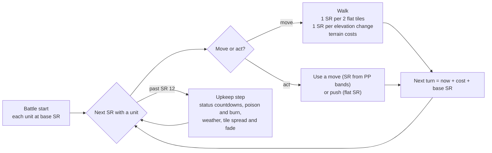
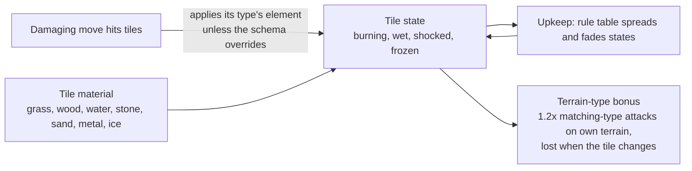

# Battle design (sub-level 1)

Date: 2026-11-16. Source: battle mechanics sub-grilling with Jess (#14). Parent: game-design.md.
Rulings: the 2026-11-16 battle files in DECISIONS.md (strike-rank-clock to mainline-systems-m2b).

## Strike rank clock [Approved]
- Base SR from a size band (height and weight), Speed adjusting by at most about one band. [Proposed] range 1 to 4.
- Battle start: every unit at its base SR. A turn is a **move or an act**. Next turn = now + cost + base SR.
- Rounds are 12 SR; the clock position carries across rounds; upkeep happens between SR 12 and SR 1.
- Same SR: higher Speed first, then a seeded tie-break. "N turns" durations count rounds.

Jess's example (Bulbasaur, base SR 1):

| SR | Action | Next turn at |
|---|---|---|
| 1 | a 3 SR move | 1 + 3 + 1 = 5 |
| 5 | Tackle, 2 SR | 5 + 2 + 1 = 8 |
| 8 | Recover, 4 SR | 8 + 4 + 1 = 13, so SR 1 of round 2 |



## Positioning [Approved]
Facing arcs (Jess's grid; C is the defender, facing up). Front or back when the sideways offset is at most twice
the forward offset; the 2:1 line counts as front or back.

```
| F | F | F | F | F | F | F | F | F | F | F | F | F | F | F | F | F |
| S | S | F | F | F | F | F | F | F | F | F | F | F | F | F | S | S |
| S | S | S | S | F | F | F | F | F | F | F | F | F | S | S | S | S |
| S | S | S | S | S | S | F | F | F | F | F | S | S | S | S | S | S |
| S | S | S | S | S | S | S | S | C | S | S | S | S | S | S | S | S |
| S | S | S | S | S | S | B | B | B | B | B | S | S | S | S | S | S |
| S | S | S | S | B | B | B | B | B | B | B | B | B | S | S | S | S |
| S | S | B | B | B | B | B | B | B | B | B | B | B | B | B | S | S |
| B | B | B | B | B | B | B | B | B | B | B | B | B | B | B | B | B |
```

| Factor | Rule | Numbers |
|---|---|---|
| Facing | Its own damage factor | [Proposed] front 1.0x, side 1.3x, back 2.0x |
| Height | Ranged range bonus plus damage factor | [Proposed] 1.1x down, 0.9x up per level, cap 2 |
| Line of sight | Direct moves blocked by taller terrain and units; arcing moves ignore units | |
| Push | Act; 1 tile if pusher's size band is at least the target's | [Proposed] 2 SR |
| Collision and fall | Collision hurts both; falls hurt by height; target picks up the tile's state | Tuning |
| Lock-down, attacks of opportunity | None for now | Revisit after the feel test |

## Environment [Approved]

Principle: intuitive sense (fire and water spread, ice melts, electricity depends on the material). The rule table
gets its own sub-grilling.

## Objectives, AI, schema, mainline
| Topic | Ruling | Tag |
|---|---|---|
| Objectives | Nodes roll from rout, defeat the leader, hold a zone, rescue (catch boost), escape; bosses fixed | [Approved] |
| Boss AI | Utility goals plus GOAP, designed ground-up for turns; Jess's own fork AI code may be used | [Approved] |
| Move schema | Fork's three axes (space, delivery, payload) as a start, redesigned for tiles, SR and rounds | [Approved] |
| Act cost | From PP bands with overrides | [Approved], formula [Open] |
| Mainline systems | Everything portable (status, stat stages, immunities, weather, abilities, held items) in M2b | [Approved] |

## Still to grill
1. Boss AI (before the M2 AI slice).
2. Environment rule table (before the tile states slice).
3. #9 opening (schema details).
