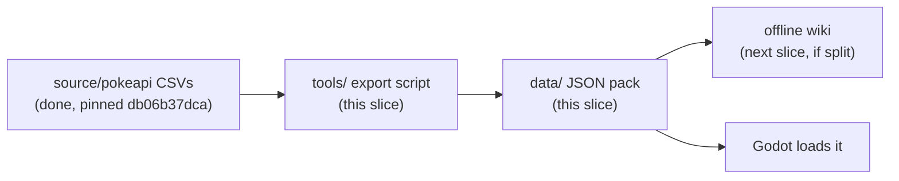

# Slice opening: pokeapi data pack export [Approved]

Date: 2026-11-15. Replaces the opening in data-transfer-plan.md (superseded). Agreed with Jess 2026-11-15; the
issue is opened from it. Next: the prose build plan, approved before any build.

## Where it sits

## Opening (to agree)

| | Proposal |
|---|---|
| Goal | data/ holds an English JSON pack of every unit, move, ability and the type chart, built by our own tools/ script from the pinned CSVs and shaped by the rulings (units, variants, transformations, learnset game, learn methods) |
| Done when | The pack is committed; rerunning the export gives no diff; the end-goal test passes headless by one command; the one-off parity report is posted on the issue; Jess spot-checks a few units (for example Vulpix and Alolan Vulpix) against pokeapi.co; Jess closes the issue |
| End-goal test | The relations below |

## End-goal test relations

| # | Relation | Source |
|---|---|---|
| 1 | Every unit has six base stats above 0 and one or two types, each one of the 18 attack types | pokeapi primer |
| 2 | Units are exactly the species defaults plus regional forms; no excluded variant (Totem, Rotom appliance, costume) appears | 2026-11-15-variant-scope |
| 3 | Every Mega, Gigantamax and Primal is attached to an existing base unit and is not itself a unit | 2026-11-15-mega-gmax-transform |
| 4 | Every id the pack references exists in it: learnset moves, abilities, evolution targets, transformation bases | CLAUDE.md "Tests" |
| 5 | Type chart is 18 by 18 with values only 0, 0.5, 1, 2; Fire on Grass beats neutral; Normal on Ghost is 0 | mainline rules |
| 6 | Every unit has at least one level-up move; every learnset entry is one of the four methods; level-up entries carry a level | 2026-11-15-learn-methods |
| 7 | All of a unit's learnset comes from one game; that game is Scarlet/Violet whenever the unit has level-up data there, and never Legends Arceus or Champions | 2026-11-15-learnset-game |
| 8 | Every unit, move and ability has an English name | English only |
| 9 | Rerunning the export gives byte-identical files | determinism |

## Questions before the plan (one at a time)
1. Answered 2026-11-15: two slices, pack first. The wiki is the next slice, with its own opening and issue.
2. Answered 2026-11-15: gdUnit4 tests read the pack with Godot's built-in JSON parser; no loader and no game code
   in this slice (the loader comes with the first slice that uses the data). Relation 9 (rerun, no diff) runs in the
   export tooling, called from the same tools\run-tests.cmd.
3. Answered 2026-11-15: one file per kind (units.json with learnsets and evolutions inside, moves.json,
   abilities.json, types.json with the chart). Measured: about 1,085 units, 937 moves, 374 abilities, about 68,000
   learnset entries, roughly 5 MB. Entries are keyed by pokeapi name (vulpix-alola, ember), unique in every table
   used; the pokeapi number stays as a plain field for cross-checks.
4. Answered 2026-11-15 (recommendation adopted): a one-off tools/ parity script compares base stats and types with
   the fork's pokedex (966 default forms, raw stats in mainline order). It runs once before the slice closes, outside
   run-tests.cmd since the fork exists only on the home machine; each difference gets a one-line reason in the
   issue. It catches swapped or mis-joined fields that relation 1 cannot.
