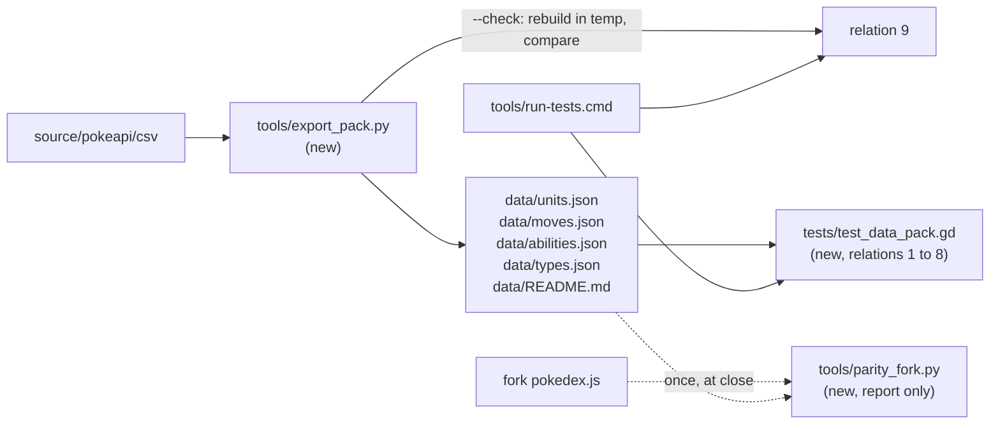
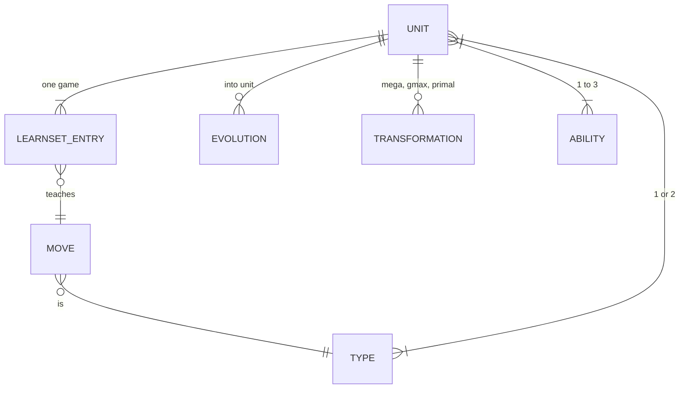

# Build plan: data pack export (#2) [Approved]

Date: 2026-11-15. Opening: data-pack-opening.md. Approved by Jess 2026-11-15 (decisions 2 to 6 as recommended; script language is a tools/ choice, Python). Numbers below
were measured on the pinned CSVs (db06b37dca), not the fork.

## What gets built

| File | Change |
|---|---|
| tools/export_pack.py | New. Reads about 25 CSVs, writes the four JSON files plus a README with counts. A check mode rebuilds into a temp folder and fails on any byte difference |
| data/*.json, data/README.md | New, generated, committed |
| tests/test_data_pack.gd | New gdUnit4 suite, relations 1 to 8 (plus 10, below), reading the pack with Godot's JSON parser |
| tools/run-tests.cmd | Runs the export check first, then gdUnit4; fails if either fails |
| tools/parity_fork.py | New, one-off: compares base stats and types with the fork for shared species, prints differences |
| Docs at close | STATE, TODO, DEVLOG, CONTEXT (test command needs Python), recount notes on the rulings below |

## What each file holds

| File | Entries | Per entry |
|---|---|---|
| units.json | 1,082 | pokeapi number, English name ("Alolan Vulpix"), species, dex number, generation, types, six base stats, EV yield, abilities (slot, hidden flag), height, weight, gender rate, capture rate, growth rate, legendary, mythical and baby flags, evolutions, transformations, learnset (game name plus entries of move, method, level) |
| moves.json | 919 | pokeapi number, English name, type, damage class, power, accuracy, PP, priority, target, effect chance, English short effect, battle details (ailment and chance, drain, healing, crit stage, hit and turn ranges, stat changes, flinch chance) |
| abilities.json | 314 | pokeapi number, English name, generation, English short effect |
| types.json | 18 | pokeapi number, English name, and the chart row: multiplier against each of the 18 types |

Format: keys sorted, two-space indent, LF, UTF-8, one learnset entry per line (65,034 entries; about 4 MB in all).
Python standard library only, so output is deterministic and needs no installs beyond Python itself.

## Surprises from measuring

| Found | Effect |
|---|---|
| Units recount: 1,025 defaults + Alola 18 + Galar 19 + Hisui 16 + Paldea 4 = 1,082 | Variant-scope ruling said Alola 19 (fork count); Galarian Zen Darmanitan is battle-only, so it is left out like plain Zen Darmanitan |
| Megas 97 and Gigantamax 34 (ruling said 91 and 30) | New Legends Z-A Megas are in the pinned data; all attach as transformations |
| 6 transformations whose own base form is an excluded variant: Rapid Strike Urshifu Gmax, Low Key Toxtricity Gmax, Original Color Magearna Mega, Droopy and Stretchy Tatsugiri Mega, female Meowstic Mega | Need decision 2 |
| 93 newer moves (Legends Arceus and Scarlet/Violet era, for example Tera Blast, Dire Claw) have no English effect text in pokeapi | Need decision 3 |
| Evolutions are stored per species, not per variant | Regional lines need form matching (Alolan Vulpix into Alolan Ninetales, not Ninetales); see added relation 10 |
| 108 learnset entries repeat a move at two levels | Kept, both levels |
| Scarlet/Violet is the learnset game for 776 units (ruling said 777); 0 units lack a level-up learnset | Recount note on the ruling |

## Decisions (all at once; recommendation first)

| # | Question | Recommendation | Other options |
|---|---|---|---|
| 1 | Script language | Python, standard library only: its csv reader handles quoted prose with commas and line breaks, and it matches pack_sprites.py | Node, matching the fetch scripts, but needs a hand-written CSV reader |
| 2 | The 6 transformations whose base form is excluded | Leave them out and list them in data/README.md; revisit if those forms become units | Attach to the species default (wrong: male Meowstic would Mega into the female Mega) |
| 3 | Moves without English effect text | Use pokeapi's newest English in-game description (flavor text) instead, marked as such | Leave the effect empty |
| 4 | Which moves go in | All 919 mainline moves (the 18 Shadow moves from the Colosseum games are left out), so the wiki can show any move | Only the moves some unit learns |
| 5 | Add relation 10 to the end-goal test: a regional unit whose evolution target has a form from the same region evolves into that form | Add it; it is the one evolution mistake relations 1 to 9 cannot see | Rely on Jess's spot check |
| 6 | Mega Stones and other transformation triggers | Not in this slice: the stones exist only as rows in items.csv, and no pokeapi table links a stone to its Mega; the transformation slice adds them | Hand-map now |

## Risks
- tools/run-tests.cmd now needs Python 3 on the path, also on the work machine (add it to the existing "can the
  work machine run Godot" check in STATE).
- A Godot export later must include data/*.json, since Godot skips non-resource files by default; flagged for the
  first export slice.
- Evolution conditions in pokeapi are many optional columns plus a newer free-text condition field (71 rows). The
  pack keeps the trigger plus only the conditions that are set, with ids turned into names; the free text is kept
  as is. Rules for using them come with progression design.
