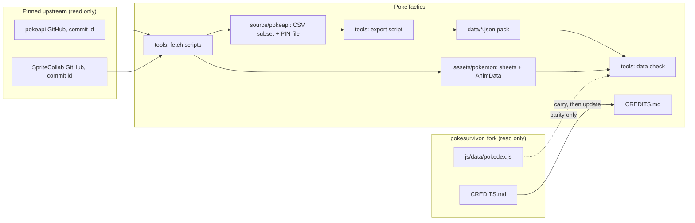
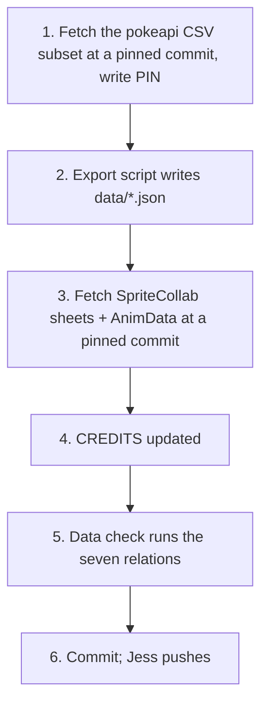

# Plan: raw data transfer

Status: [Proposed], revised 2026-11-15 for Godot 4 (2026-11-15-engine-godot-4). Nothing is built until Jess agrees
the slice opening and the decisions below.

Principle: carry over only **mainline facts and art**, never survivor tuning. Data is rebuilt from pokeapi and art is
fetched from SpriteCollab, each at a pinned commit, so nothing depends on the fork's code or generated files (CLAUDE.md
"Clean-room rule"). The fork is read once, for a parity check.

## Slice opening (to agree)

| | Proposal |
|---|---|
| Goal | The repo holds an engine-neutral, English JSON data pack of mainline Pokemon facts plus sprites and their animation metadata, rebuilt by our own scripts from pinned pokeapi and SpriteCollab commits |
| Done when | Pack, sprites, metadata and CREDITS are committed; rerunning the scripts reproduces them with no diff; the data check passes; the issue is closed by Jess |
| End-goal test | Relations only (list below), run by one command |

End-goal test relations:
1. Every species has six base stats above 0 and one or two types, each a known type.
2. Every learnset move and every evolution target exists in the pack.
3. The type chart is 18 by 18, every value is one of 0, 0.5, 1, 2. Fire on Grass beats neutral; Normal on Ghost is 0.
4. Every species with sprites has metadata for each animation sheet it ships, and every sheet's size divides evenly
   into the frame size the metadata gives.
5. Every learnset entry names a method (level, egg, machine, tutor) and level entries carry a level.
6. Rerunning the export gives byte-identical output (determinism).
7. Parity: base stats and types match the fork's pokedex for every shared species (two sources agree).

## Flow

## What goes, what stays

| Goes (raw facts) | Source | Note |
|---|---|---|
| Species: names, base stats, types, abilities, height, weight, gender rate, EV yield, base XP, generation, legendary flag | pokeapi | Not the fork's derived hp/spd/atk |
| Evolution chains with triggers and levels | pokeapi | |
| All mainline moves: type, category, power, accuracy, PP, priority, target, effect chance, short effect text | pokeapi | |
| Learnsets with levels and method | pokeapi | Version per decision 3 |
| Type chart, natures, ability names and text | pokeapi | |
| Sprite sheets and AnimData per species | SpriteCollab | Animation set per decision 4 |
| CREDITS.md | fork root, then updated | Required by the sprite license; adds pokeapi and pinned commits |

| Stays behind | Why |
|---|---|
| All fork js/data files (moves-generated, sprites-meta, items, enemies, gyms and the rest) | Survivor tuning or generated code |
| Fork sprite folders | Refetched from SpriteCollab so sheets and metadata come from one commit |
| Tileset, contact masks, lang files, changelog | Not tactics, or fork history |

## Steps

## Decisions for Jess

| # | Question | Recommendation |
|---|---|---|
| 1 | Learnset version | Latest game each species appears in (Scarlet and Violet, falling back to older games) |
| 2 | pokeapi source: fetch at a pinned GitHub commit, or copy the fork's zip copy (no commit id) | Fetch at a pinned commit, so the pin is a real id |
| 3 | Sprites: fetch from SpriteCollab, or copy the fork's sheets | Fetch, since metadata only exists in the fork as generated js, and sheets plus metadata must match |
| 4 | Animation set | The fork's eight (Idle, Walk, Attack, Hurt, Faint, Shoot, Charge, Portrait) plus full AnimData; extras (Sleep, Hop, Swing) are a rerun with a longer list when a feature needs them |
| 5 | Forms (Alolan, Galarian, Mega) | Default forms only for now |
| 6 | Script language for tools/ | Node (installed here, v22); tools never ship, so it does not touch the Godot choice |
| 7 | Sprites in plain git or Git LFS | Plain git (about 111 MB) |
| 8 | Godot layout: repo root is the Godot project, so data/ and assets/ are res:// paths; source/, tools/ and docs/ carry a .gdignore so Godot skips them | Yes (the project.godot file itself waits for the first engine slice) |
| 9 | Item icons | Later, with items |

## Risks
- SpriteCollab fetch is about 8,000 small files; the script throttles and resumes, and can take a while once.
- Some species lack some animations upstream; relation 4 only checks sheets that ship.
- pokeapi's newest games (Legends Z-A appears in the fork's copy) may have partial learnsets; decision 1's fallback covers it.
