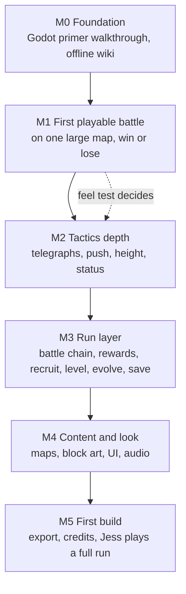
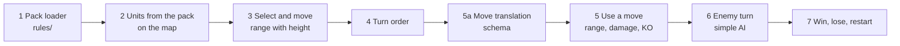
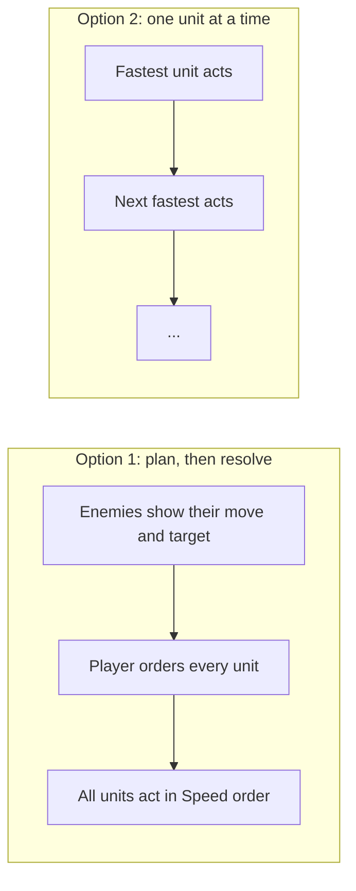

# Development plan [Proposed]

Date: 2026-11-15. Where we are: Godot project with a greybox rotating test map (#1), full data pack in data/ (#2).
No game rules exist yet. Each slice below still gets its own opening (goal, done-when, end-goal test) before build.

## Roadmap

| Milestone | Done when | Rough size |
|---|---|---|
| M0 Foundation | The offline wiki opens from disk; Jess has read a Godot primer of what is built and had every question answered | 2 slices, docs and tools only |
| M1 First playable battle | Jess plays a battle on a large test map with real pack units and wins or loses; battles also run headless in tests | 6 to 8 slices, the biggest step |
| M2 Tactics depth | The battle has the decided signature mechanics (from the M1 feel test) | 4 to 6 slices |
| M3 Run layer | A run of several battles with rewards, recruiting, levels and evolution, saved between sessions | 5 to 7 slices |
| M4 Content and look | Several hand-made maps, chosen block art, real menus and sound | Open-ended |
| M5 First build | An exported build with CREDITS that Jess plays start to finish | 1 to 2 slices |

## M1 slices (the part worth planning now)

| # | Slice | Rules side (headless, tested) | View side (Jess feel-tests) |
|---|---|---|---|
| 1 | Pack loader | Load data/ into unit, move and type definitions; stat formula in one stats module | none |
| 2 | Units from the pack | A battle unit built from a pack unit at a level | Real sprites (Vulpix, Alolan Vulpix) placed on the map |
| 3 | Select and move | Reachable tiles from movement and height | Cursor, highlight, walk animation, camera pan and zoom |
| 4 | Turn order | Who acts next, from Speed | Turn order strip |
| 5a | Move translation schema | Grid axes for moves; defaults from pokeapi target and damage class; overrides for the M1 moves | none |
| 5 | Use a move | Range, area, line of sight and height per move; accuracy; damage; faint | Target highlight, attack and hurt animations, HP bars |
| 6 | Enemy turn | Enemies pick a move and target | Enemy acts with a short pause |
| 7 | Win, lose, restart | Battle end conditions | End screen |

## Decisions that gate M1

| # | Question | Answer (Jess, 2026-11-15) | Ruling |
|---|---|---|---|
| 1 | Battle scale | Big: up to about 20 by 20; 4 units a side in M1 | 2026-11-15-battle-scale |
| 2 | Turn structure | One unit at a time in Speed order (Option 2) | 2026-11-15-turn-structure |
| 3 | Damage | Mainline formula, no damage roll; only accuracy and crits are random; reach and environment also decide a hit | 2026-11-15-damage-and-hit |
| 4 | Moves on the grid | Derived defaults plus overrides, through a translation schema like the fork's | 2026-11-15-move-grid-translation |
| 5, 6, 7 | Moves, stats, PP | 4 moves from the level-up learnset; mainline stat formula; no PP in M1 | 2026-11-15-unit-stats-and-moves |
| 8 | Movement | Fixed 4 tiles; climb 1 up, drop 2 down | 2026-11-15-movement-range |

What the answers change in M1:
- 20 by 20 does not fit one 640x360 screen, so slice 3 adds camera pan and zoom, and the test map grows.
- The translation schema is its own slice before "use a move" (new slice 5a): design the axes for a turn-based grid
  from Jess's fork docs (MOVE-AXIS-SCHEMA.md), then the defaults and the M1 move overrides.
- "Reach and environment" means slice 5 needs line of sight and height rules for hitting, not only range.

### Turn structure: the two options (Option 2 chosen)

| | Option 1: plan, then resolve | Option 2: one unit at a time by Speed |
|---|---|---|
| Feel | Into the Breach style puzzle: read the threat, answer it | FFT and Triangle Strategy: react each turn |
| What the player sees | Enemy intents for the whole round | The current board and the turn order |
| Hard rules it needs | What happens when an order goes stale: a faster unit moved the target, fainted the actor, or blocked the tile (fizzle, retarget, or act on the tile) | None new |
| Speed matters by | Who resolves first inside the round | How often and when you act |
| Enemy AI | Must commit before seeing your orders, so telegraphs are honest | Plans one unit at a time |
| Build cost | Higher: order queue, intent display, stale-order rules | Lower |

Questions Option 1 must answer before it can be built: when an enemy's target moves, does its attack follow the
unit or hit the tile; does a player see enemy intents that resolve after their own units; do enemies telegraph
movement too, or only the move.

Recommendation: decide now, because the turn loop shapes slices 4 to 6. If Option 1 is the game's signature, build it
from M1; the rules side (one action resolved on the grid) is the same either way, so only the round loop and UI
differ.

## Not decided here (later milestones)
- M2 signature mechanics: enemy intent telegraphs, push and collision, height and facing bonuses, status in turns.
- M3 run shape: battle chain or branching map, recruiting by catch or by reward, permadeath, which learn methods
  are used (2026-11-15-learn-methods).
- M4 block art source and style, portraits (open in STATE).

## Tracking
Once Jess approves, the M0 and M1 slices become issues (a batch of about nine, drafted for Jess's OK first) and a
milestone per M on the board.
