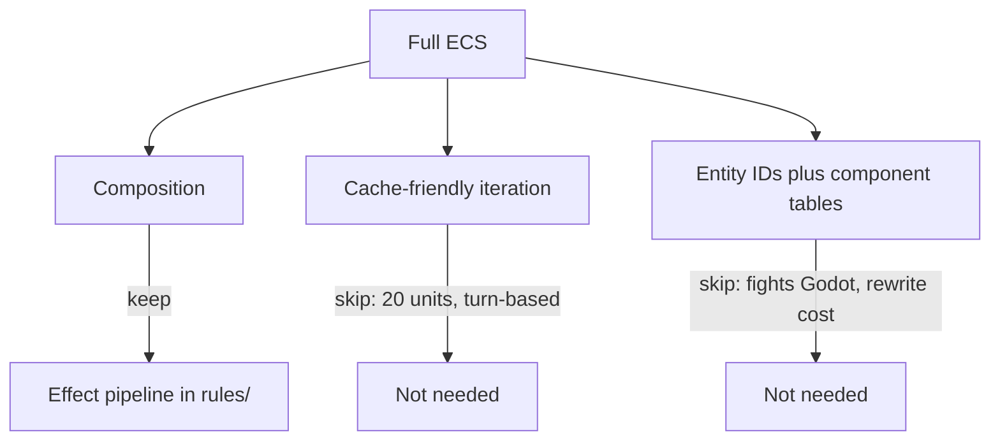
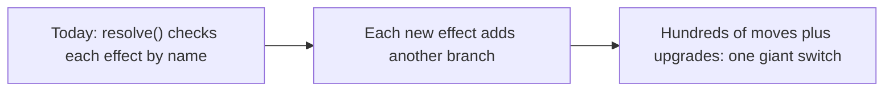
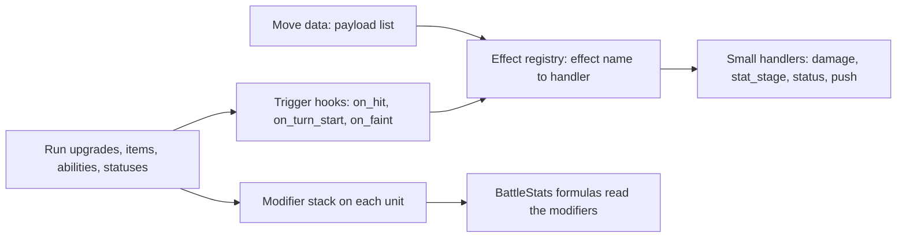
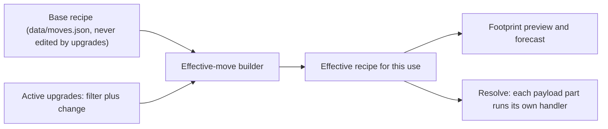
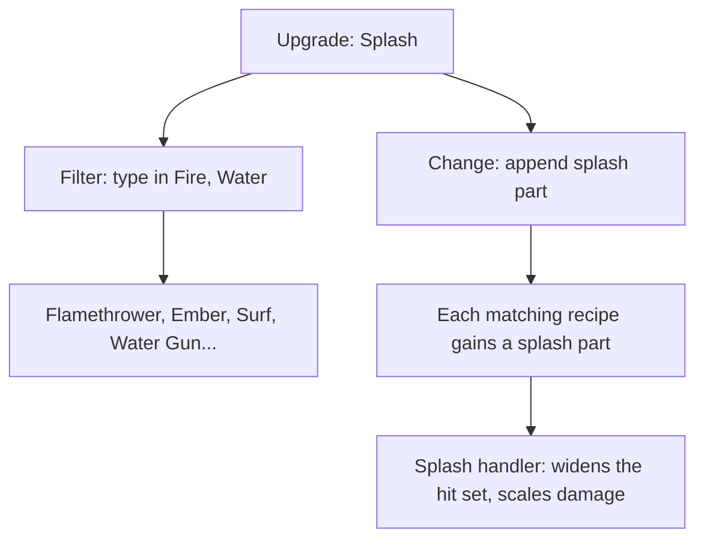
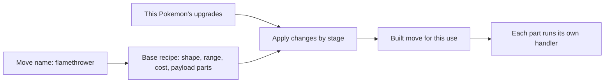
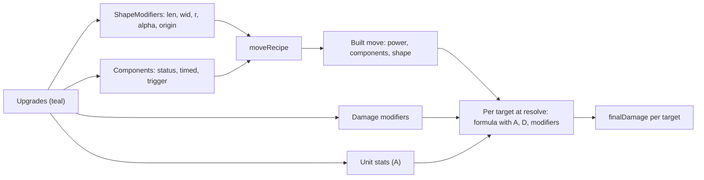
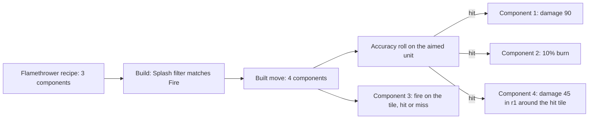

# ECS or an effect pipeline? (primer, 2026-11-17)

Question from Jess: would an ECS make move implementation and roguelite upgrades trivial?
Recommendation: no full ECS. Take the part of ECS that helps (composition) as an effect pipeline inside rules/.

## What ECS offers, and what this game would use

| ECS feature | Useful here? |
|---|---|
| Composition: a unit is a bag of parts, and behavior comes from what it carries | Yes, this is what makes moves and upgrades easy |
| Systems looping over large arrays of components | No, a battle has about 8 to 20 units and is turn-based |
| Data-oriented memory layout for speed | No, GDScript gains nothing from it |
| Entities as bare IDs with components in separate tables | Costs us: fights Godot's Node and Resource model, and we would build a framework instead of the game |



## Where the pain will actually come from

rules/move_use.gd already reads a data payload list (damage, fixed_damage, user_faints), but resolve() handles each
effect with its own hard-coded branch. Fine for 45 moves; with the full Kanto set (#26), statuses, items and run
upgrades it becomes one huge switch.



## Proposed shape (composition without ECS)



| Piece | What it does | Example |
|---|---|---|
| Effect registry | Each payload effect name maps to one small handler; a new move is mostly data | Ember: damage plus burn_chance |
| Modifier stack | Upgrades, items and statuses add modifiers; BattleStats applies them in one place (keeps the one stats module rule) | "+1 crit stage", "Fire moves x1.2" |
| Trigger hooks | Upgrades that react to events point at the same effect handlers; fixed firing order keeps battles deterministic | "On hit, 10% burn" |

This is the Slay the Spire and Into the Breach pattern. It can grow inside the existing files, one handler at a time.

## Cost comparison

| Option | Rewrite size | Fits Godot | Keeps headless and deterministic | Makes upgrades easy |
|---|---|---|---|---|
| Full ECS | Most of rules/ (about 1,400 lines) | Poorly | Yes, with care | Yes |
| Effect pipeline | move_use.gd and battle_stats.gd, grown per slice | Yes | Yes | Yes |
| Leave as is | None | Yes | Yes | No, breaks down at #26 |

## Jess's answers (round 1)

- Q1: the usual upgrades (size, range, cone spread, damage, ailment chance) plus cross-cutting ones like "add splash
  to Fire and Water moves". The real goal: a lego box of parts that composite into a move, so an addition or a
  balance change does not mean reading and reviewing everything.
- Q2 (implied): "units and moves built from parts", not a literal ECS framework.

## What that means: moves are already half lego

A move's grid entry in data/moves.json is already a recipe of parts. Flamethrower today:

| Part | Value |
|---|---|
| shape | single |
| range | 1 to 4 |
| sr_cost | 4 |
| payload | damage; ailment burn 10% on target |
| flags | close_penalty, arcing false, tile_element fire |

So the missing pieces are not an ECS. They are (a) one handler per payload part, and (b) upgrades written as
"which moves" plus "what to change", applied on top of the base recipe when the move is used.



An upgrade is two small parts of its own:

| Upgrade | Filter (which moves) | Change (what it does to the recipe) |
|---|---|---|
| Longer reach | all moves of this unit | range_max +1 |
| Wider breath | shape is cone | spread wider by one step |
| Hot hands | type is Fire | ailment burn chance +10 |
| Splash | type is Fire or Water | add a splash part: radius 1 around each hit cell, half damage |
| Heavy hitter | damage class physical | damage modifier x1.2 |



Why this fixes "review everything every time":

| Change you want | What you touch | What you review |
|---|---|---|
| Rebalance one move | its line in the data | that line |
| New upgrade from existing parts | one upgrade entry (filter plus change) | that entry |
| A genuinely new part (splash, push, summon) | one new handler plus its test | that handler |
| Base move data or other upgrades | nothing | nothing |

Each part is tested alone (relations, per CLAUDE.md: splash hits strictly more cells than without it, a bigger
burn chance never burns less over a seeded run), so new combinations need no new review.

## Open questions (round 2)

| # | Question | Why it matters |
|---|---|---|
| 3 | Own slice now (builder plus registry before #26 grows the move list), or folded into the next M2 slice that needs a new part (#19 push is a natural first handler)? | Where it lands on the board |
| 4 | Who owns an upgrade: one Pokemon, one move slot, or the whole team for the run? | Decides where active upgrades are stored and saved |
| 5 | Stacking: two "+1 range" upgrades give +2, or is there a cap (like the 12 SR cap)? Do multipliers add or multiply? | One fixed rule, or balance gets unreadable |
| 6 | Order of changes: a fixed order by kind (shape, then range, then payload, then multipliers), or the order upgrades were picked? | Determinism and readability; fixed by kind is the usual answer |
| 7 | Do enemies and bosses use the same upgrade system? | If yes, it doubles as an enemy-scaling tool |
| 8 | Should upgrades also cover units (size band, Speed, movement) or only moves for now? | Scope of the first slice |

## Jess's answers (round 2), ruling 2026-11-17-move-recipes

| # | Answer |
|---|---|
| 3 | Its own slice |
| 4 | Upgrades belong to one Pokemon |
| 5 | Later ([Open]) |
| 6 | The system decides the order, never the pick order |
| 7 | Yes, enemies and bosses use the same system |
| 8 | Pokemon keep their base stats; upgrades can cover units too, lighter than moves |

## Recipe to move, in one picture



Where the if/else goes: today resolve() asks "is this damage? is this fixed damage? is this user_faints?". With a
registry it asks nothing; it looks up each part's handler by name and runs it. Adding a part adds a handler, never
a branch. Caveat: a genuinely new kind of part (splash, push, summon) is still code, written once with its test;
new combinations of existing parts are data only.

## Q6: the fixed order by stage

| Stage | Changes in it | Why this position |
|---|---|---|
| 1. Parts | add or remove parts (splash, extra ailment) | later stages can then tune the new parts |
| 2. Shape and reach | range, radius, cone spread, line length | footprint must be final before payload |
| 3. Flat adds | +damage, +ailment chance, SR cost +/- | adds before multiplies, so +10 then x2 is always 20 more, not order-dependent |
| 4. Multipliers | damage x1.2, type boosts | last, over the final numbers |

Within a stage, order does not matter by design (adds commute, multipliers commute), so pick order never changes
the result. Caps and stacking rules (Q5) slot in at the end of each stage once decided.

## Slice opening (draft, needs Jess's OK before any build)

| Item | Draft |
|---|---|
| Goal | Moves are built from recipes with one handler per part; upgrades (filter plus change, per Pokemon, enemies too) apply by stage. Today's 45 moves behave exactly as before. |
| Done when | resolve() has no per-effect branches; one demo upgrade from existing parts (for example Fire burn chance up) and one new part (splash) work in a battle; all existing tests pass unchanged. |
| End-goal test | Relations: every roster move builds and resolves; with no upgrades the built move equals the base recipe; an upgrade touches only moves its filter matches; changes give the same result in any pick order; splash hits a superset of the cells without it; a higher burn chance never burns fewer units over a seeded run. |

## Review of Jess's drawing (docs/human-created/PokeTactics-psuedoECS.excalidraw)

Verdict: yes, this is the design. The drawing's names map onto ours one to one.

| Drawing | Our term | Match |
|---|---|---|
| moveRecipe(power, components[], shape{}) | recipe | Yes |
| Output(finalDamage, components, shape) | built move | Yes, with one fix (see below) |
| Components: majorStatus, minorStatus, timedEffect, triggerEffect | parts (payload) | Yes |
| onHit under triggerEffect | trigger hooks | Yes |
| Shape{type, size[len, wid, alpha], origin[self, other, point]} | shape part | Yes, and cleaner than today's |
| ShapeModifiers len+, wid+, r+, alpha+, origin+ (teal) | stage 2 changes | Yes |
| Modifiers list feeding the damage formula (STAB, crit, weather, targets, type chart) | stage 4 multipliers | Yes |
| Upgrades into A (attack stat) | unit upgrades (Q8) | Yes |
| Teal rim = upgrade entry point | where a change may plug in | Yes |



### Three corrections to fold in

| # | Drawing says | Issue | Fix |
|---|---|---|---|
| 1 | Damage feeds into moveRecipe; Output carries finalDamage | Damage needs the defender (D, type chart, its status), so it cannot be known when the move is built | The built move carries power; finalDamage is worked out per target when the move resolves |
| 2 | Burn modifier is an IF chain inside the modifier list (burn, not Guts, physical) | That is the if/else growth we want to avoid | Each status or ability brings its own modifier with its own filter: Burn contributes "physical x0.5", Guts removes it. The formula only multiplies whatever modifiers are present |
| 3 | No filter on upgrades | "Splash on Fire and Water moves" needs one | Every upgrade is filter plus change (Round 1 Q4) |

### What the drawing adds (new questions for round 2)

| Topic | Drawing | Question |
|---|---|---|
| Shape model | Three base types (single, square, circle); line = square len x wid; cone = circle cut by angle | Replace today's four shapes with this model in this slice? It makes len+, wid+, r+, alpha+ uniform |
| Range | Not drawn | Is range part of shape (origin point within range) or its own field? |
| Targets x0.75 | Spread moves deal 0.75 when hitting more than one | New rule, not in any ruling yet; adopt? |
| Weather x1.5 | Weather boosts matching type | Belongs to the environment model (#20); defer? |
| Drowsy as a major status | Listed with Sleep | Status design belongs to its own slice; note only |
| STAB drawn twice | Duplicate box | Drawing tidy-up only |

## Structure settled in the grilling (rounds 1 and 2)

| Topic | Answer |
|---|---|
| Shape | Base types square(len, wid) and circle(r, alpha); single is a 1x1 square, a cone is a circle with alpha under 360 |
| Range | A span min..max on the shape: self 0, melee 1, ranged 1..N. No origin kinds; every move aims at a tile |
| Anchor | centered (on the aimed tile) or forward (starts at the aimed tile, runs away from the user) |
| Recipe | basics (type, class, accuracy, SR cost) plus shape plus components |
| Component | effect plus timing (on use by default, on hit, every round for t rounds), touches (units, tiles), who (all, foes, allies, self), optional chance, optional own shape |
| Power | lives in the damage component |
| Close-range half damage | a resolve-time modifier the move brings, not a flag |
| Upgrades | build-time edits (recipe) and resolve-time modifiers (numbers once the target is known), two channels |
| Modifiers | every source (status, ability, item, upgrade, later tiles and weather) brings its own, with its own filter |
| Rolls | accuracy once per unit in the shape; on-hit components fire only on hit units; each chance rolls alone |
| Units | base stats plus attached things (status, ability, item, upgrades), each may bring modifiers or triggers |
| Deferred | 0.75x multi-target (mainline damage); weather; stacking and caps |

## Example moves in the new schema

Illustrative only: field names are not final, numbers come from today's data.

### Flamethrower (ranged single, burn on hit, leaves fire)

| Section | Field | Value |
|---|---|---|
| Basics | type, class, accuracy, SR cost | Fire, special, 100, 4 |
| Shape | type, size, range, anchor | square, 1x1, 1..4, centered |
| Component 1 | effect, timing, touches, who | damage power 90, on use, units, all |
| Component 2 | effect, timing, touches, who, chance | status burn, on hit, units, all, 10% |
| Component 3 | effect, timing, touches | leave element fire, on use, tiles |
| Modifiers it brings | close range | damage x0.5 at distance 1 |

### Incinerate (forward cone from the user)

| Section | Field | Value |
|---|---|---|
| Basics | type, class, accuracy, SR cost | Fire, special, 100, 4 |
| Shape | type, size, range, anchor | circle, r 3, alpha 60, range 0, forward |
| Component 1 | effect, timing, touches, who | damage power 60, on use, units, all |
| Component 2 | effect, timing, touches | leave element fire, on use, tiles |

### Self-Destruct (centered circle on the user)

| Section | Field | Value |
|---|---|---|
| Basics | type, class, accuracy, SR cost | Normal, physical, 100, 6 |
| Shape | type, size, range, anchor | circle, r 1, alpha 360, range 0, centered |
| Component 1 | effect, timing, touches, who | damage power 200, on use, units, all (not the user) |
| Component 2 | effect, timing, touches, who | faint, on use, units, self |

### Giga Drain (damage plus heal from damage dealt)

| Section | Field | Value |
|---|---|---|
| Basics | type, class, accuracy, SR cost | Grass, special, 100, 5 |
| Shape | type, size, range, anchor | square, 1x1, 1..4, centered |
| Component 1 | effect, timing, touches, who | damage power 75, on use, units, all |
| Component 2 | effect, timing, touches, who | heal 50% of damage dealt, on hit, units, self |
| Component 3 | effect, timing, touches | leave element grass, on use, tiles |
| Modifiers it brings | close range | damage x0.5 at distance 1 |

### Agility (self buff, no damage)

| Section | Field | Value |
|---|---|---|
| Basics | type, class, accuracy, SR cost | Psychic, status, always hits, 3 |
| Shape | type, size, range, anchor | square, 1x1, range 0, centered |
| Component 1 | effect, timing, touches, who | Speed +2 stages, on use, units, self |

### Flamethrower with the Splash upgrade

Upgrade Splash: filter "type is Fire or Water"; build-time edit "add a component".

| Section | Field | Value |
|---|---|---|
| Component 4 (added) | effect, timing, touches, who | damage power 45 (half of 90), on hit, units, all |
| Component 4 shape | type, size, anchor | circle, r 1, centered on each hit unit's tile |



### Small points these examples raise

| Point | Proposal |
|---|---|
| "who: all" with the user inside the shape (Self-Destruct) | all means everyone in the shape except the user; self is the only way to touch the user |
| Splash power 45 | written as "half the move's damage component" so a power+ upgrade carries through |
| Splash hitting the first target again | not again; a unit takes one hit per component per use |
| Leave element on a miss | yes, tiles are touched whether or not units are hit |

## Example moves as pseudocode (Jess asked, 2026-11-17)

Not real code and not the final data format; it shows how a recipe reads. Damage is on hit (gated by
accuracy), per move-recipes-plan.md D1; on use is for tiles and the user.

```
move Flamethrower
  basics:  type Fire, class special, accuracy 100, cost 4 SR
  shape:   square 1x1, range 1..4, centered
  components:
    damage  power 90              when: on hit   touches: units  who: all
    status  burn  chance 10%      when: on hit   touches: units  who: all
    element fire                  when: on use   touches: tiles
  modifiers:
    damage x0.5 if distance == 1

move Incinerate
  basics:  type Fire, class special, accuracy 100, cost 4 SR
  shape:   circle r3 angle 60, range 0, forward
  components:
    damage  power 60              when: on hit   touches: units  who: all
    element fire                  when: on use   touches: tiles

move Self-Destruct
  basics:  type Normal, class physical, accuracy 100, cost 6 SR
  shape:   circle r1 angle 360, range 0, centered
  components:
    damage  power 200             when: on hit   touches: units  who: all
    faint                         when: on use   touches: units  who: self

move Giga Drain
  basics:  type Grass, class special, accuracy 100, cost 5 SR
  shape:   square 1x1, range 1..4, centered
  components:
    damage  power 75              when: on hit   touches: units  who: all
    heal    50% of damage dealt   when: on hit   touches: units  who: self
    element grass                 when: on use   touches: tiles
  modifiers:
    damage x0.5 if distance == 1

move Agility
  basics:  type Psychic, class status, accuracy always, cost 3 SR
  shape:   square 1x1, range 0, centered
  components:
    stat    speed +2              when: on use   touches: units  who: self

upgrade Splash
  owner:   one Pokemon
  filter:  move type is Fire or Water
  edit:    add component
    damage  power half of move's damage   when: on hit   touches: units  who: all
            shape: circle r1, centered on each hit unit

upgrade Wide Breath
  owner:   one Pokemon
  filter:  shape is circle with angle < 360
  edit:    angle +30

upgrade Hot Hands
  owner:   one Pokemon
  filter:  move type is Fire
  edit:    every "status burn" component: chance +10%

What Flamethrower becomes on a Pokemon holding Splash and Hot Hands:

move Flamethrower (built)
  basics:  type Fire, class special, accuracy 100, cost 4 SR
  shape:   square 1x1, range 1..4, centered
  components:
    damage  power 90              when: on hit   touches: units  who: all
    status  burn  chance 20%      when: on hit   touches: units  who: all   <- Hot Hands
    element fire                  when: on use   touches: tiles
    damage  power 45              when: on hit   touches: units  who: all   <- Splash
            shape: circle r1, centered on each hit unit
  modifiers:
    damage x0.5 if distance == 1
```

How the game reads any move, with no per-move code:

```
use move:
  built = recipe + this Pokemon's upgrades (edits applied by stage)
  tiles = tiles covered by built.shape at the aimed tile
  for each unit on those tiles: roll accuracy once
  for each component in built:
    pick its targets (touches, who, hit or not, its own shape if any)
    roll its chance if it has one
    run the handler for its effect (damage, status, element, heal, faint...)
```
