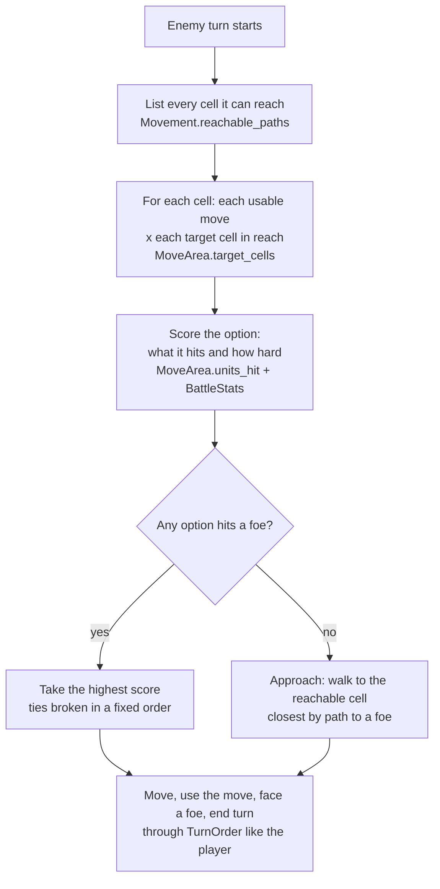
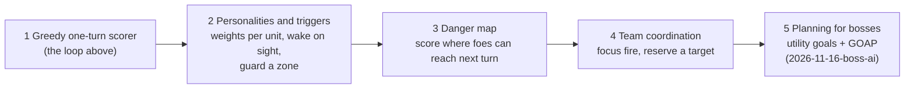

# Enemy AI primer (#11 opening)

Date: 2026-11-17. A primer on how tactics games run enemy turns, what fits PokeTactics, and the questions for the
#11 opening. No code.

## Why "move toward player, attack when ready" stops working

In a real-time horde game the enemy makes one small choice many times a second, and mistakes wash out. In an SRPG
each enemy makes one big choice per turn: where to stand, which move, which target, which way to face. A bad
choice is plain to see and it stays on the board. The upside is that a grid turn has a **finite, small set of
options**, so the AI does not need to steer. It can **list every option, score each one and pick the best**.
Nearly every SRPG AI (Fire Emblem, FFT, Triangle Strategy, Into the Breach) is a version of that loop.

## The core loop: list, score, pick

Size check: about 30 reachable cells x 4 moves x a handful of target cells is a few thousand scores per unit,
which takes no time. Everything in the boxes already exists from #7 to #10. The AI is one new rules module that
**reads the board and returns a choice**. It never touches the board itself, so it runs headless in tests.

### What goes into a score (a weighted sum, so "utility AI" in small form)

| Consideration | Effect on score | Example |
|---|---|---|
| Expected damage to foes | + damage x hit chance | Super effective hit beats neutral |
| Knocks a foe out | + large bonus | Finish the weak unit before chipping a healthy one |
| Damage to allies | minus | An area move that catches a friend scores lower |
| Own faint (Self-Destruct) | minus a unit's worth | Only worth it if it knocks out enough |
| Danger at the end cell | minus (later) | Do not end where three foes can hit you |
| Walk length | tiny minus | Ties go to the shorter walk, so it does not wander |

The weights are data, not code. A **personality is just a different set of weights**: aggressive (kills high,
danger zero), cautious (danger high), support (ally help high). This is how one AI covers wild, trainer and elite
behaviour.

**Expected, not rolled.** The AI scores with average damage and the hit chance and never draws from the battle's
random generator. Because of that its choice is the same for the same board, which keeps battles seeded and
replayable (the multiplayer horizon rule).

## The ladder of AI depth

| Rung | Feels like | Cost | When |
|---|---|---|---|
| 1 Greedy scorer | Competent, a bit reckless | Low, uses what we have | **#11** (recommended) |
| 2 Personalities, triggers | Wilds differ from trainers; enemies wait until you come close | Low once rung 1 exists | M2 or with objectives |
| 3 Danger map | Stops walking into your kill zones | Medium | M2, with facing and height |
| 4 Coordination | Gangs up on one unit | Medium | M2 |
| 5 Planner | "A human is playing against me" | High | Boss AI sub-grilling #23 |

Coordination partly comes for free with rung 1. Units act one at a time on the current board, so after the first
enemy wounds your unit, the second sees an easier knockout and scores it higher.

Into the Breach (enemies **show** their intent and you react) is a turn structure choice as much as an AI one.
It sits in M2 with the strike rank clock (development-plan.md), and the same scorer feeds it.

## Questions for the #11 opening (answer all in one go)

| # | Question | Options | Recommendation |
|---|---|---|---|
| 1 | AI depth for #11 | a) nearest foe, strongest move; b) greedy scorer, rung 1 | **b**: about as cheap as a, and it grows into rungs 2 to 5 |
| 2 | Knockout priority | a) a sure knockout beats more damage on another unit; b) raw expected damage only | **a** |
| 3 | Friendly fire | a) avoid hitting allies; b) ignore allies | **a** (area moves hit friends) |
| 4 | Self-Destruct | a) allowed, own faint counted as a cost; b) never used by AI | **a** (it is fun when a Voltorb does it) |
| 5 | Move and act order | a) always move then act; b) also act then move away | **a** for #11; b needs the danger map (rung 3) |
| 6 | Approach when nothing is in reach | a) toward the nearest foe by path; b) toward the weakest foe | **a** |
| 7 | Pacing on screen | a) instant; b) camera to the unit, walk, show the area preview about 0.5 s, then strike | **b**, pause length tuned in the feel test |
| 8 | Which side is AI | a) the enemy side always, until #15 adds a hotseat toggle; b) a toggle now | **a** |

## Draft done-when and end-goal test (relations, not values)

Done when: on F1 to F3 every enemy takes its turn with no input, the player can follow it on screen, and Jess
feel-tests a battle.

End-goal test (headless, built from small set-up boards):
1. Every choice is legal: the end cell is in the unit's reachable paths and the target is in the move's reach.
2. A super effective hit is chosen over a neutral one when both are open from the same cell.
3. A knockout is chosen over a non-knockout hit (if q2 = a).
4. An option that hits only allies is never chosen (if q3 = a).
5. With no foe in reach, the unit ends its turn closer by path to the nearest foe than it started.
6. Same board, same choice: running the AI twice gives the same answer, and it does not draw from the battle's
   random generator.
7. A full test battle with the AI on both sides ends with one side standing (no stalls).
