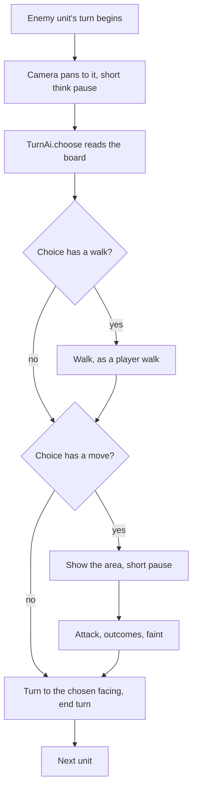

# #11 opening and plan: enemy turn, simple AI

Date: 2026-11-17. Issue: #11. Primer: enemy-ai-primer.md (opening answers: all recommendations, Jess
2026-11-17). Ruling: 2026-11-17-enemy-ai-m1. Builds on #7 (movement), #8 (turn order), #9 and #10 (moves).

## Goal [Approved]
On an enemy unit's turn the game chooses for it with a one-turn scorer (primer rung 1): where to stand, which move,
which target, which facing. The player can follow it on screen. Rules stay headless, seeded and deterministic.

## Done when [Approved]
- On F1 to F3 every enemy takes its turn with no input; the player controls only the player side.
- The end-goal test passes headless via `tools\run-tests.cmd`.
- Jess feel-tests a battle (pacing, whether choices look sensible). Committed; Jess closes #11.

## End-goal test (relations) [Approved]
| # | Relation |
|---|---|
| 1 | Every choice is legal: the end cell is in the unit's reachable paths (or its own cell), and the target is in the move's reach from there |
| 2 | Super effective is chosen over neutral when both are open from the same cell and neither knocks out |
| 3 | A sure knockout is chosen over a bigger non-knockout hit on another unit |
| 4 | An option that hits only allies (or only the user) is never chosen; with only such options the unit does not act |
| 5 | With no foe in reach, the unit ends closer by path to the nearest foe than it started |
| 6 | Same board, same choice; choosing never draws from the battle's random generator |
| 7 | A headless battle with the AI on both sides, on fixed seeds for wild, trainer and boss, ends with one side standing |

## Turn flow

## How a choice is scored
For each reachable cell (plus standing still), each known move with grid behaviour, and each target cell (or each
of 4 directions for an aimed cone or line), the move's footprint is read as if the unit stood there: its start cell
is empty, its new cell holds it. Each unit in the footprint adds:
- a foe: hit chance x (expected damage, capped at its HP, as a fraction of its max HP), plus the knockout bonus if
  that damage knocks it out;
- an ally, or the user itself: the same amount, subtracted. Self-Destruct counts the user as an ally knocked out.

Highest score wins; ties go to the shorter walk, then the first found (a fixed order). A score of 0 or less is not
an attack. With no attack, the unit walks to the reachable cell closest by path to any foe, and does not act.
End facing: toward the nearest foe by grid distance.

Expected damage is the non-crit damage (crits are left out of the estimate). The knockout bonus is a full unit
(1.0), which is what makes relation 3 hold: any knockout scores above any hit that does not knock out.

## Prose plan

### Part 1: rules/turn_ai.gd (new, about 160 lines)
- Class TurnAi, rules only. One public static function: choose, given the battle, the pack and the unit, returns a
  Choice (an inner class: the walk path, possibly empty; the move name or none; target cell; aim direction; end
  facing). It never changes the board and takes no random generator.
- Private helpers: list the stand cells, score one option, read the footprint as if standing on a cell, the
  path-distance field to foes, the approach pick, the end facing.
- Named consts at the top: the knockout bonus (1.0).
- Path distance to foes: one breadth-first pass over the whole grid from every standing foe's cell, using
  Movement.can_step for the height rule and ignoring units (so a walled-in foe still pulls).
- Reuses: Movement.reachable_paths and can_step, MoveArea.target_cells, footprint, distance, is_aimed via MoveUse,
  BattleStats.move_damage, close_range_damage, level_damage, type_multiplier, Battle.unit_at and units_on_side,
  Facing.
- Where: rules/, since it is a pure decision over the board.

### Part 2: small shared helpers so the AI and a real move agree (touched-code cleanups)
- rules/battle_stats.gd: a new hit_chance for a move (1 when accuracy is missing or 100 or more, else accuracy out
  of 100). rolls_hit is rewritten to use it, so the "always hits" rule has one home. Behaviour unchanged.
- rules/move_use.gd: the choice of formula (fixed level damage or the stat formula, then 0.5x at range 1) moves
  out of _strike into a public static function giving one non-crit hit's damage from a given user cell, so the AI
  scores with exactly the rule a real hit uses. _strike calls it, adding the crit case. The private has-effect
  check becomes a public static one taking a grid entry, since the AI needs "deals damage" and "user faints".
  Behaviour unchanged; the existing #10 tests guard it.

### Part 3: view/test_map.gd (450 to about 510 lines)
- When the active unit is on the enemy side, a new AI turn mode runs the flow above with player input blocked
  (F1 to F3 still restart). Two named consts for the pauses: think about 0.4 s, area preview about 0.5 s; Jess
  tunes them in the feel test.
- The walk and the move playback are reused, not copied: the current walk start and move use are split so the
  player path and the AI path feed the same "play this walk" and "play this move use" steps. After an AI move the
  turn ends instead of returning to the menu.
- Header comment and hint text updated: the player controls only the player side.
- Size: grows by about 60 lines within its one job (driving the test battle on screen); no split.

### Part 4: tests/test_enemy_turn.gd (new)
The 7 relations above, on small hand-built boards (as test_use_a_move.gd does), plus relation 7 on the real test
battle setup. Relation 7 runs each side's turns through TurnAi and TurnOrder with a round cap as a stall guard
(the cap is a safety limit, not an expected value).

## Not built (YAGNI)
- Status moves: they score 0 and are never chosen, since they do nothing yet (#10 ruling).
- Act then move away, danger at the end cell, personalities, wake-on-sight, coordination: primer rungs 2 to 4, M2.
- Crit and accuracy beyond expectation, PP and strike rank cost (#13), facing and height bonuses (#17).
- A hotseat or AI toggle per side (#15). Win and lose (#12): until then, when one side is gone, the other side's
  turns pass with nothing to do.

## Risks
- Relation 7 can stall for real: two survivors that are immune to each other's moves (a Ghost against a unit with
  only Normal and Fighting moves). If a fixed seed stalls, I report it to Jess rather than change the scorer.
- Speed: about 40 cells x 4 moves x up to about 60 target cells per unit, each a small footprint. Should be
  milliseconds; if a turn visibly hitches, skip target cells whose footprint can hold no unit.
- Part 2 touches the #10 damage path; behaviour must not change, and the 91 existing tests must stay green.
