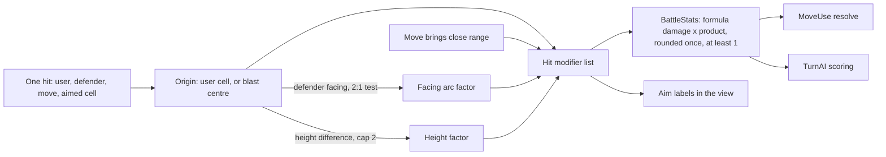
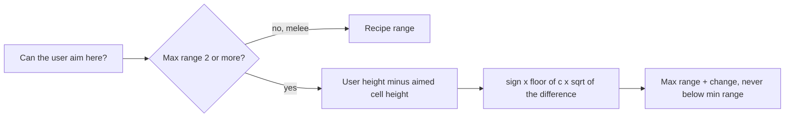

# Facing arcs and height, build plan (#17)

Rulings: 2026-11-16-facing-arcs, 2026-11-16-height-and-sight, 2026-11-17-facing-height-rules. Design:
battle-design.md "Positioning". Checked against the coding-principles skill. No code in this plan.

## Opening (agreed 2026-11-17)

| Item | Content |
|---|---|
| Goal | Damage gets a facing factor (front, side, back of the defender) and a height factor; ranged moves reach further from higher ground and less from lower; the player can see both before committing. |
| Done when | The aim labels, the inspect arc tint, the damage and the AI all use the factors; the relations below pass headless; Jess feel-tests. |
| End-goal test | tests/test_facing_and_height.gd, the relations below. |

End-goal relations:
1. Same attacker and defender, only the attacker's cell changes: back damage beats side, side beats front.
2. Cells exactly on the 2:1 line are front or back, never side, at any distance.
3. Same pair, only height changes: attacking down beats flat, flat beats attacking up.
4. A height difference of 3 gives the same damage as 2 (the cap).
5. A ranged move's reach from higher ground covers every cell its flat reach covers; from lower ground it covers a
   subset of the flat reach; it never drops below its min range.
6. Range change never shrinks as the height difference grows, and each extra level adds no more than the one
   before (diminishing).
7. A melee move's reach is the same at any height.
8. Fixed damage and faint moves deal the same at any arc and height.
9. A distant blast bigger than one tile measures from its centre; the unit on the centre tile is measured from the
   user.
10. Seeded battles stay deterministic (same seed, same log).

## Where the factors enter

## Parts

| Part | Where | Reuses | New | Why there |
|---|---|---|---|---|
| P1 Numbers and formulas | rules/battle_stats.gd | Close-range factor pattern, _round_half_down neighbours | Named consts: front, side, back factors; height step down and up; height cap; range constant c. Functions: arc factor, height damage factor, range change from a height difference, and "apply a modifier product to an amount" (round down once, at least 1) | Every combat formula lives here |
| P2 Arc test | rules/facing.gd | grid_step, Direction | An Arc enum (front, side, back) and one function: the arc of an origin cell relative to a defender's cell and facing, by the 2:1 rule | Pure direction geometry, no battle state |
| P3 Hit origin | rules/move_area.gd | is_on_user_tile, _is_single_tile, the anchor logic in footprint | One function: the cell a hit is measured from (user cell, or the aimed cell for a centred shape bigger than one tile with range above 0; falls back to the user when the defender stands on that centre) | MoveArea already decides anchors |
| P4 Reach with height | rules/move_area.gd | can_reach, target_cells | Both take the grid; ranged moves add the P1 range change, floored at min range. target_cells widens its search box by the largest possible change (height 9) | Reach is MoveArea's job |
| P5 Hit modifier list | new rules/hit_modifiers.gd | MoveRecipe.has_modifier, P1, P2, P3 | Collects the resolve-time modifiers for one hit as a short list of entries (source name, factor): close range from the move, facing and height from positions. Gives the product and the entries. No unit-attached sources yet (M2b adds them) | One home for "what applies to this hit", read by both damage and the view labels; keeps MoveUse a thin loop |
| P6 Damage path | rules/move_use.gd | component_damage, hit_damage | Both take the battle (grid heights, defender facing) instead of only the pack. Formula damage multiplies the P5 product once. Fixed damage keeps only close range, as today (Night Shade's open call unchanged). The close-range special case moves into P5 | Same function, one source |
| P7 AI | rules/turn_ai.gd | _score via hit_damage; _facing_toward_nearest_foe (Q8 already built) | Passes the battle to hit_damage and the grid to target_cells. No new logic: flanking and high ground come through the scores | AI reads the board, never forks the formula |
| P8 Aim labels | view/unit_sprite.gd, view/test_map.gd | float_text styling, the aiming refresh at test_map.gd:758 | While aiming, each foe in the footprint shows a small steady label from the P5 entries, e.g. "Back", "Side, from above", "Front, from below"; cleared when aiming ends | Presentation only |
| P9 Arc tint | view/tile_highlight.gd, view/test_map.gd | move_range_cells and fill helpers | When inspecting a unit, side cells and back cells within 4 grid steps get two tints (front stays plain) | Presentation only |
| P10 Tests | tests/test_facing_and_height.gd; callers in test_enemy_turn, test_win_lose, test_move_recipes | test_battle_setup small boards | The 10 relations; signature updates in the existing suites | End-goal test |

Size: test_map.gd grows by the label and tint wiring (same job: running the battle on screen, no split). New file
hit_modifiers.gd is small. battle_stats.gd grows by about 30 lines.

## Decisions needed

| # | Question | Recommendation | Why |
|---|---|---|---|
| D1 | The parity fixture (tests/fixtures/move_parity.json) replays 24 seeded battles; #17 changes damage, so it will fail. | Delete it and its two tests in #17 (it proved #27 changed nothing; that job is done). Relation tests keep footprints covered. | Already slated for the next damage or recipe change |
| D2 | Arc tint radius when inspecting | 4 grid steps | Jess's chart is 8 across and 4 deep; the whole board would be noise |
| D3 | Label wording | Arc word, plus "from above" or "from below" when height differs; no numbers while they are placeholders | Numbers would change at every tuning pass |

## Not built (YAGNI)
- Tags, line of sight, and the arcing-only range split: #18.
- Unit-attached modifiers (status, ability, item): M2b. Upgrades: M3 (#28).
- A damage number preview while aiming: none exists today; can join #25.
- Facing or height on fixed damage and faint moves (ruled out).

## Risks
- Signature changes to can_reach, target_cells, hit_damage and component_damage touch the AI, the view and three
  test suites. All in one step, checked by the full run.
- The test battle starts with sides facing each other; flanks will now matter a lot at 2.0x back. That is the feel
  test's question, not a bug.
- Determinism: no new randomness; the modifier product is computed in a fixed order and rounded once.
