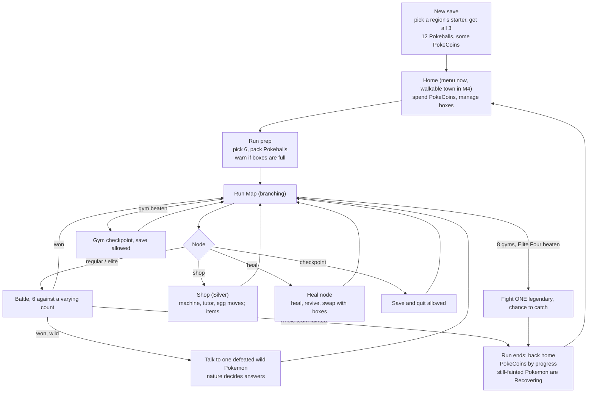
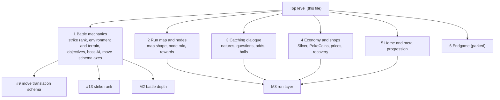

# Game design (top level)

Date: 2026-11-16. Source: top-level grilling with Jess. Rulings: the 2026-11-16 files in DECISIONS.md.
Sub-levels are grilled just in time, before the slices that need them (see "Design tree").

## Pitch [Approved]
Strategy RPGs (FFT, Fire Emblem, Ogre Tactics, Triangle Strategy) plus Pokemon, inside a run-based roguelite
(Into the Breach, Slay the Spire). You are a trainer taking a team through a region's 8 gyms and the Elite Four
for a chance to catch that region's legendary.

## Pillars [Approved] (equal weight)
| Pillar | The moment it aims for |
|---|---|
| Tactics rewarded | "That was sick, I didn't think I was going to make it!" |
| Boss AI | Bosses feel like an intelligent human opponent |
| Environment | Element combos on tiles (lightning on water, burning trees) and terrain-type bonuses |

## Save to home to run

## What persists
| Thing | Scope | Notes |
|---|---|---|
| Pokemon, EXP, levels, evolutions | Persistent | Levels gate which shop moves appear |
| PokeCoins | Persistent | End-of-run reward; spent at home |
| Pokeballs found | Persistent | 12 at a new save |
| Recovering status | Persistent | Only if still fainted at run end; depth sets length; items shorten it |
| Silver | One run | Shops and healing |
| Badges and map progress | One run | A wipe restarts the region at gym 1 |
| Save | One slot | Written only at gym checkpoints and checkpoint nodes |

## Rules at a glance
| Topic | Ruling | Tag |
|---|---|---|
| Run | One region: 8 gyms, Elite Four, one legendary; about 6 hours or more | [Approved] |
| Difficulty | Fixed enemy levels (gym 1 about 6 up to legendaries 80+); over-levelling allowed | [Approved] |
| Over-levelling risk | Later runs may trivialise early gyms; difficulty modifiers are a candidate fix | [Proposed] |
| Party | Carry 6, field 6; swap with boxes at heal nodes; catches go to boxes | [Approved] |
| Enemy counts | Vary by node; bosses full teams; wild 2 to 4, trainer and elite 3 to 6 | [Approved], counts [Proposed] |
| Battle end | Rout in M1; objectives later | [Approved] |
| Catching | Talk after battle, wild only, one offer per battle, ball adds odds | [Approved] |
| Moves | Level-up automatic; shops sell machine, tutor, egg moves gated by level | [Approved] |
| Turn limit on strong moves | No PP; strike rank (RuneQuest style) | [Approved] |
| Multiplayer | Horizon; hotseat versus in M1b with free pick at a set level | [Approved] |
| First build | Kanto only | [Approved] |
| Endgame | Legendary picks, shiny tiers, Arceus, Descendant Mutation, The Climb | [Proposed], parked |
| Starting PokeCoins, recovery lengths, prices | Economy sub-grilling | [Open] |

## Design tree (sub-grillings, just in time)

Order: 1 next (it gates #9), then 2 to 4 before M3, 5 before the home menu, 6 after the first build.
