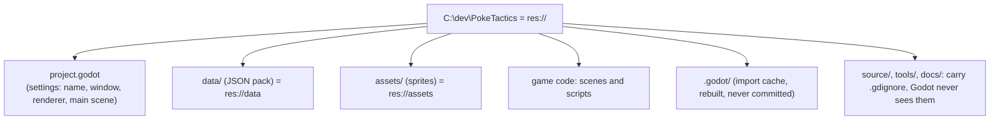
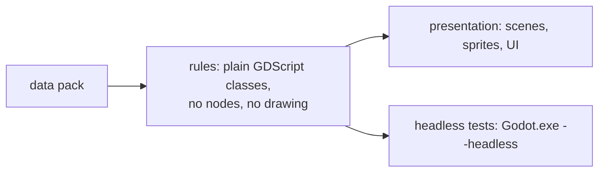
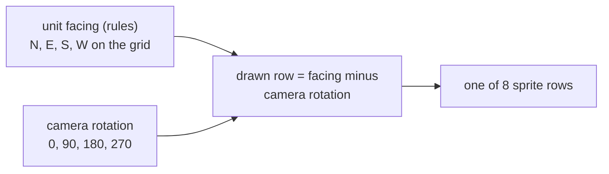

# Godot primer (what "Godot at the repo root" means)

2026-11-15. Jess's install: Godot 4.6.2 stable, standard build (GDScript only, no C#), at
C:\Users\boric\OneDrive\Desktop\Godot.exe. It runs from the command line, so headless checks and tests are possible.

## A Godot project is a folder with one file in it

- Whichever folder holds project.godot is the project, and Godot calls it `res://`. At the repo root, the game reads
  `res://data/...` and `res://assets/...` directly, with no copying.
- A folder with a .gdignore file inside is invisible to Godot (no import, no listing). source/ already has one.

## What Godot writes next to our files

| File | What it is | Commit? |
|---|---|---|
| project.godot | Project settings, plain text | Yes |
| .godot/ | Import cache and editor state, rebuilt from the files | No (gitignore) |
| `<image>.png.import` | One per imported image: how Godot imports it (filter, compression) | Yes, so both machines import the same way |
| `<script>.gd.uid` | Stable id per script (new in Godot 4.4), so moves and renames keep links | Yes |
| export_presets.cfg | Build targets (Windows, web) | Yes, when we add one |

About 8,000 sprite sheets means about 8,000 .import files. That is normal for Godot, and it is why sprites belong in
their own folder.

## Settings a 2D pixel tactics game needs from day one

| Setting | Options | What it changes |
|---|---|---|
| Renderer | Forward+ / Mobile / Compatibility | Compatibility is the lightest, runs on older and work GPUs, and is the only one that exports to the web |
| Texture filter | Linear / Nearest | Nearest keeps pixel art crisp; linear blurs it |
| Base resolution and stretch | for example 480x270 scaled up, or native | Sets how big a tile and a sprite look, and keeps pixels square when the window resizes |
| Godot version | 4.6.2 recorded in the repo | Both machines must open the project with the same version, or files get rewritten |

## Rules and presentation stay apart (CLAUDE.md "Coding conventions")

Battles must run with no window so tests can check them. In Godot that means rules are plain scripts that never
touch nodes or the screen, and scenes only display what the rules decide.

## Isometric with rotation (2026-11-15-isometric-rotating-view)

Every SpriteCollab sheet has 8 rows, one per facing (checked: Spearow Walk is 160x320, frames 32x40, so 8 rows).
Rotating the view 90 degrees shifts the drawn row by 2. A unit facing grid north looks "up-right" in one view and
"up-left" after one rotation; the rules never change, only the row drawn.

Two ways to build the map:

| | 3D blocks, 2D sprites (FFT, Triangle Strategy) | Pure 2D isometric tiles |
|---|---|---|
| Map | Godot GridMap of blocks, orthographic camera at the iso angle | TileMapLayer in isometric mode |
| Rotation | Turn the camera 90 degrees, smooth for free | Redraw the map from each of 4 sides; tile art per side |
| Height | Natural: stack blocks | Hard: hand-sorted draw order, per-rotation |
| Hiding behind walls | Depth buffer does it | Manual sort rules |
| Pixel look | Render to 640x360 and scale up; snap camera to pixels | Native pixels |
| Tile art | Block tops can use 24x24 top-down tiles (RawAsset), sides need cliff textures | Needs isometric tiles drawn for it |
| Fits decisions so far | Yes: Compatibility renderer does basic 3D | Yes |

Decided: 3D blocks with 2D sprites (2026-11-15-isometric-rotating-view). Open: the block art.

## Questions to talk through (one at a time)
1. Answered: Compatibility (2026-11-15-renderer-compatibility).
2. Answered: 640x360, integer scaling (2026-11-15-base-resolution).
3. Folder layout for game code (for example game/ for rules, scenes/ for presentation).
4. Test tool: a plain headless test runner of our own, or an add-on (GUT, gdUnit4)?
5. Can the work machine run Godot (the open question in STATE.md)?
