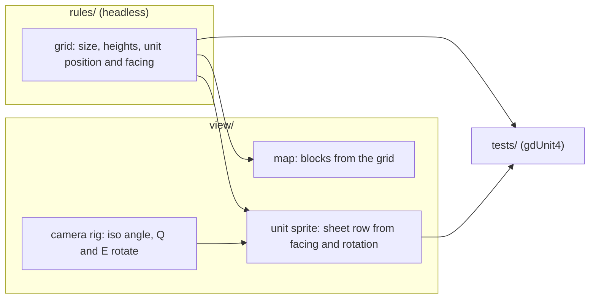

# Plan: Godot setup and greybox rotating test map [Approved] (Jess, 2026-11-15)

2026-11-15. Words only (CLAUDE.md "Edit boundary"). Nothing is built until Jess agrees the slice opening and the
plan. Decisions it rests on: renderer-compatibility, base-resolution, isometric-rotating-view,
godot-layout-and-tests, animation-set.

## Slice opening (to agree)

| | Proposal |
|---|---|
| Goal | The Godot project at the repo root shows a small greybox map in the isometric view, rotatable in four 90 degree steps, with one Pokemon idling on it, at crisp 640x360 pixels; gdUnit4 tests run headless |
| Done when | Jess opens the test scene and feel-tests: rotation works both ways, Charmander turns to the right sprite row in every view, pixels stay crisp at 2x and 3x window sizes, height steps read clearly. Tests pass headless. Committed. Jess closes the issue |
| End-goal test | Relations below, run headless by one command |

End-goal test relations:
1. For each of the four grid facings, the four camera rotations give four different sprite rows.
2. Rotating the camera one step moves the drawn row by exactly 2 of the 8 rows; four steps give back the start row.
3. Rotating left then right (or right then left) gives back the start view and row.
4. A unit's Idle sheet height is exactly 8 times the frame height its AnimData.xml gives (8 facing rows).
5. Project settings match the rulings: Compatibility renderer, 640x360 base, integer scaling, nearest filtering.

## Flow

## Steps

| # | What | Files and where | Numbers and choices |
|---|---|---|---|
| 1 | Keep what Godot made, fix one thing | project.godot, .gitignore (.godot/ ignored), .editorconfig, icon.svg kept. .gitattributes already restored by hand | Physics stays Jolt (unused). The d3d12 line only affects Forward+ and is harmless |
| 2 | Pixel settings | project.godot | Base viewport 640x360, stretch mode viewport (the whole game, 3D included, renders at 640x360), scale mode integer, window starts at 1280x720 (2x), default texture filter nearest |
| 3 | Godot skips non-game folders | an empty .gdignore in tools/ and docs/ (source/ has one) | |
| 4 | Sprite imports | the .import files Godot is making now next to every sprite (about 96k) | Committed, so both machines share import settings and resource ids. Defaults are right (lossless, no mipmaps). Each machine still builds its own .godot/ cache on first open (minutes, once) |
| 5 | gdUnit4 | addons/gdUnit4 from release v6.2.3, plugin enabled in project.godot | Credited in CREDITS.md as a dev tool (MIT); left out of game exports |
| 6 | Grid rules | rules/: a battle grid (8 by 8, a height per cell) and a unit (cell, facing N/E/S/W). No nodes, no drawing | Test map heights 0 to 3, with a ramp of steps and a raised corner |
| 7 | Map view | view/: blocks built from the grid, greybox materials in assets/terrain/ | 1 block = 1 world unit = 24 sprite pixels. Tops lighter, sides darker, one colour per height so steps read |
| 8 | Camera rig | view/: orthographic camera on a pivot over the map centre | Pitch 30 degrees down, yaw 45 degrees plus the rotation step. Q and E rotate in 0.25 second turns. Camera held to whole-pixel positions to stop shimmer |
| 9 | Unit sprite | view/: a camera-facing sprite that plays one animation from a SpriteCollab sheet and AnimData.xml | Charmander (0004) Idle. Sprite pixel size 1/24 unit so its pixels match block pixels. Drawn row = facing turned by camera rotation; row switches at the middle of a turn. Feet on the block top using the Shadow sheet's anchor |
| 10 | Tests | tests/: the five relations above, as gdUnit4 tests | One headless command runs them; it is written into CONTEXT.md for every session |
| 11 | Issue and close | GitHub issue with the slice opening as its done-condition (also checks the board auto-adds it) | |

## Decisions (answered 2026-11-15)
1. The Pokemon on the map: Charmander (0004).
2. Rotation keys: Q and E.
3. Work happens on a branch Jess creates (slice/godot-setup).

## Risks
- Pixel shimmer while the camera turns: mitigated by pixel snapping; if it still shows, the turn can be a quick cut
  instead of a smooth 0.25 second turn. Jess's feel test decides.
- About 96k .import files make the commit large in file count (small in bytes) and the first open on another machine
  slow. Accepted cost of keeping sprites as normal Godot resources.
- Godot's wizard overwrote .gitattributes once; reopening project setup could do it again. The note at its top warns.
- gdUnit4 is third-party code; pinned to v6.2.3, upgraded only on purpose.
