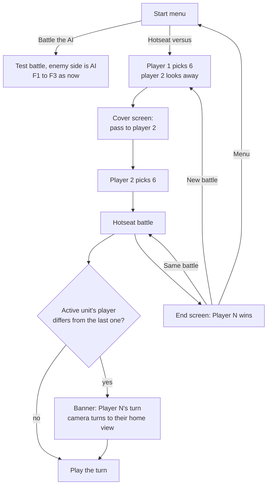

# #15 opening and plan: hotseat versus (M1b)

Date: 2026-11-17. Issue: #15. Rulings: 2026-11-17-hotseat-m1b, 2026-11-16-multiplayer-horizon (hotseat right
after M1, free pick 6 at one set level, no save file), 2026-11-17-battle-end-m1, 2026-11-17-enemy-ai-m1.

## Goal [Approved]
Two players on one machine each pick 6 units at one set level and play the test map to a rout, each controlling
their own side. The AI battle stays available. Rules stay deterministic and headless; no save file.

## Done when [Approved]
- The end-goal test passes headless via `tools\run-tests.cmd`.
- Jess and a second player pick teams and play a hotseat battle start to finish (M1b done).
- Committed; Jess closes #15.

## Answers (Jess, 2026-11-17: every recommendation, plus the camera rule)
| # | Question | Answer |
|---|---|---|
| 1 | Pick pool | Today's 12 units (player roster and enemy pool); widened later by a data slice (#26) |
| 2 | Set level | 30 |
| 3 | How players pick | Blind: player 1 picks 6 while player 2 looks away, then player 2 |
| 4 | Duplicates | A species at most once per team (Vulpix and Alolan Vulpix count as one); mirrors across teams allowed |
| 5 | Getting in | A start menu: "Battle the AI" and "Hotseat versus" |
| 6 | Control | Hotseat: player 1 the south-east side, player 2 the north-west; neither is AI |
| 7 | Handing over | A short "Player 2's turn" banner whenever control passes, **and the camera turns to that player's view** (Jess) |
| 8 | End screen | "Player 1 wins" or "Player 2 wins"; Same battle replays teams and seed; New battle returns to picking |
| 9 | Visibility | Everything on the map is open |

Camera rule as built: each player has a home view, player 1 the view the battle starts in, player 2 the opposite
one (turned 180 degrees), so their own start corner is nearest the screen. On every handover the camera turns to
the incoming player's home view and pans to the active unit. Q and E still turn freely during a turn.

## Flow

## End-goal test (relations) [Approved]
| # | Relation |
|---|---|
| 1 | A team is exactly 6 units, every one from the pool, no species twice; a short, long, off-pool or same-species team is refused |
| 2 | Every pool unit at the set level knows only moves with grid behaviour, and has a sprite set |
| 3 | A battle built from two teams puts every unit of team 1 on the player side and team 2 on the other, at the set level, on distinct start cells |
| 4 | In hotseat no side is played by the AI; in the AI battle only the enemy side is |
| 5 | The same two teams and seed give the same battle and the same turn order |
| 6 | A hotseat battle with both sides driven through the same turn order calls (by the AI) ends with a result |

## Prose plan

### Part 1: rules/test_battle_setup.gd (grows about 45 lines)
- New consts: TEAM_SIZE (6), the hotseat pool (the player roster plus the enemy pool, one list), and a play-mode
  enum (AI battle, hotseat) with a table of which sides the AI plays in each mode (enemy only; none).
- New build-from-teams: places team 1 on the player side and team 2 on the enemy side at UNIT_LEVEL on the
  existing start cells. The current build becomes build-from-teams with the player roster and the seeded enemy
  roster, so both share one placement (touched-code cleanup, behaviour unchanged; the #6 and #16 tests guard it).
- New team checks: whether a unit may join a team (in the pool, team not full, species not already in it, using
  the pack's species field), and whether a team is complete and valid. The pick screen and the tests both use them.
- Where: the setup already owns the map, start cells, roster and pool, and hotseat plays the same test map.

### Part 2: view/camera_rig.gd (grows about 15 lines)
- New turn-to-view-step: turns the shortest way to a given view step (90 or 180 degrees in one tween), reusing the
  existing turn tween, the halfway view-step announcement and the yaw settle. turn (Q and E) becomes a one-step call
  of it (touched-code cleanup).

### Part 3: view/test_map.gd (grows about 60 lines)
- Static play mode and the two hotseat teams, kept across scene changes like encounter_kind. The AI_SIDE const is
  replaced by the setup's AI-sides table for the current mode.
- Side labels by mode ("You" and "Foe", or "Player 1" and "Player 2"), handed to the unit panel and end screen;
  the duplicate label table in test_map goes (touched-code cleanup).
- Handover: when the active unit belongs to a human player other than the last one, show the banner for about 1.2 s
  (a named const) and turn the camera to that player's home view (a two-entry table, player 1 the start view, player
  2 the opposite). The AI battle never turns the camera.
- F1 to F3 switch to the AI battle of that kind (from hotseat too). End screen: Same battle as now; New battle
  goes to the pick screen in hotseat, a new seed in the AI battle; a new Menu button goes to the start menu.
- The result title moves here (Victory or Defeat, or Player N wins) and is handed to the end screen.

### Part 4: view/unit_panel.gd and view/end_screen.gd (small)
- Unit panel: takes the side labels instead of its own table. End screen: takes the title and side labels, and gains
  the Menu button and its signal.

### Part 5: new scenes (view/start_menu.gd and .tscn, about 40 lines; view/team_pick.gd and .tscn, about 140 lines)
- Start menu: two buttons. It becomes the project's main scene (project.godot, a build config change).
- Team pick: one row per pool unit (portrait from PortraitLoader, name, types), click to add or remove, rows that
  may not join greyed (team full or species taken), a count, and Done at 6. After player 1: a cover screen ("Pass to
  player 2", Ready). After player 2: sets the teams and play mode on the test map and opens it.
- Panel colours and font size follow MoveMenu and UnitPanel.

### Part 6: tests/test_hotseat.gd (new)
- Relations 1 to 6 above, on the real setup. Relation 6 reuses the AI loop shape of test_win_lose.gd (a third loop
  now exists across suites; they stay separate because each checks different things, noted here as a watch item).

## Not built (YAGNI)
- A wider pool and other levels (#26). Online play, co-op. Hidden teams. Picking moves, items or map. Saving teams.
- A key for the start menu during battle (the end screen's Menu button and closing the window cover it).

## Risks
- The main scene changes: launching the project now opens the start menu, not the battle (one extra click).
- Turning the camera at every handover may feel busy when turns alternate often; the banner time and turn speed
  are tuned in the feel test.
- The handover check must ignore turns the AI plays, and the first turn of a hotseat battle counts as a handover.
