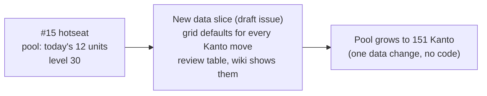

# #15 opening: hotseat versus (M1b)

Date: 2026-11-17. Issue: #15. Rulings: 2026-11-16-multiplayer-horizon (hotseat right after M1, free pick 6 at one
set level, no save file), 2026-11-17-battle-end-m1 (result in rules), 2026-11-17-enemy-ai-m1 (enemy side is AI
until this slice adds a toggle).

## Goal (draft) [Proposed]
Two players on one machine each pick 6 units at one set level and play the test map to a rout, each controlling
their own side. The AI battle stays available. Rules stay deterministic and headless; no save file.

## Done when (draft) [Proposed]
- The end-goal test passes headless via `tools\run-tests.cmd`.
- Jess and a second player pick teams and play a hotseat battle start to finish (M1b done).
- Committed; Jess closes #15.

## The blocker: which units can be picked
Only the 45 roster moves have grid behaviour (#9, Jess's choice then). A move without it cannot be used, and the AI
skips it. Counted from the pack:

| Pool | Units | Distinct moves known at level 30 | Without grid behaviour |
|---|---|---|---|
| Today's 12 (player roster and enemy pool) | 12 | all covered | 0 |
| All 151 Kanto species | 151 | about 200 | about 160 (about 200 of 230 at level 50) |

tools/move_grid.py already derives a default grid entry from pokeapi's target and damage class; it only emits
entries for the moves named in authored/. Widening the pool means emitting defaults for those moves and reviewing
them, as #9 did for 45.

## Questions (answer all in one go)
| # | Question | Options | Recommendation |
|---|---|---|---|
| 1 | Pick pool for #15 | a) today's 12 units, widened later by a data slice; b) widen to all Kanto first (that data slice, then #15); c) any unit whose 4 moves already have grid behaviour | **a**: hotseat is playable now; the pool is a list in one place, so widening later changes no code. I draft the widening slice as an issue |
| 2 | The set level | a) 30, as the test battle; b) 50 (mainline competitive); c) chosen on the pick screen | **a**: the 45 grid moves are the roster's level 30 moves; at 50 they learn moves without grid behaviour. Revisit with the widening slice |
| 3 | How players pick | a) blind: player 1 picks 6 while player 2 looks away, then player 2; b) open snake draft (1, 2, 2, 1, ...), a unit once per battle; c) open, one after the other, duplicates allowed | **a**: no counter-picking, and it works with a small pool (a draft from 12 would force the last picks) |
| 4 | Duplicates | a) a species at most once per team, mirrors across teams allowed; b) anything goes | **a**: the mainline species clause |
| 5 | Getting in | a) a small start menu: "Battle the AI" (today's test battle, F1 to F3) and "Hotseat versus" (pick screen); b) a key on the test map | **a**: the first menu the game has, and the AI battle stays one click away |
| 6 | Who controls what | Hotseat: player 1 the south-east side, player 2 the north-west side; neither is AI. AI battle: as now | As stated |
| 7 | Handing over | a) a short "Player 2's turn" banner whenever control passes to the other player; b) the turn label only | **a**: turns interleave by Speed, so control changes often and easily goes unnoticed |
| 8 | End screen in hotseat | "Player 1 wins" or "Player 2 wins"; Same battle replays the same teams and seed; New battle goes back to the pick screen | As stated |
| 9 | Do players see each other's teams after picking? | a) yes, everything on the map is open (the turn bar and Tab panel show all units); b) hide until first sight | **a**: hiding needs line of sight rules (#18) |

## End-goal test (relations, draft) [Proposed]
| # | Relation |
|---|---|
| 1 | A team is exactly 6 units, every one from the pool, no species twice in a team (if q4 = a); an invalid team is refused |
| 2 | Every pool unit at the set level knows only moves with grid behaviour, and has a sprite set and a portrait |
| 3 | A battle built from two teams puts every unit of team 1 on one side and team 2 on the other, at the set level, on distinct start cells |
| 4 | In hotseat no side is played by the AI; in the AI battle only the enemy side is |
| 5 | The same two teams and seed give the same battle (the Same battle button relies on it) |
| 6 | A headless hotseat battle with both sides driven by the AI through the same calls ends with a result (players and AI are interchangeable) |

## Not built (YAGNI)
- Widening the pool and changing the level (the drafted data slice).
- Online play, accounts, lobbies (2026-11-16-multiplayer-horizon). Co-op.
- Hidden teams, fog of war (#18). Picking moves, items or abilities. Map choice.
- Saving teams or results.

The prose plan (files, numbers, risks) follows once these answers are in.
