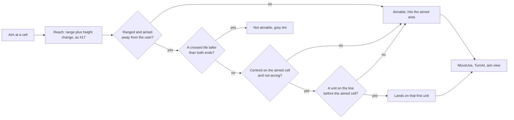

# Line of sight and arcing moves, opening (#18)

Rulings: 2026-11-16-height-and-sight, 2026-11-17-facing-height-rules, 2026-11-17-height-range-all-ranged.
Status: agreed 2026-11-17 (ruling 2026-11-17-line-of-sight-rules). Build plan: line-of-sight-plan.md. No code here.

## Opening (draft)

| Item | Content |
|---|---|
| Goal | Moves gain tags: all 21 pokeapi move flags, plus arcing (seeded from ballistics, plus overrides), replacing the arcing field. Walls taller than both ends block every ranged move. A ranged move centred on its aimed cell, without arcing, stops at the first unit on its line (a blast bursts there). Beams, cones and other areas hit everyone inside them. The player sees walled-off cells and the unit a shot will really hit before committing. |
| Done when | Tags replace the arcing field in the pack, wiki and tests; aiming, resolve and the AI all use one sight check and one "first unit on the line" rule; the aim view shows both; the relations below pass headless; Jess feel-tests targeting. |
| End-goal test | New tests/test_line_of_sight.gd, the relations below. |

Draft end-goal relations:
1. On flat open ground with no units in between, every cell a move could reach before #18 is still aimable and
   hits the same units.
2. A wall taller than both user and aimed cell, on the line between them, makes the cell unaimable, for direct and
   arcing moves alike.
3. A wall no taller than the higher of the two ends never blocks.
4. A direct move centred on its aimed cell, aimed past a unit, lands on that unit instead (the first one on the line,
   allies included; a blast bursts centred there); an arcing one lands on the aimed cell.
5. An area move (line, cone, circle) hits every unit in its area; units never shelter each other; walls shelter
   tiles behind them (seen from the blast centre, or from the user for shapes that start at the user).
6. Melee moves (range 1) and moves on the user's own tile never need sight.
7. Sight is symmetric: if A can see B, B can see A (same heights, same walls).
8. Every move carries exactly its pokeapi flags as tags; a move with the ballistics flag is arcing unless
   overridden; every tag is from the known list.
9. Range from height is unchanged by #18 (direct and arcing reach the same cells).
10. The AI never picks an aim the player could not pick, and scores the unit that would really be hit.
11. Seeded battles stay deterministic.

## Where sight enters

## Answers (Jess, 2026-11-17)

| # | Question | Answer |
|---|---|---|
| Q1 | Which moves are arcing | pokeapi ballistics flag, plus a short override list (for example Rock Slide, Rock Throw) |
| Q2 | Which flags become tags | All 21 pokeapi flags, plus arcing |
| Q3 | Sight line | Centre to centre; every tile crossed counts; an exact corner blocks only if both tiles beside it block. Later: free aim at any cell in circular range with best-approximation lines and shapes (#29) |
| Q4 | Unit size as height | No, tile height only |
| Q5 | Allies block | Yes, any unit other than user and target |
| Q6 | Past a unit | A single-tile projectile without arcing hits the first unit in the way. Beams (lines), cones, circles and other areas hit everyone in the area |
| Q7 | Inside areas | Walls shelter tiles behind them; units do not shelter each other |
| Q8 | Blocked look | Dim grey tint, not pickable, "No line of sight" on hover |
| Q9 | Distant blast without arcing, unit on the way | It bursts on the first unit in the way, centred there, like a projectile |
| Q10 | Status moves at range | Follow the projectile rule too |

Notes:
- Q6 applies to every ranged single-tile move without arcing, status moves included (Confuse Ray, Toxic, Sleep
  Powder), since they travel the same line.
- The aim view (Q8) also marks the unit a redirected shot will hit, so the player is never surprised.
- No roster move is arcing today except Rock Blast (ballistics), which covers relation 4's arcing half.
