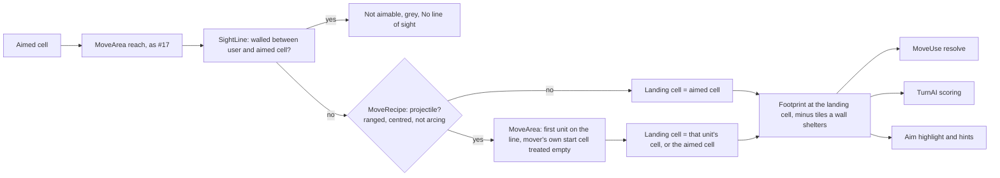

# Line of sight and arcing moves, build plan (#18)

Rulings: 2026-11-16-height-and-sight, 2026-11-17-line-of-sight-rules, 2026-11-17-height-range-all-ranged.
Opening: line-of-sight-opening.md (goal, done when, the 11 relations). Checked against the coding-principles skill.
No code in this plan. Status: built 2026-11-17; Jess's feel test passed, #18 closed.

## As built (2026-11-17)
- D1 reading order (lower grid y, then lower x); D3 and D4 as recommended.
- D2 changed by Jess: aimable when a unit stands in front of the wall. The wall test runs from the user to where
  the move lands (the first unit for a projectile), so a wall before that unit still blocks.
- MoveUse gained units_hit(), shared by resolve and the aim hints, so both use the landing cell.
- Arcing comes only from ballistics for now; no overrides were needed in the 45 roster moves.
- Tests: 140 (129 plus 11 in test_line_of_sight.gd). Relation 10 checks the shot only when the AI chooses to shoot (it may walk instead).

## How one aim resolves

## Parts

| Part | Where | Reuses | New | Why there |
|---|---|---|---|---|
| P1 Tags in the pack | tools/export_pack.py, tools/move_grid.py, data/moves.json (regenerated) | The contact-flag lookup at export_pack.py:153; default_recipe; the override merge (whole top-level fields); the validator | Each move's pokeapi flags read once as a list (contact is then read from that list, a touched-code cleanup). Recipe field arcing becomes tags: the move's flags in pokeapi id order, plus arcing when it has ballistics. Validator: tags only from the known list (21 flags plus arcing), no repeats. Pack README line updated | The export owns pokeapi facts; move_grid owns recipe defaults |
| P2 Wiki | tools/build_wiki.py | The recipe rows at line 347 | The "Arcing yes/no" row becomes a "Tags" row | Wiki reads the pack |
| P3 Recipe questions | rules/move_recipe.gd | needs_aim, is_on_user_tile, ANCHOR_FORWARD | TAG_ARCING const; has_tag; is_projectile (ranged, max range 2 or more, centred anchor, not arcing) | MoveRecipe answers "what kind of move is this" |
| P4 Sight line | new rules/sight_line.gd | BattleGrid.height_level_at | Two functions: the tiles a centre-to-centre line crosses between two cells, in order from the start, with exact corner crossings given as a pair (whole-number arithmetic on doubled coordinates, no floats, so it is exact and deterministic); and whether that line is walled (a crossed tile taller than both ends; a corner pair walls only if both tiles do) | One job, pure geometry plus heights; MoveArea (169 lines, shapes) stays about shapes and reach |
| P5 Reach, landing, shelter | rules/move_area.gd | can_reach, target_cells, footprint, units_hit, hit_origin | can_reach adds the wall test (adjacent cells cross nothing, so melee and range 0 are untouched). New walled_cells: in reach but walled, for the grey tint. New landing_cell: for a projectile, the first standing unit on the crossed tiles (skipping the mover's own cell, so the AI can ask "as if I stood there"), else the aimed cell. footprint takes the grid and drops tiles a wall shelters from the hit origin (the blast centre, or the user for shapes from the user) | MoveArea already owns reach and footprints |
| P6 One use | rules/move_use.gd | is_allowed, footprint, resolve, damage_to | A landing cell worked out once; footprint, units hit and damage (hit origin) use it; target_cell stays the aimed cell | Same loop, one source |
| P7 AI | rules/turn_ai.gd | _options_from (target_cells already excludes walled), _units_hit_from, _score | Footprint and hit_damage use the landing cell from the stand cell; no new scoring logic | AI reads the same rules as the player |
| P8 View | view/tile_highlight.gd, view/test_map.gd | move_range_cells fill, _cost_label by the cursor, _show_aim_hints | A grey walled_cells tint while aiming; the cursor label reads "No line of sight" over a walled cell; hints already follow the footprint, so a redirected shot shows its hint on the unit really hit | Presentation only |
| P9 Tests | new tests/test_line_of_sight.gd; signature updates in test_move_schema, test_facing_and_height, test_use_a_move, test_move_recipes, test_enemy_turn | test_battle_setup small boards; Rock Blast (ballistics, so arcing) for the arcing half of relation 4 | The 11 relations; RECIPE_FIELDS swaps arcing for tags | End-goal test |

Size: rules/move_area.gd grows by about 40 lines (same job); new rules/sight_line.gd about 60; view/test_map.gd a
few lines (same job). No file takes on a second job.

## Not built (YAGNI)
- Free aim at any cell in range, and drawing the shot's path: #29.
- Arcing overrides for non-roster moves (Rock Slide, Rock Throw): they get recipes with #26; a note goes on #26.
- Rules for the other tags (sound, punch, powder and so on): tags are carried, nothing reads them yet.
- Unit size as height.

## Decisions for Jess (recommendation first)

| # | Question | Recommendation | Alternative |
|---|---|---|---|
| D1 | A projectile's line passes exactly through a corner with units on both tiles: which is hit? | The one first in reading order (lower grid y, then lower x): fixed and deterministic | The one on the user's left |
| D2 | Aimed cell behind a wall, with a unit in front of the wall | Jess: aimable, the shot lands on the unit | (recommended: not aimable) |
| D3 | A redirected blast: where are facing and height measured from? | The burst centre, as #17 does for any distant blast | The aimed cell |
| D4 | The AI preview while it plays a redirected shot | Lights the footprint at the landing cell (what really gets hit) | Lights the aimed cell |

## Risks
- footprint() gains a grid argument: every caller and four test suites change in step (mechanical).
- Rerunning the export rewrites data/moves.json recipes (arcing to tags); the pack --check catches drift.
- Seeded replays stay deterministic, but any existing test whose units stand in a shot's path may now hit a
  different unit; those are real rule changes and get read, not re-pinned.
