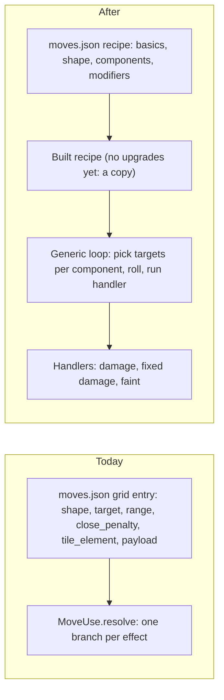
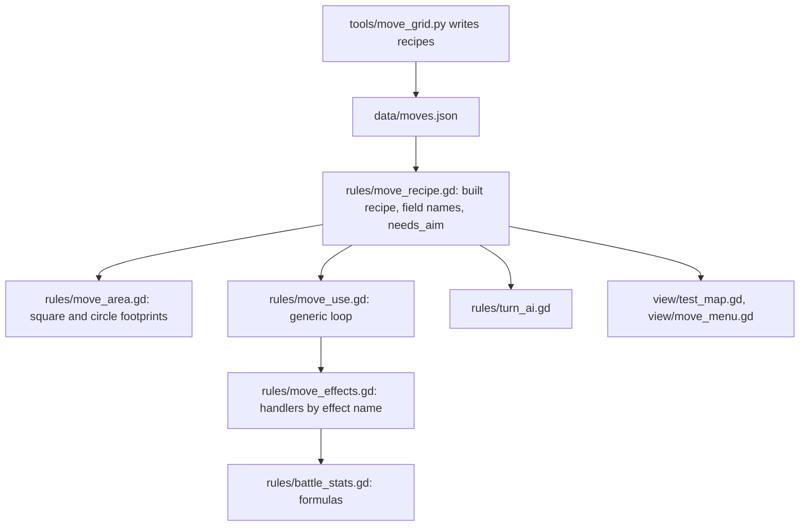

# Move recipes plan (#27)

Date: 2026-11-17. Rulings: 2026-11-17-move-recipes, 2026-11-17-move-recipe-structure, 2026-11-17-move-recipes-build.
Status: [Approved] 2026-11-17 (D1 to D7 as recommended); built, see "As built" at the end.

Goal: every move is a recipe (basics, shape, components) run by one generic loop with one handler per effect. The
45 roster moves behave exactly as today. Upgrades are #28.

## Before and after

## Decisions needed (recommendation first)

| # | Decision | Recommendation | Why |
|---|---|---|---|
| D1 | What "on use" and "on hit" mean | on hit = only units that passed the accuracy roll (damage, fixed damage, burn chance); on use = not gated by accuracy (tile effects, faint on the user, self buffs). Damage is on hit | Matches today (a miss deals nothing). Corrects the pseudocode examples, which marked damage "on use" |
| D2 | The user's tile in a range-0 circle (Self-Destruct) | Leave it out of the footprint, as today; revisit with #21 when tile effects exist | Keeps #27 a pure no-change slice; the preview stays identical |
| D3 | "All existing tests pass unchanged" | Amend: test_move_schema.gd is rewritten to the new fields with the same relations; two other suites change one line each where they read the old grid entry | That suite tests the old field names directly, so it cannot stay unchanged |
| D4 | How to prove nothing changed | Before any change, record today's footprints for every roster move (each direction, sample targets) and one seeded AI-vs-AI battle log into a test fixture; a new test compares against it. Delete the fixture when #28 closes | Strongest no-change check; a parity snapshot of the old behaviour, not tuning values |
| D5 | Square sizes | Odd widths only, centred on the aim axis; length runs along the aim. Only 1x1 is used today | Keeps footprints symmetric with no half-tile rule |
| D6 | Names in data | moves.json key "grid" becomes "recipe"; authored/move_grid_overrides.json becomes move_recipe_overrides.json | Says what it is |
| D7 | Effect renames | ailment becomes status, user_faints becomes faint, tile_element becomes an element component, side becomes who (target to all, user to self) | Matches the ruling and your drawing's terms |

## Parts

### P1. Export writes recipes (tools/move_grid.py, tools/export_pack.py, authored/)
- Reuses: the derived defaults from pokeapi facts, the overrides merge, the validator, the shape table.
- Changes: each roster move gets a recipe instead of a grid entry. Basics: type, class, accuracy, SR cost, arcing.
  Shape: square or circle, size, range span, anchor. Components: today's payload mapped by D7, each with timing,
  touches, who and chance; power moves into the damage component. Modifiers: the close-range half for ranged
  damaging moves.
- Mapping: single to square 1x1 centred; cone to circle with its angle, forward; circle to circle 360, centred;
  line to square len x 1, forward. Self moves get range 0.
- Validator: checks the new fields, odd square sizes, angle in 15 degree steps, range 0 for self-only shapes.
- The two non-empty overrides (Night Shade, Self-Destruct) are rewritten in the new field names.
- Shape table: no change. It already covers radius up to 50 in 15 degree steps, which satisfies the "tables reach
  every upgrade, up to a cap" ruling.
- The wiki builder (tools/build_wiki.py) reads the new fields.

### P2. Recipe access (new rules/move_recipe.gd)
- New: field-name constants, "built recipe for this unit and move" (returns a copy of the base recipe; #28 adds
  upgrades here), "needs aim" (forward anchor, or a circle under 360), "deals damage", "has effect".
- Why new: these are read by MoveUse, MoveArea, the AI and the view; today they are spread across MoveUse statics.

### P3. Shapes (rules/move_area.gd)
- Rewritten for square and circle, centred or forward, with the range span. Same public functions (distance,
  can reach, target cells, footprint, units hit), now taking a recipe.
- Rule kept from today: a forward shape never covers the user's tile; a range-0 circle leaves out the user (D2).

### P4. Effect handlers (new rules/move_effects.gd)
- A lookup from effect name to handler. Handlers now: damage, fixed damage, faint. An effect with no handler yet
  (status, stat, heal, drain, recoil, multi hit, flinch, element, needs rule) is skipped silently.
- Picks each component's targets by touches, who and timing (D1).

### P5. The loop (rules/move_use.gd)
- resolve becomes: build, footprint, accuracy once per unit, then for each component pick targets, roll its
  chance, run its handler. No per-effect branches. Outcomes (hit, crit, damage, type multiplier) unchanged, so the
  view's outcome text needs no change.
- hit_damage reads power from the damage component and the close-range modifier from the recipe.

### P6. Formulas (rules/battle_stats.gd)
- move damage takes power as a value instead of reading move power; hit chance takes accuracy from the recipe
  basics. Formulas and constants unchanged.

### P7. AI (rules/turn_ai.gd)
- Reads the built recipe for deals damage, needs aim, target cells, footprint and faint. Scoring unchanged.

### P8. View (view/test_map.gd, view/move_menu.gd)
- Aim check, SR cost, own-cell target for range 0, and the menu's reach text read the built recipe. No visual
  change.

### P9. Tests
- New tests/test_move_recipes.gd (end-goal test): every roster move builds and resolves; footprints match the D4
  fixture; the seeded battle log matches; with no upgrades the built recipe equals the base recipe; an effect
  without a handler changes nothing and raises no error.
- test_move_schema.gd rewritten to the new fields, same relations (D3).

## Plan check

| Item | Answer |
|---|---|
| Reuses | pokeapi defaults, overrides merge, validator, shape table, BattleStats formulas, MoveArea's public functions, Outcome |
| New files | rules/move_recipe.gd (shared recipe reads), rules/move_effects.gd (handlers), tests/test_move_recipes.gd, the D4 fixture |
| Not built | upgrades and splash (#28); handlers for status, stat, heal, drain, recoil, multi hit, flinch, element (M2b, #21); resolve-time modifier channel beyond close range (#28); squares wider than 1 in use; 0.75x multi-target; weather |
| Where it lives | rules/ for all logic, tools/ for export, view/ only switches what it reads |
| Size | move_use.gd shrinks; move_area.gd about the same; the AI and view change only their reads |
| Touched-code cleanups | MoveUse statics (is_aimed, deals_damage, has_effect) move to move_recipe.gd |

## Risks

| Risk | Guard |
|---|---|
| Largest refactor so far; a silent behaviour change | D4 fixture (footprints and a seeded battle log) recorded before any edit |
| Cone footprints shift by a tile after the remap | Same shape table and quarter turns; fixture catches any drift |
| Save data | None: no saves exist yet, and recipes are pack data |
| Wiki drift | Wiki rebuilt in the same step |

## Order of work
1. Record the D4 fixture with today's code.
2. P1 export, regenerate the pack, `--check`.
3. P2 to P8.
4. P9 tests, `tools\run-tests.cmd` green, wiki rebuilt.
5. Jess feel-tests that nothing changed.

## As built (2026-11-17)

| Item | Result |
|---|---|
| D4 fixture | tests/fixtures/move_parity.json: 3,612 footprints and 24 seeded AI battles, recorded with the pre-#27 code by a one-off recorder (deleted after use) |
| New files | rules/move_recipe.gd, rules/move_effects.gd, tests/test_move_recipes.gd, authored/move_recipe_overrides.json (replaces move_grid_overrides.json) |
| BattleStats | move_damage(name) kept for its callers; it now calls the new power_damage (power given). New rolls_chance for component chances |
| MoveUse | on-hit components unit by unit (accuracy, then each chance and handler), then on-use ones; accuracy is rolled only when a handled on-hit component exists, so status moves still roll nothing |
| Tests | 122 pass (5 new). A deliberate one-character break of close range made the battle replay fail 15 times, so the fixture guards behaviour |
| Not changed | shape table (already radius 50, 15 degree steps); the view's outcome text |
