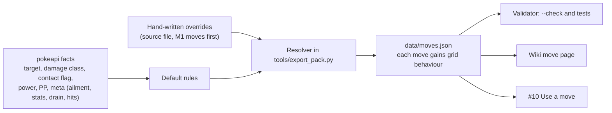

# #9 opening: move translation schema [Proposed]

Date: 2026-11-16. Issue: #9. Rulings: 2026-11-15-move-grid-translation, 2026-11-16-move-schema-adaptation,
2026-11-16-act-cost, 2026-11-16-height-and-sight, 2026-11-16-environment-model, 2026-11-16-push-and-collision.
Idea source (ideas only, no code): fork docs/MOVE-AXIS-SCHEMA.md.

## Goal
Every move in the pack gets grid behaviour: where it can reach, which tiles it hits, and what it does. The defaults
come from pokeapi facts, and overrides cover the moves the test battle fields. #10 ("use a move") then reads this
behaviour and needs no per-move code.

## Done when
- Jess approves the schema (axes, fields, shape set, default rules).
- Every move in the pack resolves to a valid entry, and every M1 roster move has a reviewed entry (the 45 moves
  below).
- The end-goal test passes headless via `tools\run-tests.cmd`. The wiki shows each move's grid behaviour.
  Committed; Jess closes #9.

## End-goal test (relations)
| # | Relation |
|---|---|
| 1 | Every move in the pack resolves; every resolved entry passes the validator (no missing or contradictory field) |
| 2 | Every override names a move that exists in the pack, and every overridden field is a schema field |
| 3 | A contact move never reaches farther than a non-contact move with the same target kind, unless overridden |
| 4 | A move that targets only the user hits no other unit; an all-opponents move never hits an ally |
| 5 | Lower PP never gives a cheaper SR cost than higher PP (band order), unless overridden |
| 6 | Every damaging move's tile element is its own type unless overridden; a status move applies none by default |
| 7 | Resolving twice gives identical output (the export rerun check covers it) |
| 8 | Each shape's tile footprint, aimed in each of the 4 directions, is the same set rotated |

## The three axes, adapted to the grid

| Axis | Fields (proposed) | Fork fields dropped |
|---|---|---|
| Space (which tiles) | shape (single, line, cone, burst, ring, self, field), size, aimed or picked | px sizes, spread in radians, pierce, chain hops |
| Delivery (how it gets there) | range in tiles (min and max), needs line of sight or arcing, SR cost | speed, paths, homing, orbits, lifetimes |
| Payload (what happens) | ordered effects: damage, ailment, stat, heal or drain, multi-hit, push, tile element | shields, cooldown, cards |

Top-level fields stay source facts: type, damage class, power, accuracy, PP (used only to derive the SR cost).

## Proposed default rules
| pokeapi fact | Default |
|---|---|
| selected-pokemon, contact | single target, range 1 (melee) |
| selected-pokemon, no contact | single target, range 2 to 4, line of sight |
| all-opponents | cone, aimed, length 3 |
| all-other-pokemon | burst around the user, radius 1 (hits allies too) |
| user, user-and-allies, users-field | self, or the user plus adjacent allies |
| entire-field, opponents-field | field effect (no tile shape), runs in a later slice |
| random-opponent, specific-move, others | single target, then reviewed in overrides |
| meta category, ailment, stat changes, drain, hits | copied into the payload as written |
| PP band | SR cost from the bands in 2026-11-16-act-cost (formula still open, placeholder marked) |

## M1 roster moves (45, level 30, test battle)
Damaging contact (13): aqua-tail, assurance, bite, cross-chop, fire-fang, iron-tail, knock-off, slash, spark,
strength, take-down, thrash, vital-throw. Damaging without contact (14): feint, aurora-beam, extrasensory,
flamethrower, giga-drain, hex, moonblast, night-shade, rock-blast, smack-down, icy-wind, incinerate, swift,
self-destruct. Physical moves without contact (feint, rock-blast, smack-down) would default to ranged, so the
override review checks them. Status (18): agility, baby-doll-eyes, confuse-ray, copycat, curse, iron-defense, rain-dance,
scary-face, shell-smash, sleep-powder, spite, stealth-rock, swagger, sweet-scent, synthesis, toxic, will-o-wisp,
worry-seed.

## Decisions needed (recommendations first)
| # | Question | Recommendation |
|---|---|---|
| Q1 | Where does resolving happen? | At export: overrides live in a hand-written source file, export_pack.py writes resolved behaviour into data/moves.json, and the validator runs in --check. The game then reads finished data. |
| Q2 | Shape set | The 7 shapes above. Aimed shapes (line, cone) point in one of the 4 grid directions; picked shapes (single, burst) choose a cell in range. |
| Q3 | Ranged default reach | 2 to 4 tiles for non-contact single-target moves, with min 2 so they cannot be used point blank. Alternative: 1 to 4. |
| Q4 | Payload in M1 | The schema records the full payload now, but M1 runs only damage. Other effects wait for M2b, and push for #19. |
| Q5 | Overrides scope | Review all 45 roster moves now. All other moves use defaults until a slice fields them. |
| Q6 | Export the contact flag | Yes. It is in source/pokeapi/csv/move_flag_map.csv and is the best melee signal. |
