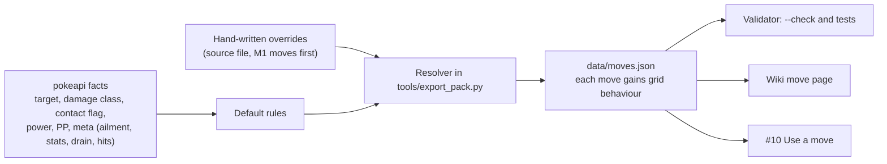
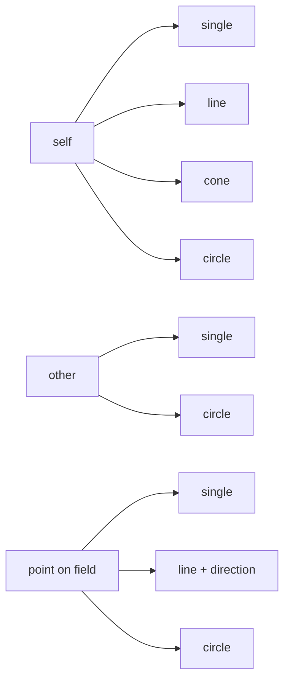
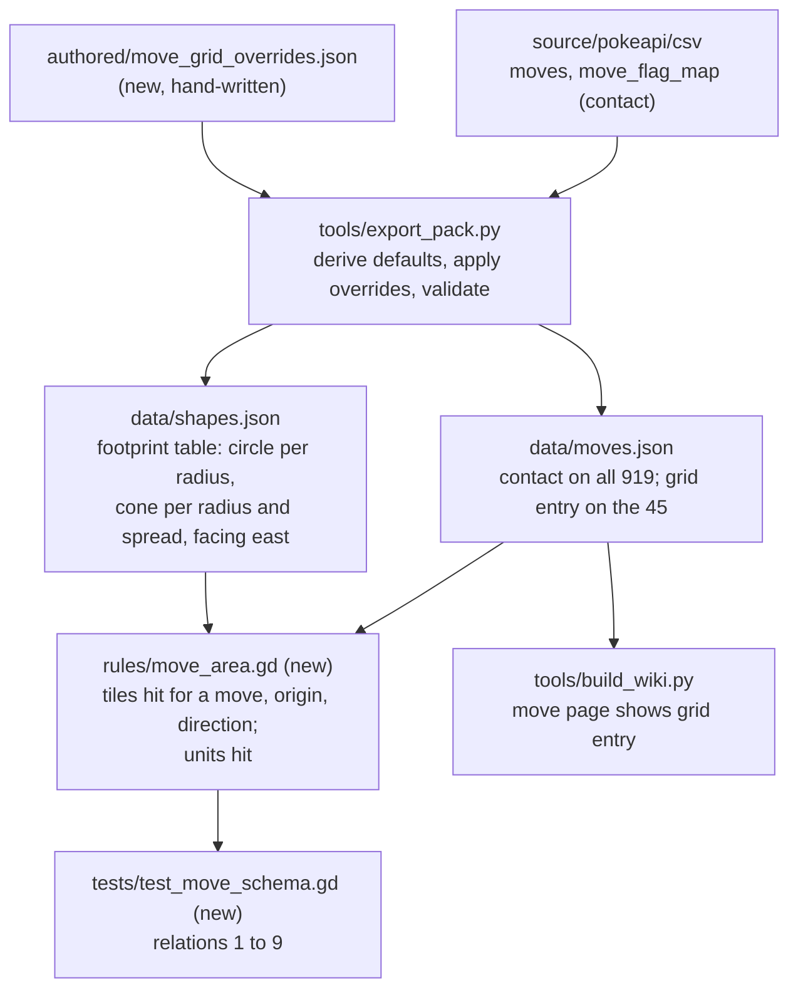

# #9 opening: move translation schema [Proposed]

Date: 2026-11-16. Issue: #9. Rulings: 2026-11-15-move-grid-translation, 2026-11-16-move-schema-adaptation,
2026-11-16-act-cost, 2026-11-16-height-and-sight, 2026-11-16-environment-model, 2026-11-16-push-and-collision.
Idea source (ideas only, no code): fork docs/MOVE-AXIS-SCHEMA.md.

## Goal
Every move in the pack gets grid behaviour: where it can reach, which tiles it hits, and what it does. The defaults
come from pokeapi facts, and overrides cover the moves the test battle fields. #10 ("use a move") then reads this
behaviour and needs no per-move code.

## Done when
- Jess approves the schema (axes, fields, shape set, default rules).
- Every move in the pack resolves to a valid entry, and every M1 roster move has a reviewed entry (the 45 moves
  below).
- The end-goal test passes headless via `tools\run-tests.cmd`. The wiki shows each move's grid behaviour.
  Committed; Jess closes #9.

## End-goal test (relations)
| # | Relation |
|---|---|
| 1 | Every move a roster unit knows has an entry; every entry passes the validator (no missing field, no shape and target pair outside the allowed set) |
| 2 | Every override names a move that exists in the pack, and every overridden field is a schema field |
| 3 | A contact move never reaches farther than a non-contact move with the same target kind, unless overridden |
| 4 | An area hits exactly the units standing in its footprint, whatever their side; a single {self} move hits only the user |
| 5 | Lower PP never gives a cheaper SR cost than higher PP (band order), unless overridden |
| 6 | Every damaging move's tile element is its own type unless overridden; a status move applies none by default |
| 7 | Resolving twice gives identical output (the export rerun check covers it) |
| 8 | Each shape's tile footprint, aimed in each of the 4 directions, is the same set rotated |
| 9 | A circle's footprint is symmetric about its origin; a cone's footprint lies inside the circle of the same radius; a larger radius or spread never covers fewer tiles |
| 10 | A ranged move at range 1 deals less damage than the same move at range 2, all else equal |

## The three axes, adapted to the grid

| Axis | Fields (proposed) | Fork fields dropped |
|---|---|---|
| Space (which tiles) | shape (single, line, cone, burst, ring, self, field), size, aimed or picked | px sizes, spread in radians, pierce, chain hops |
| Delivery (how it gets there) | range in tiles (min and max), needs line of sight or arcing, SR cost | speed, paths, homing, orbits, lifetimes |
| Payload (what happens) | ordered effects: damage, ailment, stat, heal or drain, multi-hit, push, tile element | shields, cooldown, cards |

Top-level fields stay source facts: type, damage class, power, accuracy, PP (used only to derive the SR cost).

## Proposed default rules
| pokeapi fact | Default |
|---|---|
| selected-pokemon, contact | single target, range 1 (melee) |
| selected-pokemon, no contact | single target, range 2 to 4, line of sight |
| all-opponents | cone, aimed, length 3 |
| all-other-pokemon | burst around the user, radius 1 (hits allies too) |
| user, user-and-allies, users-field | self, or the user plus adjacent allies |
| entire-field, opponents-field | field effect (no tile shape), runs in a later slice |
| random-opponent, specific-move, others | single target, then reviewed in overrides |
| meta category, ailment, stat changes, drain, hits | copied into the payload as written |
| PP band | SR cost from the bands in 2026-11-16-act-cost (formula still open, placeholder marked) |

## M1 roster moves (45, level 30, test battle)
Damaging contact (13): aqua-tail, assurance, bite, cross-chop, fire-fang, iron-tail, knock-off, slash, spark,
strength, take-down, thrash, vital-throw. Damaging without contact (14): feint, aurora-beam, extrasensory,
flamethrower, giga-drain, hex, moonblast, night-shade, rock-blast, smack-down, icy-wind, incinerate, swift,
self-destruct. Physical moves without contact (feint, rock-blast, smack-down) would default to ranged, so the
override review checks them. Status (18): agility, baby-doll-eyes, confuse-ray, copycat, curse, iron-defense, rain-dance,
scary-face, shell-smash, sleep-powder, spite, stealth-rock, swagger, sweet-scent, synthesis, toxic, will-o-wisp,
worry-seed.

## Jess's answers (2026-11-16)
- Q2, Q3: shapes are single target, line, cone and circle. Targets are self, other and point on field. Allowed
  pairs: single {self, other, point}, line {self, point}, cone {self}, circle {self, other, point}. A line's
  target is where it starts; line {point} needs a direction too (walls). Melee range defaults to 1. Ranged
  defaults to 2 or more (2 to 4 in this slice), with a 0.5x penalty at range 1.
- Q4, Q6: agreed. Q5: import only the 45 roster moves. Q1: explained, follow-ups below.

## Decisions needed, first round (superseded by the answers above)
| # | Question | Recommendation |
|---|---|---|
| Q1 | Where does resolving happen? | At export: overrides live in a hand-written source file, export_pack.py writes resolved behaviour into data/moves.json, and the validator runs in --check. The game then reads finished data. |
| Q2 | Shape set | The 7 shapes above. Aimed shapes (line, cone) point in one of the 4 grid directions; picked shapes (single, burst) choose a cell in range. |
| Q3 | Ranged default reach | 2 to 4 tiles for non-contact single-target moves, with min 2 so they cannot be used point blank. Alternative: 1 to 4. |
| Q4 | Payload in M1 | The schema records the full payload now, but M1 runs only damage. Other effects wait for M2b, and push for #19. |
| Q5 | Overrides scope | Review all 45 roster moves now. All other moves use defaults until a slice fields them. |
| Q6 | Export the contact flag | Yes. It is in source/pokeapi/csv/move_flag_map.csv and is the best melee signal. |

## Decisions needed, second round (recommendations first)
| # | Question | Recommendation |
|---|---|---|
| Q1 | Where are the finished entries built? | At export, by tools/export_pack.py, so the game loads finished entries |
| Q7 | Pack scope: does "only the 45" mean entries for 45 moves, or a pack with 45 moves? | Entries for 45 moves. The pack keeps all 919 (learnsets, wiki); if a unit knows a move with no entry, the check fails |
| Q8 | Do the 45 start from derived defaults and then get reviewed, or are they written by hand? | Defaults, then a reviewed override where needed (the same path later moves will take) |
| Q9 | What shape is a circle on a square grid? | A diamond (every tile within N steps), radius 1 by default. Does circle {self} include the user? Recommend no |
| Q10 | Cone footprint | A triangle aimed one of 4 ways: row 1 is 1 tile wide, row 2 is 3, row 3 is 5; default depth 3 |
| Q11 | Who do area shapes hit? | Whoever stands in the footprint, filtered by a "hits" field (foes, allies, all) taken from pokeapi's target (all-opponents = foes, all-other-pokemon = all) |
| Q12 | Does the 0.5x at range 1 apply to status moves, line and cone? | Damage only, for ranged single and circle moves. Status moves have no penalty; line and cone already start at range 1, so they have none either |
| Q13 | How is range counted? | Grid steps (no diagonals), height ignored until #17 adds the height range bonus |

## Jess's answers, second round (2026-11-16)
Q1 at export. Q7 entries for 45, the pack keeps 919. Q8 derived defaults. Q9 circle by the centre point test.
Q10 cone by distance plus angle test. Q11 areas hit friend and foe. Q12, Q13 agreed. Q14 4 directions. Q15 default
cone 60 degrees, length 3. Q16 circle {self} leaves out the user. Q17 radius 1 is the 3x3 block. Q18 yes, as a full
table over radius and spread, since players will upgrade both. Q19 yes. Q20 weather is single {self}; Stealth Rock
is circle {point} radius 1. All in 2026-11-16-move-shapes-and-range.

Note: a 60 degree cone of length 3 covers 1, 3 and 3 tiles by row (7 in all). Row 1 is a single tile because its
side tiles sit at 45 degrees.

## Plan [Proposed]

1. **Hand-written overrides (new folder, game data).** A new top-level authored/ folder holds hand-written game
   data that the exporter reads (source/ stays upstream data only). authored/move_grid_overrides.json lists the
   45 roster moves, so the export knows which moves get an entry. A move with no special needs has an empty
   override.
2. **Export (tools/export_pack.py).** Exports pokeapi's contact flag on all 919 moves. For each of the 45 moves it
   derives the default entry (shape, target, size, aim, range, hits, SR cost, tile element, arcing, payload) from
   pokeapi facts, applies the override, then validates it. The validator checks the allowed shape and target
   pairs, ranges and sizes within the table's bounds, and that every override names a real move and a real field.
   An invalid entry stops the export with the move named. --check then covers it.
3. **Footprint table (data/shapes.json, new).** Each circle footprint per radius, and each cone footprint per radius
   and spread, for the east direction only, computed at export with exact integer comparisons where possible.
   Bounds (proposed): radius 1 to 6, spread from 15 to 360 degrees in 15 degree steps. The other 3 directions
   are exact quarter turns of the tile list, done in the rules without trigonometry. A line is a straight run of
   tiles, so it needs no table.
4. **Rules (rules/move_area.gd, new).** Given a move entry, an origin, a target and a direction, it returns the
   tiles covered and the units standing on them. It stays headless, with no drawing. #10 will call it.
5. **Tests (tests/test_move_schema.gd, new).** End-goal relations 1 to 9 against the real pack. Relation 10 (0.5x
   damage at range 1) moves to #10, which builds damage. That rule's distance lives here as a field, while the
   multiplier belongs in battle_stats.gd with the other formulas.
6. **Wiki (tools/build_wiki.py).** Each move page shows contact and, for the 45, its shape, target, size, range,
   hits and SR cost.
7. **Review table.** Before the commit I put all 45 resolved entries in one table here for you to review. Overrides
   from that review go into the file, for example if you want Flamethrower or Aurora Beam as a line.

| Default entry field | Source |
|---|---|
| shape and target | pokeapi target: selected-pokemon, random-opponent, specific-move = single {other}; all-opponents = cone {self}; all-other-pokemon = circle {self} r1; user and weather = single {self}; opponents-field = circle {point} r1 |
| range | contact = 1; otherwise 2 to 4 (close penalty flag on damaging ranged moves); self = 0 |
| hits | everyone in the footprint (Q11) |
| SR cost | placeholder PP bands, marked as tuning (2026-11-16-act-cost: 35 to 40 PP is 2 SR down to 5 PP is 6 SR) |
| tile element | the move's type if it deals damage, else none |
| arcing | false unless overridden |
| payload | damage, ailment and chance, stat changes, drain or heal, multi-hit, flinch, copied from pokeapi meta; M1 runs damage only |

**Risks.** Exporting contact changes every move entry, so data/ gets a large diff (expected, and the rerun check
covers it). The new authored/ folder is a structure change. The table bounds are a guess until upgrades are
designed (a resize is just a re-export). The SR bands are placeholders.

**Decisions in this plan.** (a) The authored/ folder name. (b) Table bounds: radius 1 to 6, spread 15 to 360
degrees in 15 degree steps. (c) Relation 10 moves to #10.
