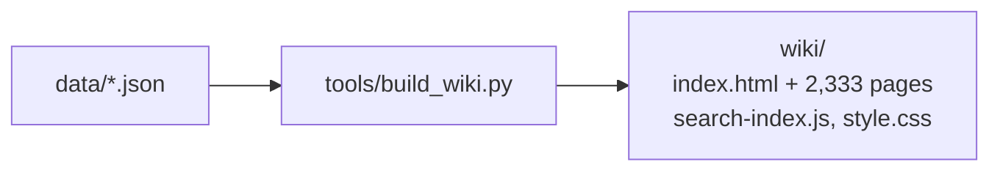

# Slice opening: offline wiki (#4) [Approved]

Date: 2026-11-15. Ruling: 2026-11-15-offline-wiki. The wiki is a tools/ build (never ships), so its internals are the
assistant's call: tools/build_wiki.py (Python, standard library), output committed in wiki/ (Godot skips it).

## Opening

| | Proposal |
|---|---|
| Goal | wiki/ holds a static HTML wiki of the data pack: one page per unit (1,082), move (919), ability (314) and type (18), cross-linked, with search and a sortable unit list, opening from disk with no network |
| Done when | Committed; Jess browses it and closes #4 |

## Pages

| Page | Shows |
|---|---|
| Unit | Name, dex number, types, base stats with total, abilities (hidden marked), defensive type multipliers (from the chart), evolutions with conditions in plain words, evolves-from, transformations (types, stats, abilities), learnset by method and level, learnset game |
| Move | Type, class, power, accuracy, PP, priority, target, effect (marked when it is the in-game description), battle details, every unit that learns it and how |
| Ability | Effect, every unit with it (normal or hidden) |
| Type | Attack row and defence column of the chart, units and moves of that type |
| Index | Search box over every English name; tabs for units, moves, abilities, types; units table sortable by any stat |

## No test suite
Jess, 2026-11-15: a dev-tool HTML build needs no end-goal test. The relations once drafted here were dropped.
Questions 1 and 2 went with the recommendations: no sprites until #6 maps units to sprite sets; transformations
show on their base unit's page.
