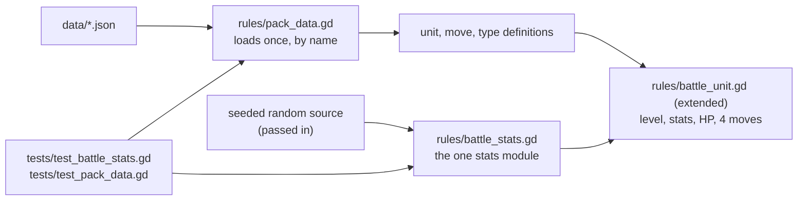

# Slice #5: pack loader and stats module [Approved]

Date: 2026-11-15. Rulings: 2026-11-15-unit-stats-and-moves, 2026-11-15-damage-and-hit, 2026-11-15-data-pack-shape.
Rules side only: no scene, view or data/ changes. Approved by Jess 2026-11-15 with decisions 1 to 3 as
recommended (IVs and EVs 0, last 4 level-up moves, Gen 6 crits).

## Opening

| | Proposal |
|---|---|
| Goal | rules/ can load the data pack once and build a battle-ready unit from any pack unit at a level (stats, types, abilities, 4 moves), and one stats module computes stats, damage, hit and crit by the mainline formulas |
| Done when | The end-goal test passes headless in tools\run-tests.cmd; nothing on screen changes; Jess approves and closes #5 |
| End-goal test | Relations below |

## What gets built

| File | Change |
|---|---|
| rules/pack_data.gd | New. Reads the four pack files once with Godot's JSON parser; looks up units, moves, abilities and types by name; fails loudly on a missing name |
| rules/battle_stats.gd | New, the only place formulas live: battle stats from base stats and level; damage; accuracy check; crit check; type multiplier from the chart |
| rules/battle_unit.gd | Extended: built from a pack unit and a level, it carries its stats, current HP, types, abilities and 4 moves, next to the existing cell and facing |
| tests/test_pack_data.gd, tests/test_battle_stats.gd | New gdUnit4 suites, the relations below |

Random rolls (accuracy, crit) come from a random source the caller passes in, so tests replay a fixed seed.

## Formulas (mainline, per the rulings)

| Piece | Rule |
|---|---|
| Stats | Mainline formula, IVs and EVs counted as 0, neutral nature (until IVs and EVs are designed) |
| Damage | Mainline formula: level, power, attack against defense (physical uses Attack and Defense, special uses the special pair), then same-type bonus 1.5, type multiplier, crit 1.5; no random spread; at least 1 when it is not immune |
| Status moves | Deal no damage (their effects come in later slices) |
| Hit | A move with no accuracy value or 100 always hits; otherwise one roll against its accuracy (reach and environment are #10) |
| Crit | Mainline stage chances: stage 0 is 1 in 24, +1 is 1 in 8, +2 is 1 in 2, +3 always; the stage comes from the move |
| Moves known | The 4 most recently learned level-up moves at or below the unit's level (the mainline wild rule); moves learned on evolution count as learned |

## End-goal test relations

| # | Relation | From |
|---|---|---|
| 1 | Every unit, move, ability and type in the pack loads, and looking up a name not in the pack fails | data-pack-shape |
| 2 | At the same level, a higher base stat never gives a lower battle stat; at a higher level a stat never drops | mainline formula |
| 3 | HP is the larger result for equal base value and level (HP's formula adds level plus 10, the others add 5) | mainline formula |
| 4 | Super effective beats neutral beats not very effective, for the same attacker, move power and defender stats; an immune target takes 0 | type chart |
| 5 | A same-type move does more damage than an otherwise equal other-type move | same-type bonus |
| 6 | A crit does more damage than the same hit without one; a damaging hit that is not immune does at least 1 | damage-and-hit |
| 7 | The same inputs always give the same damage (no random spread) | damage-and-hit |
| 8 | A 100 percent or no-accuracy move hits on every seed tried; a lower-accuracy move both hits and misses across seeds; the same seed gives the same result | damage-and-hit |
| 9 | Every move a built unit knows is a level-up move at or below its level, it knows at most 4, and no level-up move learned later than one it knows is missing | unit-stats-and-moves |
| 10 | A built unit starts at full HP, and its types and abilities are its pack unit's | pack loader |

## Decisions (recommendation first)

| # | Question | Recommendation | Other option |
|---|---|---|---|
| 1 | IVs and EVs until designed | Count both as 0, neutral nature | Perfect IVs (31), as many fan games do |
| 2 | Which 4 moves | The last 4 learned by level, as wild Pokemon in mainline | Hand-picked per unit for M1 |
| 3 | Crit rules | Mainline from Gen 6 on: 1.5 times damage, stage table above | Gen 1 style, based on Speed |

## Risks
- Rounding: mainline floors and rounds at set points inside the damage formula; small differences from the real
  games are possible but do not affect any relation above. Flagged so the wiki or a later calculator check can
  compare.
- Loading 5 MB of JSON takes a moment; it is loaded once per run, not per battle.
