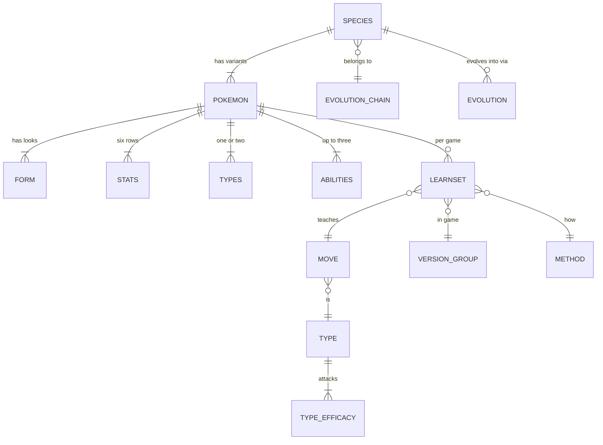
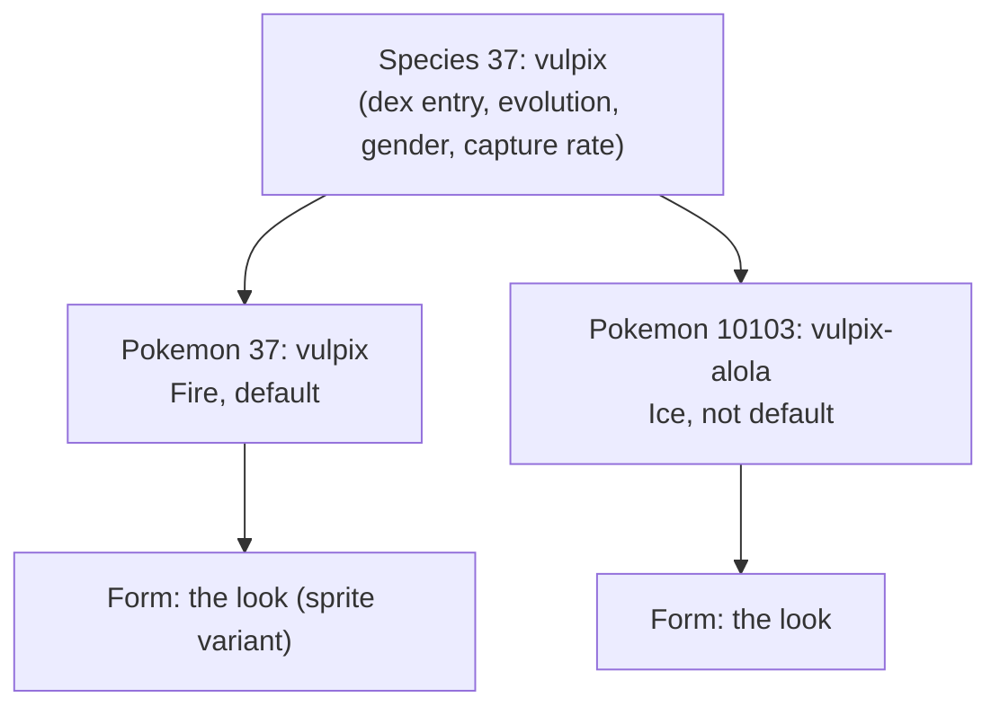
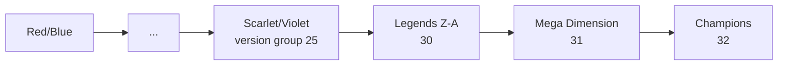
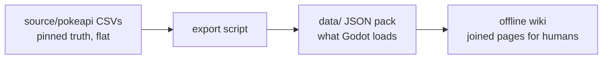
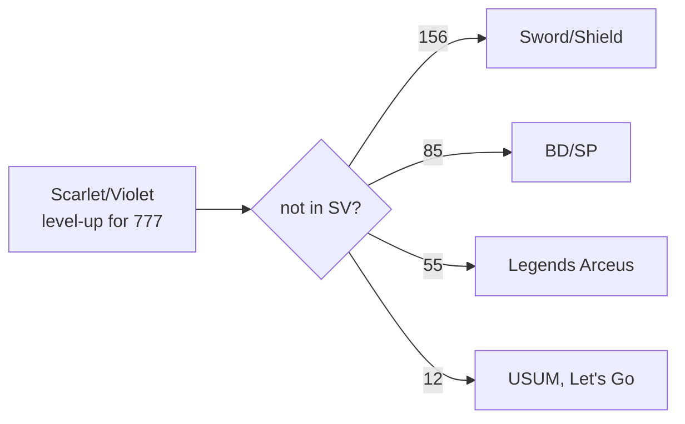
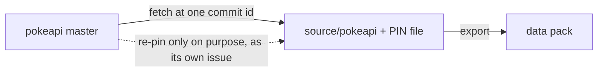

# pokeapi primer (our source of truth)

Read from the fork's local copy (pokesurvivor_fork/pokeapi-master, read only), 2026-11-15. Examples are real rows.

## What it is
- PokeAPI (github.com/PokeAPI/pokeapi) is a public web API. Its whole database ships in the repo as plain CSV files
  under data/v2/csv: 190 files, about 51 MB. We only need the CSVs, never the API server or its Python code.
- License: BSD-style for the project; Pokemon names are Nintendo trademarks. Credit it in CREDITS.md.
- The fork's copy is not pristine: it has extra files the fork owner added (build_dataset.py, peek_csv.py,
  api_dataset.json, validation_report.json) and no commit id. A clean fetch avoids both problems.

## How it is shaped: one fact per table, joined by ids

Names and text live in separate tables (move_names, ability_prose, and so on), one row per language. English is
language id 9.

## Three layers of "a Pokemon"

| Layer | Rows | Holds |
|---|---|---|
| pokemon_species | 1,025 | Identity: dex number, generation, evolution chain, gender rate, legendary flag |
| pokemon | 1,351 (1,025 default plus 326 variants) | Battle facts: stats, types, abilities, moves, height, weight |
| pokemon_forms | 1,579 | Cosmetic and battle-only looks (157 battle-only, 97 Mega) |

Stats, types and moves hang off **pokemon**, not species. That is why Alolan Vulpix can be Ice.

## Time: facts change by game

- Learnsets are stored per version group (game). Vulpix has learnset rows in 25 different games. All learnsets
  together are 638,321 rows.
- pokemon.csv, pokemon_types.csv and type_efficacy.csv hold today's values. The *_past tables hold the old ones (for
  example a Pokemon that was Normal before Fairy existed). We only need today's.

## Worked trace: Vulpix learns Ember and evolves

| Question | Table | Row | Reads as |
|---|---|---|---|
| Base stats? | pokemon_stats | 37,1,38 ... 37,6,65,1 | HP 38, Atk 41, Def 40, SpA 50, SpD 65, Spe 65; 1 Speed EV |
| Type? | pokemon_types | 37,10,1 | slot 1 is type 10, Fire |
| Ember? | moves | 52,ember,...,10,40,25,100 | Fire, power 40, PP 25, accuracy 100, special |
| Ember text? | move_effect_prose (lang 9) | effect 5 | "Has a chance to burn the target." |
| Fire on Grass? | type_efficacy | 10,12,200 | factor 200 means 2x (percent, not decimal) |
| Normal on Ghost? | type_efficacy | 1,8,0 | 0x |
| Evolves? | pokemon_evolution | 25,38,3,...,82 | Ninetales by trigger 3 (use item), item 82 (Fire Stone) |

## Things that surprised me

| Surprise | Why it matters to us |
|---|---|
| type_efficacy is exactly 18 by 18 (324 rows), in percent | Our check reads 0, 50, 100, 200, or we convert |
| types.csv also has 19 stellar, 10001 unknown, 10002 shadow | Not attack types; we leave them out of the chart |
| 12 learn methods, including stadium-surfing-pikachu, xd-shadow, zygarde-cube | We pick which ones a tactics game cares about |
| Prose text is multilingual in one file | Filter to language 9 |
| The copy already has games newer than Scarlet and Violet (30 to 32) | "Latest game" may mean a game with partial data |

## REST API or raw files?

| Way | Pinnable | Offline | Requests | Shape |
|---|---|---|---|---|
| REST at runtime | No | No | Every play | Nested JSON |
| REST once at build time | No (serves latest) | After fetch | Thousands | Nested JSON, heavy duplication |
| PokeAPI/api-data repo (REST responses as static files) | Yes | Yes | One download | Nested JSON, large |
| CSV files at a commit | Yes | Yes | One download | Flat tables, joined by ids |

The REST JSON is generated from these same CSVs, so the facts are identical. Leaning: CSVs for the build; the live
API (pokeapi.co/api/v2/pokemon/vulpix) as a browser for learning and spot checks. Never at runtime (CLAUDE.md
"Scope": local first).

## Three layers from one source

- The wiki is built from the pack, not the CSVs, so it shows exactly what the game sees and a wrong export shows up
  on the page.
- Game code loads the pack, never the CSVs: one Vulpix needs about ten tables joined by id, which belongs in a build
  script, not in the game.
- Decided: static HTML wiki, built from the pack, pages committed (2026-11-15-offline-wiki).

## Learnsets: which game counts (measured on our 1,085 units)

| Game | Learnset rows | Usable as a learnset? |
|---|---|---|
| Legends Z-A, Mega Dimension | 0 | No: listed as games, no move data yet |
| Champions | 19,810 for 319 pokemon, all method "train", no levels | No: a flat move pool, not level-up |
| Scarlet/Violet | 867 pokemon with levels | Yes, covers 777 of our units |
| Older games | Fill the other 308 | Yes, as fallback |

So "latest game" must mean "latest game with level-up data", or a naive script would pick Champions for 222 units.
Every unit gets a level-up learnset this way (0 missing). Legends Arceus has its own move system (mastery), so it may
be better skipped as a fallback (BD/SP then covers those 55).

## Pinning: how stale is the fork's copy?

Compared file by file with upstream master (commit db06b37dca, 2026-11-12):

| Result | Files |
|---|---|
| Identical once Windows line endings (CRLF) are turned back into LF | 169 |
| Really different | 18: mostly names (Chinese name fixes), encounters, and pokemon_abilities.csv |
| Only in the fork's copy | 7 added scripts and JSON files |

So the copy is roughly a mid-October snapshot (16 upstream data commits since 2026-10-01), and it was extracted with
CRLF line endings. Git on this machine also converts LF to CRLF (the commit warnings), so without a .gitattributes
rule the same CSV could hash differently on two machines, which breaks the "rerun gives no diff" check.

## Questions to talk through (one at a time)
1. Answered: a unit is a **pokemon** row (2026-11-15-unit-is-pokemon-variant). Variant scope answered too
   (2026-11-15-variant-scope); Mega and Gigantamax are transformations
   (2026-11-15-mega-gmax-transform).
2. Answered: 2026-11-15-learnset-game.
3. Answered: 2026-11-15-learn-methods.
4. Answered: 2026-11-15-pokeapi-source.
