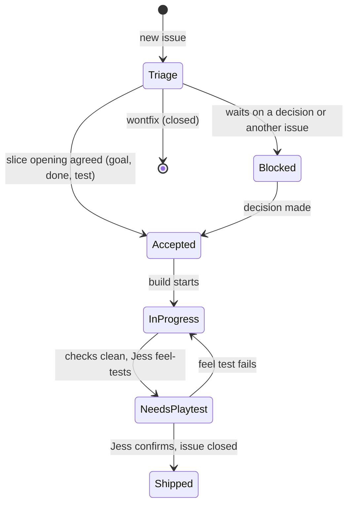
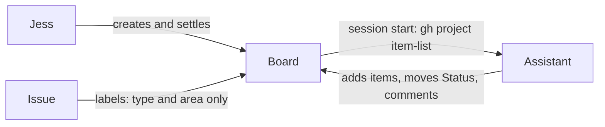

# Project board plan [Approved] (2026-11-15-project-board)

Goal: one board that Jess reads at a glance and the assistant reads and updates through `gh`, with one source of truth
for where each issue stands.

## Issue flow (board Status column)

The column names are the same as PokeSwarm's, so they are already familiar and the triage skill maps onto them with
few edits.

## Who reads and writes what

| Piece | Holds | Set by |
|---|---|---|
| Status (board) | Where the issue stands. The only state field | Assistant moves it, Jess confirms Shipped |
| Waiting on (board, single select: Jess, Assistant) | Who acts next. Drives "what Jess owes" at session start | Assistant |
| Labels: type | slice, decision, bug, chore, docs | Assistant |
| Labels: area | data, combat, ui, tooling (grows as needed) | Assistant |
| Issue body | Goal, done-condition, end-goal test (CLAUDE.md "Slice shape") | Agreed with Jess |

State lives on the board, not in labels (no needs-triage or ready labels), so the two can never disagree.

## Views

| View | Layout | Filter |
|---|---|---|
| Board | Board, grouped by Status | open items |
| Jess owes | Table | Waiting on = Jess |
| Decisions | Table | label: decision |

## Setup steps

| Step | Who | Why |
|---|---|---|
| Keep one project (done: project 3) | Jess | Deleting is Jess-only |
| Rename it PokeTactics, link the poketactics repo | Jess | Project settings are Jess-only |
| Set Status options to the six above, add the Waiting on field | Jess | Field edits are settings |
| Turn on workflows: auto-add repo issues, closed to Shipped | Jess | Settings |
| Create the three views | Jess (UI only) | gh cannot make views |
| Create the type and area labels | Assistant | Allowed (create labels) |
| Name the board in STATE.md and CONTEXT.md, adapt the triage skill | Assistant | Docs edit |

## Decisions (answered 2026-11-15)
1. Keep project 3, renamed PokeTactics.
2. Keep the PokeSwarm column names.
3. Add the Waiting on field.
