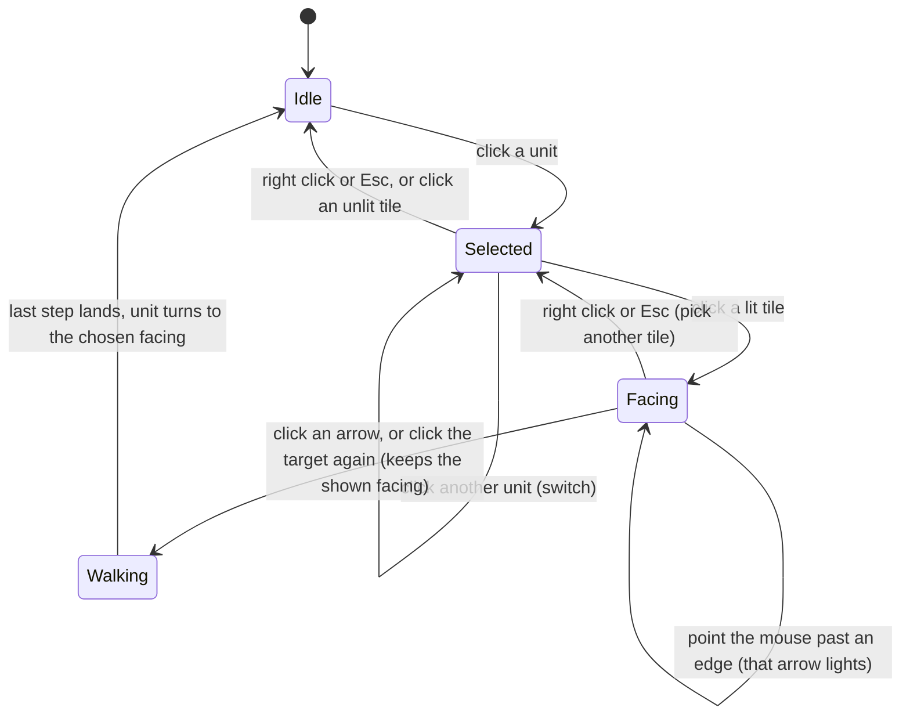
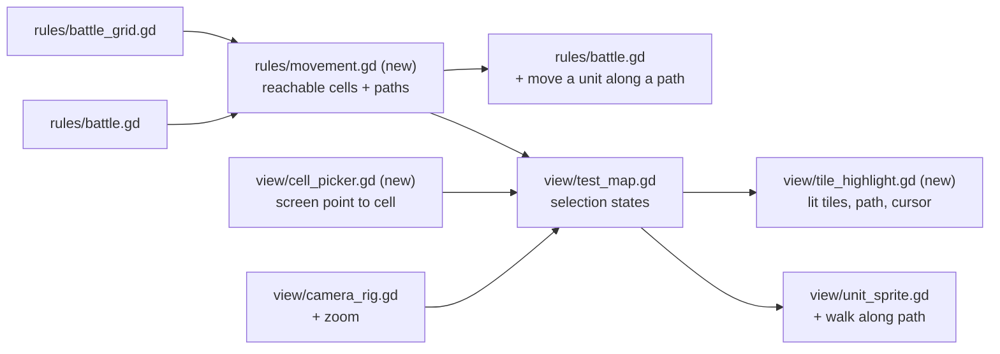

# Slice #7: select and move, camera zoom [Approved]

Date: 2026-11-15. Rulings: 2026-11-15-movement-range (4 steps, climb 1, drop 2), 2026-11-15-base-resolution
(integer scaling). Jess ruled 2026-11-15: zoom in integer steps only (never below 1 sprite pixel per screen pixel).
Pan already shipped in #6.
Approved by Jess 2026-11-15 with decisions 1 to 6 as recommended, plus a facing choice after picking the tile and
before the walk (decision 7).

## Opening

| | Proposal |
|---|---|
| Goal | Click a unit to select it, see every tile it can reach this turn highlighted, hover a tile to see the path, click it, choose which way the unit will face, then watch it walk there along that path; zoom in and out in whole-number steps across the 20 by 20 map |
| Done when | Jess feel-tests selection, highlight, path preview, the walk (flat, climbing, dropping) and zoom in all four rotations; the end-goal test passes; Jess closes #7 |
| End-goal test | Relations below, run headless |

## Flow

## What gets built

| File | Change |
|---|---|
| rules/movement.gd | New, rules only. From a unit's cell: every cell reachable in up to 4 orthogonal steps, where each step climbs at most 1 level and drops at most 2, plus the shortest path to each. Ties between equal paths broken the same way every time |
| rules/battle.gd | Moving a unit along a path to a chosen facing: its cell becomes the last cell, its facing becomes the chosen one |
| view/cell_picker.gd | New: which cell top is under a screen point, worked out from the camera ray and the height map (the map is one mesh with no collision, so no physics picking). Taller cells in front win |
| view/tile_highlight.gd | New: thin flat overlays on cell tops: reachable tiles in one tint, the hovered path in a stronger tint, a cursor outline on the hovered cell; in the facing step, four arrows on the target's edges (the shown one brighter). Pixel-crisp, no shading |
| view/unit_sprite.gd | Plays Walk while moving tile to tile; a step that changes height plays a short hop arc. Facing row follows each step, then turns to the chosen facing on landing |
| view/camera_rig.gd | Zoom with mouse wheel and the + and - keys: 1x, 2x, 3x (1x is today's view). Keeps the same focus, stays inside the map, pan steps stay whole sprite pixels |
| view/test_map.gd | Selection states above; input blocked while a unit walks or the camera turns; hint line updated |
| tests | New relation tests below |

## End-goal test relations

| # | Relation |
|---|---|
| 1 | Every reachable cell is inside the grid and at most 4 orthogonal steps from the start (Manhattan distance 4 or less) |
| 2 | On flat open ground, the reachable cells are exactly the cells within Manhattan distance 4, minus the start |
| 3 | Every path starts next to the unit, ends on its target, is at most 4 steps, and each step goes to an orthogonal neighbour |
| 4 | No step in any path climbs more than 1 level or drops more than 2 |
| 5 | A cell walled off by a 2 level rise on every side is not reachable; the same cell with one 1 level ledge is |
| 6 | No path ends on, or (per decision 2) passes through, a blocked cell |
| 7 | After moving, the unit stands on the target and faces the chosen direction, for each of the 4 directions; every other unit is unchanged |
| 7b | The facing offered first is the direction of the path's last step |
| 8 | The cell picker returns the cell whose top is drawn under a point: the top centre of every cell, projected to the screen in all four rotations and at every zoom, picks back that cell |
| 9 | Zoom never goes below 1x or above 3x, each level is a whole-number multiple of 1x, and zooming keeps the focus inside the map on the sprite pixel grid |

## Decisions (recommendation first)

| # | Question | Recommendation | Other option |
|---|---|---|---|
| 1 | Who can be moved in #7 (turn order arrives in #8) | Any unit, either side, as often as you like: a test harness for movement | Only your 4 units |
| 2 | Moving past other units | Walk through allies, enemies block, never stop on any unit (FFT style) | Every unit blocks |
| 3 | Input | Mouse only for #7 (hover, left click, right click or Esc cancels); a keyboard or gamepad cursor later | Also a keyboard cursor now |
| 4 | Walk speed | About 0.2 s per tile, hop arc on any height change | Faster or slower, by feel |
| 5 | Zoom range | 1x to 3x; mouse wheel and + / - | 1x to 2x only |
| 6 | Camera during a walk | Stays put (you pan if needed) | Follows the walker |
| 7 | Facing (Jess) | Chosen after the tile, before the walk; 4 grid directions; the first one shown is the last step's direction | |

## Risks
- Picking from the camera ray against stacked cell tops is the fiddliest part; relation 8 checks it in every
  rotation and zoom, so a miss shows up in tests and not only by feel.
- At 2x and 3x the visible area shrinks to a half and a third, so panning matters more; pan speed stays in screen
  pixels so it feels the same.
- The overlays sit a hair above cell tops; sprites already lean toward the camera (#6), so they stay drawn over
  the highlight. Feel test checks this on the hill.
- Walk and Hop animations exist in the packed sets checked; a set missing Walk falls back to Idle, never crashes.
