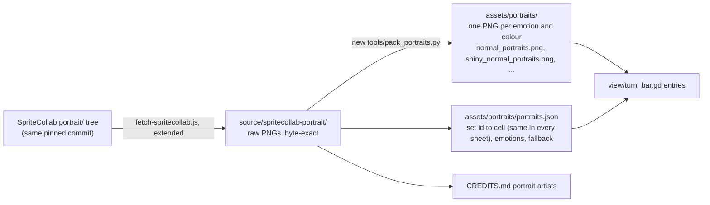

# #16 opening and plan: 6 a side with portraits [Proposed]

Date: 2026-11-16. Issue: #16. Rulings: 2026-11-16-party-and-battles, 2026-11-15-sprite-sources.
Scope grew from the draft: portraits in the turn bar are added (Jess, 2026-11-16).

## Goal
The test battle fields 6 player units against an enemy count set by encounter kind (wild 2 to 4, trainer 3 to 6,
boss 6), and the turn bar shows each unit's Normal portrait from SpriteCollab, packed as one sheet per species.

## Done when
- Jess feel-tests all three encounter kinds: start zones, the bar with up to 12 units, portraits reading clearly.
- The end-goal test passes headless via `tools\run-tests.cmd`, including the portrait pack rerun check.
- CREDITS lists portrait artists. Committed; Jess closes #16.

## End-goal test (relations)
| # | Relation |
|---|---|
| 1 | The player side always has 6 units; each encounter kind's enemy count falls inside its range |
| 2 | The same seed gives the same enemy count and roster; every count in a range is reachable by some seed |
| 3 | No two units share a start cell; every start cell is inside the map and walkable |
| 4 | Every unit and transformation in the pack resolves to a portrait (its own, or a fallback named in the index) |
| 5 | Every cell in the index lies inside every sheet; all sheets share one size; a shiny set never resolves to a non-shiny portrait when its own exists |
| 6 | Re-running the portrait packer gives byte-identical files |
| 7 | With 12 units the turn bar's entries all sit inside the 640x360 screen |

## Plan

1. **Fetch (tools/, direct edit).** fetch-spritecollab.js gains a portrait pass over the same set scope as sprites
   (normal, mainline forms, shiny of each) at the same pinned commit, with the same blob-hash check, into
   source/spritecollab-portrait/ (under source/, which Godot ignores). Every emotion is fetched, including flipped
   (`^`) and Special ones: about 30,600 files over 2,377 sets. Portrait credits go into CREDITS.md.
2. **Pack (new tools/pack_portraits.py, deterministic).** One sheet per emotion and colour (Jess, 2026-11-16):
   `normal_portraits.png` holds the Normal portrait of every non-shiny set (each species and form),
   `shiny_normal_portraits.png` the same cells for the shiny sets, and so on for every emotion, the flipped ones
   (`normal_flipped_portraits.png`) and the Specials: about 80 sheets, about 160 files with Godot's .import
   files. Cells are 40x40 in a grid of about 35 by 35 (about 1,400 px square), ordered by dex number then form.
   A set has the same cell in every sheet, so emotion and colour only pick the file. Missing cells stay
   transparent. One portraits.json maps each sprite set id to its cell, the emotions it has, and its fallback
   (own form's normal colours, then the species' normal, then a generic placeholder portrait).
3. **Turn bar (game code).** Each entry draws the unit's Normal portrait instead of the idle-frame crop; the side
   colour frame, HP sliver, hover and click stay.
4. **Test setup (game code).** rules/test_battle_setup.gd: 6 player units, an enemy pool, three encounter kinds;
   the seed picks the enemy count and roster. Number keys 1, 2, 3 restart the test battle as wild, trainer or
   boss. Start zones grow to 6 cells a side.
5. **Tests.** The seven relations above in a new gdUnit4 suite; tools\run-tests.cmd also runs the portrait
   packer's check like the sprite and data checks.

## Decisions needed
| # | Question | Recommendation |
|---|---|---|
| 1 | Portrait size in the bar: the active entry is 40 px (native) but others are 30 px, and scaling 40 to 30 with nearest filtering looks ragged | Active entry 40 px native; others show a centred 30x30 crop of the portrait (no scaling, stays crisp) |
| 2 | Fetch every emotion now (about 30,600 raw files, an estimated 40 to 80 MB in plain git), or only Normal and Normal^ now (about 2,800) and the rest later | Every emotion now, as you asked, so the packer never needs a second fetch; small next to the 831 MB of raw sprites |
| 3 | Player roster (Kanto, first build) | Charmander, Squirtle, Bulbasaur, Pikachu, Eevee, Machop |
| 4 | Enemy pool | Vulpix, Alolan Vulpix, Geodude, Gastly, Oddish, Mankey |

## Risks
- Repo size and file count: 30,600 raw files is many, though small next to source/spritecollab (831 MB today).
  Mitigation if git gets slow: keep raw portraits out of git and record only the pinned commit plus hashes
  (needs Jess's call).
- Upstream gaps: some sets have Normal only; the fallback chain covers them, and test 4 catches holes.
- The turn bar's 8 entries at 40 and 30 px already fit 360 px; 12 units do not change the entry count (the bar
  forecasts 8 turns), so test 7 guards the layout rather than forcing a redesign.
