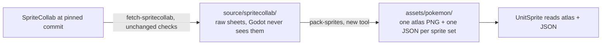

# Plan: pack sprites so Godot sees about 6,500 files, not 188,000 [Approved, built 2026-11-15]

2026-11-15, part of issue #1 (its feel test failed on editor speed). Words only. Nothing is built until Jess agrees.

## Why
Measured: the editor spends 20 seconds just checking files on open (headless, the real window is slower), and the
whole editor lags (focus, clicks, dragging) because it tracks 188,079 files under assets/ (96k sprite files plus
92k .import files) and a 619 MB import cache. The game itself launches in under a second.

## Shape: raw in, packed out (same pattern as pokeapi)

| | Now | After |
|---|---|---|
| Files Godot tracks under assets/pokemon | 188,079 | about 6,500 (2,151 atlases, 2,151 JSON, 2,151 .import) |
| Files per unit the game loads | up to about 180 sheets | 1 atlas + 1 JSON |
| Offsets and Shadow sheets | images | numbers in the JSON (feet point, effect anchors per frame) |

## Steps

| # | What | Where | Choices |
|---|---|---|---|
| 1 | Raw sprites move out of Godot's view | assets/pokemon/ moves to source/spritecollab/ (source/ already has .gdignore). The 92k .import files are deleted. Done with plain file moves plus `git add` (no git mv, which is Jess-only) | The fetch script writes there from now on; provenance note and sprite CREDITS move with it, and CREDITS.md links follow |
| 2 | New pack tool | tools/pack-sprites, run by Godot headless, using Godot's own image functions (no new dependency) | One sheet per sprite set (Charmander, shiny Charmander, Mega Charizard X each get one): every fetched animation's Anim sheet, shelf-packed 4096 wide, or 8192 when one animation is wider, never over 8192 tall. Simulated on all 2,151 sets: 2,145 fit 4096 by 4096, all fit 8192 by 8192 (the big six: Rayquaza, Mega Rayquaza, Mega Zygarde and their shinies) |
| 3 | The JSON per set | next to its atlas, flat names like 0037-0001.json (dex, form, shiny) | Per animation: where it sits in the atlas, frame size, frame count, durations, hit frame, return frame, CopyOf resolved, feet point from the Shadow sheet, anchor points from the Offsets sheet by marker colour |
| 4 | UnitSprite reads the pack | view/unit_sprite.gd, view/anim_data.gd | Draws a region of the atlas instead of a whole sheet; the feet point comes from the JSON, not from reading pixels at run time |
| 5 | Tests | tests/ | Relation 4 widens from 5 sample sets to all 2,151: every packed animation is 8 rows of its frame height, frames match durations, every sheet fits 8192 by 8192. New: every raw set has a packed set; packing twice gives identical files |
| 6 | Defender (Jess) | Windows Security exclusion for C:\dev\PokeTactics | Optional, helps file-heavy tools |

## Decisions (Jess, 2026-11-15)
1. Raw sprites stay in git under source/spritecollab/ (near 1 GB with the sheets).
2. One sheet per sprite set, up to 8192 pixels, no exceptions.
3. The branch is squash-merged into main, so the 92k .import files in commit 12538469e never reach main's history.

## What changed while building
| Planned | Built | Why |
|---|---|---|
| Pack tool runs in Godot headless | tools/pack_sprites.py (Python with Pillow and numpy) | Reading the marker pixels means about 10 billion pixel visits; Godot script would take hours, numpy takes minutes |
| Every animation has 8 rows | 8 rows, or 1 row for animations drawn the same for every facing (5,122 of 30,629) | That is how SpriteCollab draws them; JSON carries "rows" |
| Sheets saved full colour (567 MB) | Palette PNG when 256 colours or fewer (about 16 in practice), about 250 MB | Lossless; every save is read back and compared pixel by pixel |
| Feet from the Shadow sheet | The single white pixel per frame | Shadow sheets mark the centre white; coloured blobs show shadow size |
| | Project import default: textures never switch to compressed 3D formats | Godot recompresses textures used in 3D by default, which would blur pixel art |

Packing twice gave byte-identical output (all 4,303 files compared).

## Risks
- A future set bigger than 8192: the tool stops and names it rather than writing a bad sheet; the test checks sizes.
- Memory: a typical sheet is about 2048 by 1856 (about 15 MB of video memory); the big six about 4096 by 4900.
  Trimming the empty space around frames could shrink this a lot later; not in this change.
- Offsets marker colours are read, not yet named (head, hands, centre); naming waits until effects need them.
- About 250 MB more in git with raw kept (decision 1).
- Shipping: the sprite credits live in source/spritecollab/, which the game does not include. The first export
  slice must ship them (CC BY-NC needs the credits with the game).
