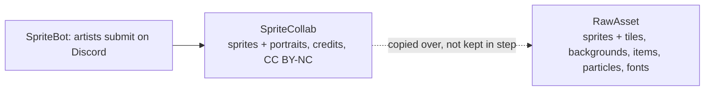
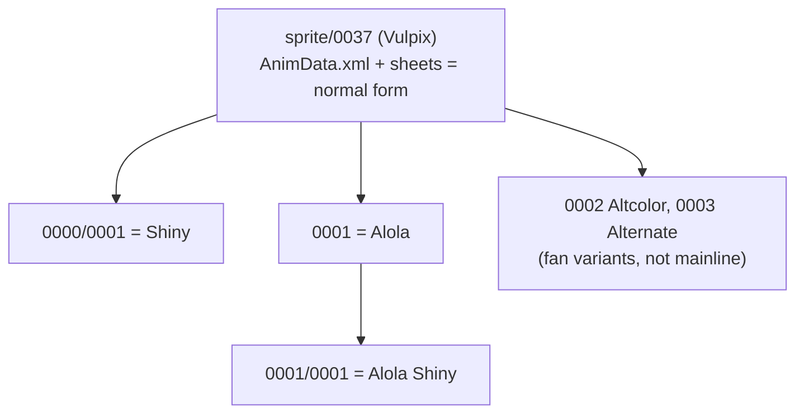

# Sprites primer: RawAsset or SpriteCollab

Read with gh (read only), 2026-11-15. Both repos belong to PMDCollab, the Pokemon Mystery Dungeon fan art community.

| | SpriteCollab | RawAsset |
|---|---|---|
| What | The community sprite and portrait library | Raw assets for the PMDCollab fan game: sprites plus tiles, backgrounds, items, icons, objects, particles, fonts |
| Pokemon sprite folders | 988 | 948 |
| Last updated | 2026-11-15 (today, active) | 2025-09-05 (over a year old) |
| License | CC BY-NC 4.0 stated in the README, per-sprite credits.txt | No license file; spritebot_credits.txt lists artists |
| Per species | AnimData.xml plus about 40 animations, each as Anim, Offsets and Shadow sheets | Same format |
| Tiles | None | 24x24 dungeon tilesets (21), 8x8 |

Both include original Chunsoft (the PMD developer) sprites alongside community work, credited as CHUNSOFT.

Correction to the old data transfer plan: species have about 40 animations, not 8 (Idle, Walk, Attack, Hurt,
Sleep, Hop, Swing, Rotate, Pose and more), each with three sheets.

Decided: Pokemon sprites from SpriteCollab, RawAsset later for the rest (2026-11-15-sprite-sources).

## How SpriteCollab is laid out (measured at commit 2f5d22b505, 2026-11-15)

- Folder = dex number, then form, then shiny. tracker.json names every folder (Alola, Mega, Gigantamax, Shiny and so
  on) and marks it complete or not.
- Whole sprite folder: 175,239 files, about 1,031 MB, in 3,348 sprite sets (forms, shinies, fan altcolors,
  cutscene and beta variants included). We need only the sets that match our units and transformations.

## Animations: a core every Pokemon has, then a long tail

| Group | Animations | Sprite sets that have it (of 3,348) |
|---|---|---|
| Core | Rotate, Idle, Walk, Swing, Double, Sleep, Attack, Charge, Hop, Hurt | 3,287 to 3,348 (98 to 100 percent) |
| Nearly core | Shoot | 2,809 (84 percent) |
| Tail | Faint, Eat, Pose, Nod, Laying, Float, Tumble, Pain and about 20 more | about 700 each (about 22 percent) |
| Rare | Strike, SpAttack, Hover, Special0 and others (99 kinds in all) | under 550 |

Faint is in the tail: only about 1 in 5 sprite sets has it, so the game cannot rely on it.

| Size (all 3,348 sets) | MB |
|---|---|
| Everything | 1,031 |
| No shinies | 552 |
| Core 11 only | 836 |
| Core 11, no shinies | 447 |

Our units are a subset of these sets, so our real numbers are smaller; the exact count comes with the mapping from
pokeapi variants to SpriteCollab folders.

## Animation set: core plus tactics extras (proposed, from names only)

Jess, 2026-11-15: no flavor animations (Eat, Tumble, Pose, Nod); keep any animation a tactics game can use, such as
Hover for Spearow. So: fetch the core 11 for every unit, plus each tactics extra the unit happens to have. The game
always has the core; an extra plays when present, otherwise a core fallback.

Two findings from AnimData.xml: animations can be aliases (`CopyOf`, for example Spearow's Swing copies Attack), and
attacks carry a `HitFrame` (the frame where the hit lands), which a tactics game can time damage numbers and
knockback to. Flying idles are inconsistent: Spearow has Hover, Pidgey has Float and FlapAround instead.

| Use in tactics | Animations (sprite sets that have it) | Fallback |
|---|---|---|
| Core, always | Idle, Walk, Rotate (turn to face), Attack, Swing, Double, Shoot, Charge, Hop, Hurt, Sleep | none needed (Shoot 84 percent: Attack) |
| Flying or floating idle | Hover 176, Float 731, FlapAround 94 | Idle |
| Knocked out | Faint 732, Fainted 68 | Hurt, then fade |
| Flinch, stagger, knockback | Cringe 874, Pain 717, LostBalance 693, Trip 688, Tumble 704, TumbleBack 702, HitGround 689, Injured 18 | Hurt |
| Guard | Withdraw 158 | Idle |
| Sleep status | EventSleep 750, Wake 719, Laying 733 | Sleep |
| Melee variants | Strike 543, QuickStrike 247, MultiStrike 104, Slam 72, Bite 69, MultiScratch 67, Punch 59, Kick 45, Jab 45, Stomp 40, Scratch 36, Slice 16, Chop 3, Uppercut 2, Slap 5, Lick 9, TailWhip 37 | Attack |
| Ranged or special variants | SpAttack 243, Emit 136, Shock 65, Gas 7, Roar 17, Ricochet 22, Rumble 20, Swell 48, Shake 145 | Shoot or Charge |
| Movement variants | LeapForth 697, Jump 20, DigIn 10, DigOut 12, Sink 693 | Hop or Walk |
| Leave out (flavor, cutscene) | Eat, Pose, Nod, Sit, Head, LookUp, Pull, DeepBreath, Dance, Bow, Wave, Sing, Cry, Yawn, Appeal, StandingUp, Twirl, Wiggle, RaiseArms, CarefulWalk | not fetched |
| Unknown | Special0 to Special26 (species-specific, unlabeled, 2 to 197 each) | look before deciding |

Meanings are read from names; a viewer page (or the wiki) would let Jess check by eye before the list is final.

## Questions to talk through (one at a time)
1. Answered: core plus tactics extras (2026-11-15-animation-set); Special0 to Special26 wait for a look.
2. Answered (Jess, 2026-11-15): shinies included now. All three sheets (Anim, Offsets, Shadow) kept; plain git.
3. Portraits (face images with emotions, a separate folder): now, or later with dialogue and UI?
4. Missing sprites: a unit with no SpriteCollab sprite (for example 2 of the 4 Paldea forms) falls back to what?
