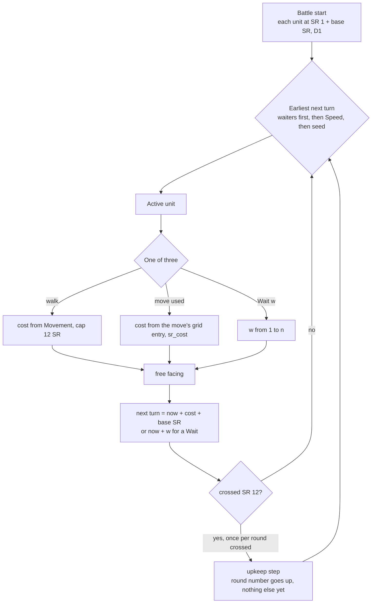
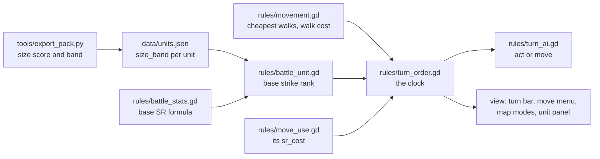

# Strike rank clock, build plan (#13)

Rulings: 2026-11-16-strike-rank-clock, 2026-11-17-size-bands, 2026-11-17-wait-action, 2026-11-17-elevation-cost,
2026-11-16-act-cost. Grilling: strike-rank-size-bands.md. Checked against the coding-principles skill.

## As built (Jess approved, feel test passed 2026-11-17)
- The AI waits 1 SR as a fallback when it can neither attack nor close in (wait-action ruling updated).
- Space or the menu row opens Wait (W and the arrows already pan); the wheel or + and - set its length.
- The bar shows the next 8 turns (12 do not fit at the current entry size).
- Relation 7 reads: a climb costs at least the same drop, and more from 2 levels (1 level up or down both cost 2).
- Move rows show their SR cost. Row 4 of Jess's walk table cannot happen on the grid (climb 1 per step); its cost is
  measured directly.

## Opening (agreed 2026-11-17)

| Item | Content |
|---|---|
| Goal | The strike rank clock replaces Speed order: base SR 0 to 4 from size plus a Speed nudge; a turn is a move, an act or a Wait, with the agreed costs; 12 SR rounds with an upkeep step; the turn bar becomes a forecast with a landing preview. |
| Done when | The relation tests below pass headless, the AI and hotseat play full battles, Jess feel-tests the flow and the bar. |
| End-goal test | tests/test_strike_rank.gd, the 10 relations below plus Jess's 5 walk rows. |

## Decisions needed before the build

| # | Question | Recommendation | Why it comes up |
|---|---|---|---|
| D1 | Rounds run SR 1 to 12, so where does a base 0 unit start? | Start at SR 1 + base SR (smallest at SR 1, largest at SR 5); later turns use the formula as ruled. | The ruling says "start at base SR", and SR 0 does not exist. |
| D2 | Does the Speed nudge read the species' base Speed or the unit's Speed at its level? | Base Speed (a species fact, like size). | The thresholds 100 and 40 are base-stat sized; level-30 Speeds are different numbers. |
| D3 | The forecast can only know each unit's next turn (later ones depend on the action taken). What does the bar show? | Each standing unit's next turn in order (12 at 6 a side), each with its SR, a round divider, and a ghost of the active unit at its landing SR. | "The next 12 turns" would need guessed costs. |
| D4 | My exact segment rule: a new segment starts where the walk starts, and at each step that changes height after a flat step or after the opposite change. Each segment costs round up(tiles / 2) + climb levels + round up(drop levels / 2). Flat tiles after a change stay in that segment. | Accept. It gives all 5 of Jess's rows and stairs as one segment. | The rows and the stairs answer need one rule that covers both. |
| D5 | How does the walk picker show cost? | The hovered cell shows its SR cost by the cursor, and the bar ghost moves to match; no number on every cell. | A number on every reachable cell (up to 12 SR away) clutters the map. |
| D6 | How does a player Wait, and what does Space do now? | W or Space opens Wait: mouse wheel or arrow keys pick w (1 to n), the ghost shows the landing, click or Enter confirms, then facing. No free "end turn" without an action. | A turn is now always exactly one of three things. |
| D7 | view/test_map.gd is 674 lines; #13 adds a Wait mode and cost display. Split it first? | No (Jess). | Length alone is not a reason to split; the map script holds one job (running the battle on screen), and Wait and cost display belong to it. |

Answers (Jess, 2026-11-17): D1, D3, D4, D6 yes. D2: Speed at the unit's level, compared with the Speed a base
100 or base 40 species has at the same level (the same stat formula), so the nudge holds at any level. D5: hover
label. D7: no split.

## Flow of a turn after the change

## Parts

### P1. Size band in the pack (tools/export_pack.py, data/units.json)
- Reuses: the existing unit export, its height and weight fields, the --check run and the pack README.
- New: each unit gains size_band (0 to 4). The script ranks default species by the size score and cuts at 10, 30,
  70 and 90%; forms are placed against those cutoffs. A README line explains the field.
- Where: the export owns it, since the ruling says cutoffs come from the pack and data/ is generated, never hand-set.
- Size: export_pack.py grows by about 30 lines; units.json gains one field per unit.

### P2. Base strike rank (rules/battle_stats.gd, rules/battle_unit.gd)
- Reuses: BattleStats as the home of every formula; BattleUnit.from_pack.
- New: one formula in BattleStats (base SR from size band and base Speed, with named consts for 100, 40 and the 0
  to 4 range). BattleUnit gains a base strike rank set in from_pack (a bare test unit defaults to the middle band).
- Not built: any per-species override table (no user yet).

### P3. Walk cost (rules/movement.gd)
- Reuses: can_step (climb 1, drop 2), Facing.ALL_DIRECTIONS order for determinism, last_step_facing.
- New: a walk cost function for a path (the D4 rule), and reachable_paths becomes a cheapest-cost search capped at
  12 SR that returns each cell's path and its cost. The 4-step limit goes.
- Risk: costs are rounded per segment, so the search state carries the open segment's kind and its odd or even
  counts. Ties resolve in direction order so the same board gives the same paths.

### P4. The clock (rules/turn_order.gd)
- Reuses: the seeded tiebreak drawn once per unit, the fainted-unit handling, Battle.settle_rout, Slot for the bar.
- Changes: rounds of "everyone once" are replaced by a clock position and a next-turn SR per unit. The active unit
  takes exactly one of walk, move use or Wait; end_turn applies the facing, schedules the next turn and runs the
  upkeep step once for every round boundary crossed. A Wait marks the unit to go first on its landing SR.
- New: Wait and its limit, the current SR, each unit's next turn (for the panel), and a landing preview for a cost.
  Forecast slots gain the SR.
- Separation: the AI, hotseat and tests drive it through the same calls the player uses.

### P5. AI (rules/turn_ai.gd)
- Reuses: the scorer, _approach and the nearest-foe search as they are.
- Changes: attacks are scored from the unit's own cell only; if none scores above 0 it walks toward the nearest
  foe. Equally close cells go to the cheaper walk. Choice holds a walk or a move, never both.
- Not built: weighing SR cost, choosing Wait (#23).

### P6. View (view/turn_bar.gd, move_menu.gd, test_map.gd, unit_panel.gd, tile_highlight.gd)
- Reuses: the bar's entry and divider drawing, the move menu rows, the map's modes and the hotseat handover.
- New: the SR on each bar entry and the landing ghost (D3); a Wait row in the move menu and a Wait mode on the map
  (D6); the hovered cell's cost (D5); size band, base SR and next turn in the unit panel. After any one action
  the map goes straight to choosing facing. The turn label shows the SR next to the round.

### P7. Tests
New suite tests/test_strike_rank.gd, relations only:

| Relation | Source |
|---|---|
| A cheaper action brings the next turn sooner | strike-rank-clock |
| A larger size score never gives a smaller size band | size-bands |
| Band shares across default species are 10/20/40/20/10% within rounding | size-bands |
| Higher base Speed never gives a later turn, all else equal | size-bands |
| A Wait of w lands exactly w later and goes before non-waiters on that SR | wait-action |
| Every action lands strictly later than now | wait-action, size-bands |
| A climb costs at least the same drop, and more from 2 levels | elevation-cost |
| A stair run costs no more than the same steps split into segments | elevation-cost |
| Upkeep runs exactly once per round boundary, also for a round no unit lands in | strike-rank-clock |
| The same seed and actions give the same order | CLAUDE.md scope |
| Jess's 5 worked walk rows give their SR | elevation-cost (Jess's own numbers) |

Existing suites that assume a move plus an act per turn, 4 steps or Speed rounds are updated to the new rules:
test_turn_order, test_select_and_move, test_enemy_turn, test_use_a_move, test_hotseat, test_six_a_side,
test_win_lose. Their relations stay; only the setup changes (for example, a walk and a move use become two turns).

## Not built in #13

| Left out | Where it goes |
|---|---|
| Terrain costs per tile | #21 |
| Push and its 2 SR flat cost, fall damage | #19 |
| Priority moves beating a Wait | M2b (#24) |
| The PP band formula (sr_cost stays 3 to 6 placeholders) | tuning, 2026-11-16-act-cost |
| AI cost weighing and AI Wait | #23 |
| Anything upkeep does (status, weather, tile spread) | M2b and #21 |
| Save data | none touched |

## Risks
- The clock rewrite touches 7 test suites; I update their setup, never their expected relations.
- Feel: walking is cheap next to moves (4 tiles is 2 SR, a move 3 to 6), so units may kite. The feel test decides;
  act costs are the knob.
- test_map.gd grows by the Wait mode and cost display; no split (D7), since it keeps one job.

## Touched-code cleanups
- Header comments in movement.gd, turn_order.gd and turn_ai.gd name the rules they no longer follow (4 steps,
  move and act per turn); they get the new ruling names.
