# Strike rank size bands (#13 grilling)

Chosen (2026-11-17-size-bands): Option 3, one combined size score ranked 10 / 20 / 40 / 20 / 10%, as base SR
0 to 4 (Options 1 and 2 below are the road there; their SR numbers use the earlier 1 to 5 scale).

Idea (Jess, 2026-11-17): the middle of the curve is base SR 3, and each standard deviation (SD) either way moves
it by 1. Population: the 1,025 default species in data/units.json; forms use their own height and weight.

## The idea

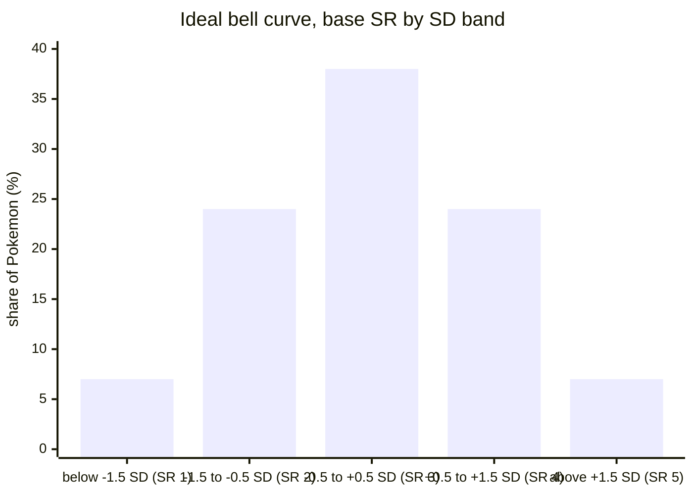

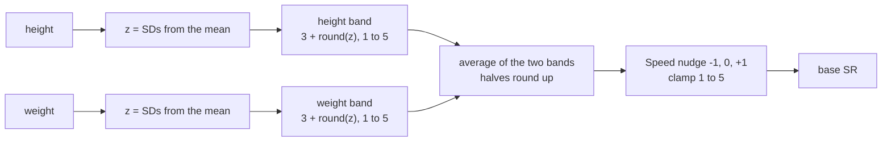

## Problem: raw sizes are lopsided

A few giants (Eternatus 20 m, Groudon 950 kg) stretch the SD, so on raw meters and kilograms nothing lands
below -1.5 SD and SR 1 is empty. Counts per half SD, from -3 to +3:

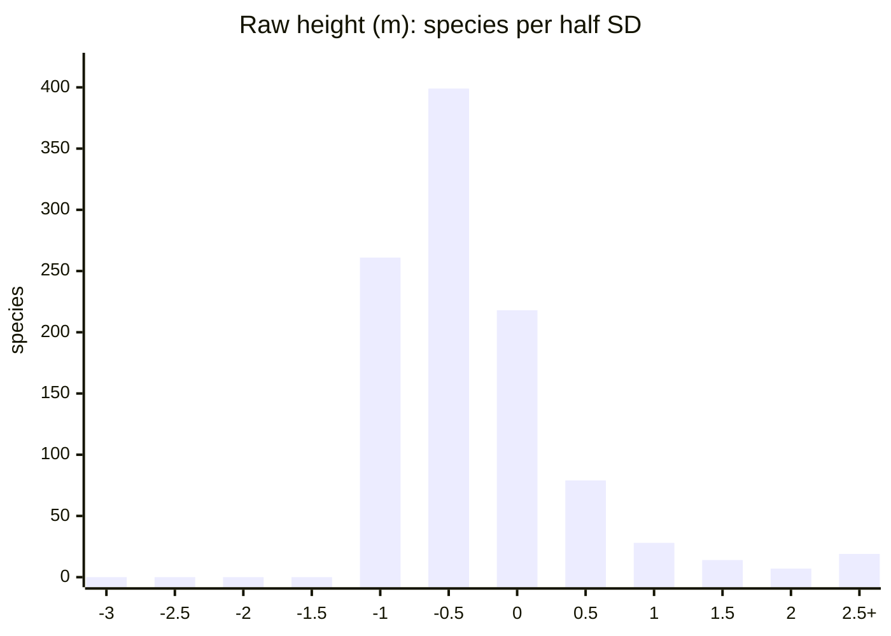

## Fix: measure SDs on a log scale

On a log scale (each step is "twice as tall" rather than "+1 m"), sizes form a near bell curve and every band
fills. Height: mean 0.91 m, 1 SD is x2.1. Weight: mean 23 kg, 1 SD is x5.

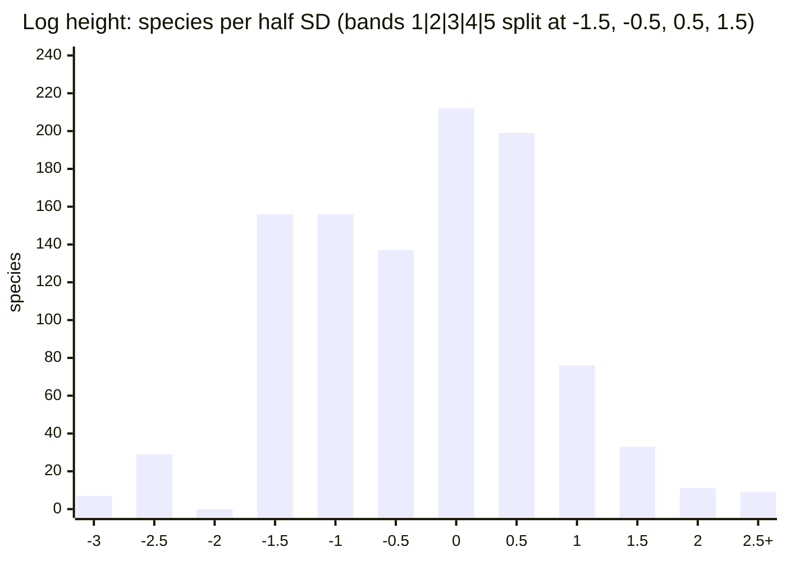

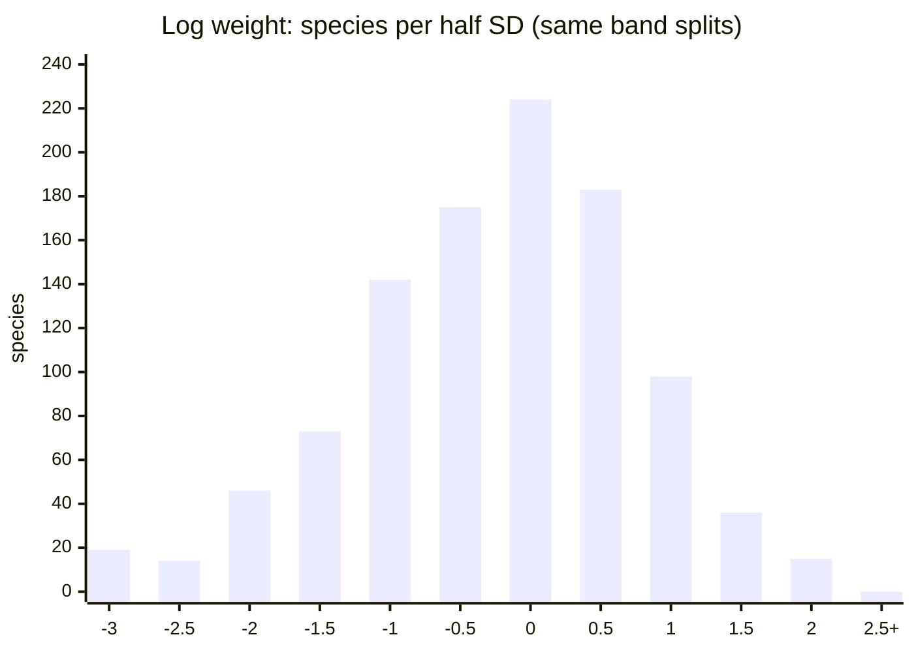

| Band (base SR before Speed) | Height cutoff | Weight cutoff |
|---|---|---|
| 1 | under 0.30 m | under 2.1 kg |
| 2 | 0.30 to 0.63 m | 2.1 to 10 kg |
| 3 | 0.63 to 1.32 m | 10 to 52 kg |
| 4 | 1.32 to 2.78 m | 52 to 261 kg |
| 5 | over 2.78 m | over 261 kg |

## Result for all 1,025 species (log scale, before the Speed nudge)

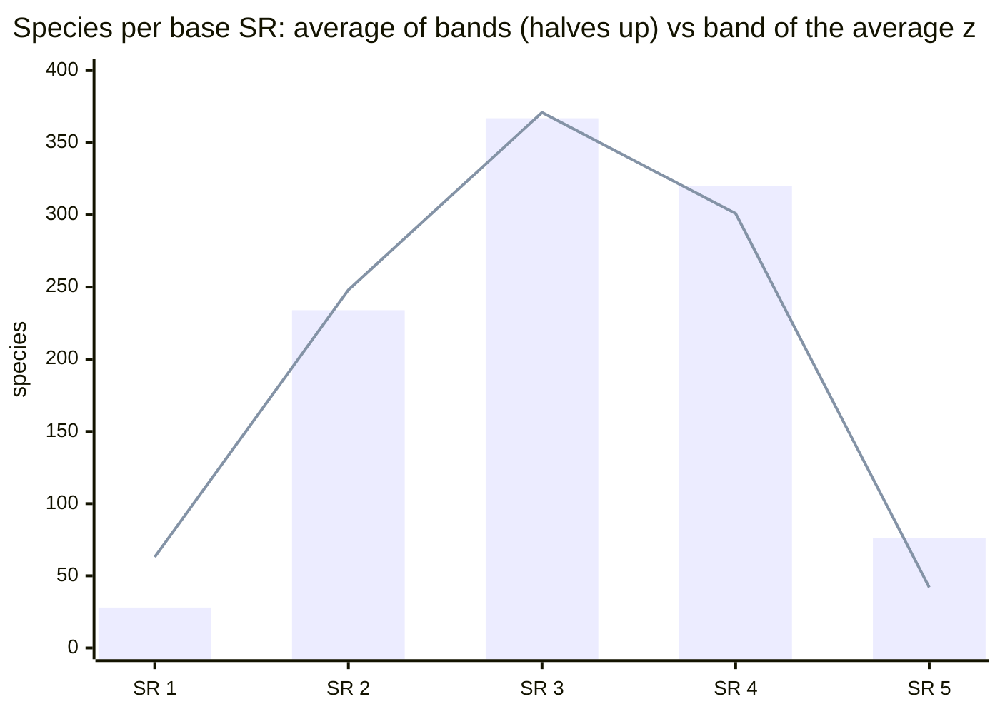

Bars: average of the two bands, halves round up (round 2 answer). Line: average the two z scores first, then band.

| Pokemon | Height, weight | Height band | Weight band | Average of bands | Band of average z |
|---|---|---|---|---|---|
| Joltik | 0.1 m, 0.6 kg | 1 | 1 | 1 | 1 |
| Pikachu | 0.4 m, 6 kg | 2 | 2 | 2 | 2 |
| Bulbasaur | 0.7 m, 6.9 kg | 3 | 2 | 3 | 2 |
| Gengar | 1.5 m, 40.5 kg | 4 | 3 | 4 | 4 |
| Charizard | 1.7 m, 90.5 kg | 4 | 4 | 4 | 4 |
| Snorlax | 2.1 m, 460 kg | 4 | 5 | 5 | 4 |
| Onix | 8.8 m, 210 kg | 5 | 4 | 5 | 5 |
| Wailord | 14.5 m, 398 kg | 5 | 5 | 5 | 5 |
| Cosmoem | 0.1 m, 999.9 kg | 1 | 5 | 3 | 3 |

## Option 2: whole SDs, capped at plus or minus 2 (Jess, 2026-11-17)

Log scale; band = 3 + the SD count rounded toward the mean (so anything within 1 SD is SR 3), capped at 1 and 5.

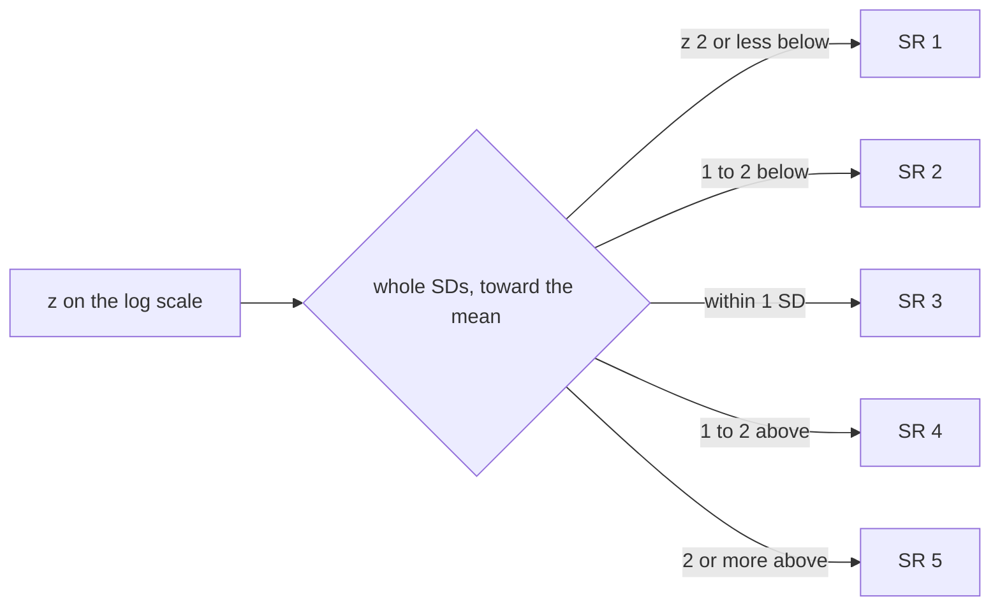

| Band | Height cutoff | Weight cutoff |
|---|---|---|
| 1 | 0.21 m or less | 0.94 kg or less |
| 2 | 0.21 to 0.43 m | 0.94 to 4.7 kg |
| 3 | 0.43 to 1.92 m | 4.7 to 117 kg |
| 4 | 1.92 to 4.03 m | 117 to 583 kg |
| 5 | 4.03 m or more | 583 kg or more |

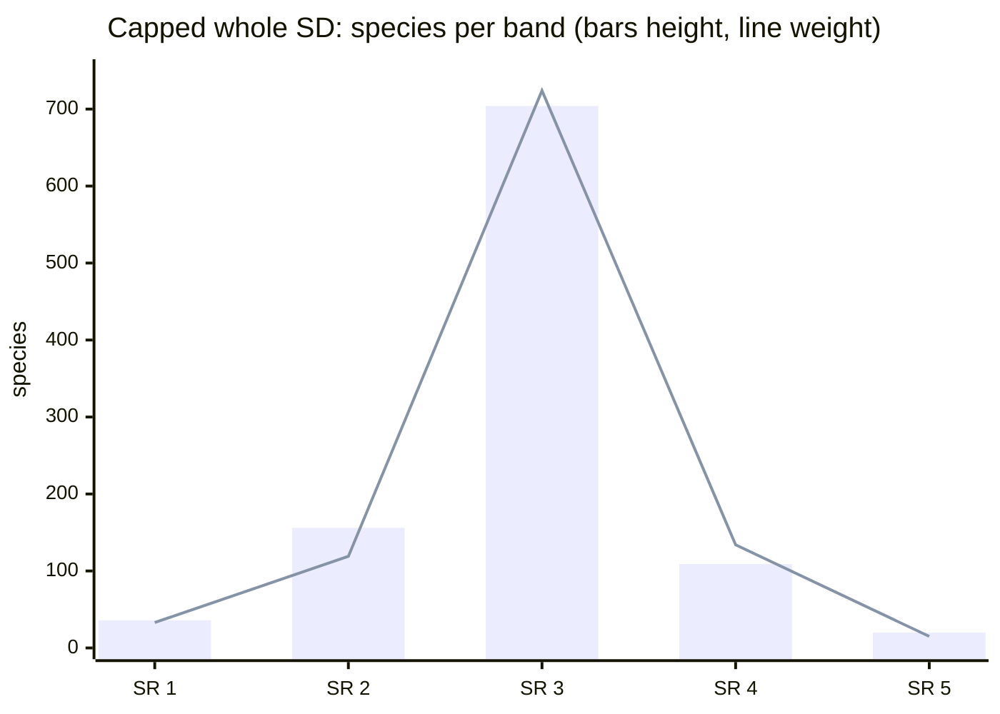

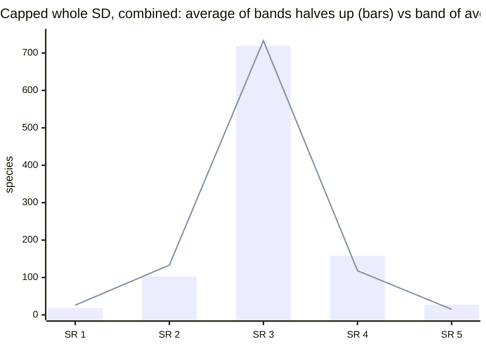

| Pokemon | Height band | Weight band | Average of bands | Band of average z |
|---|---|---|---|---|
| Joltik | 1 | 1 | 1 | 1 |
| Pikachu | 2 | 3 | 3 | 3 |
| Bulbasaur | 3 | 3 | 3 | 3 |
| Gengar, Charizard | 3 | 3 | 3 | 3 |
| Snorlax | 4 | 4 | 4 | 4 |
| Onix | 5 | 4 | 5 | 5 |
| Wailord | 5 | 4 | 5 | 5 |
| Cosmoem | 1 | 5 | 3 | 3 |

About 70% of species land on SR 3, so within that middle the Speed nudge does most of the sorting.

## Option 3: fixed shares 10 / 20 / 40 / 20 / 10 (Jess, 2026-11-17)

Bands by rank (percentiles) instead of SDs: the smallest 10% are SR 1, the next 20% SR 2, the middle 40% SR 3,
the next 20% SR 4 and the largest 10% SR 5.

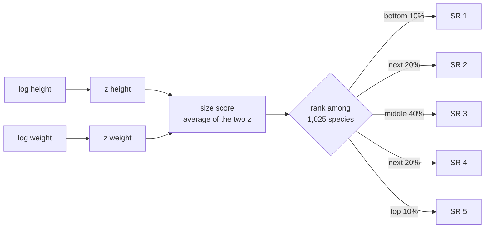

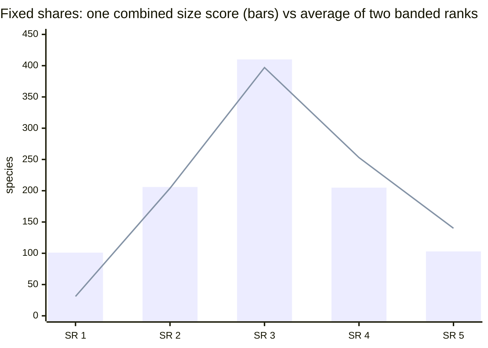

| Method | SR 1 | SR 2 | SR 3 | SR 4 | SR 5 |
|---|---|---|---|---|---|
| Combined size score, then rank (bars) | 10% | 20% | 40% | 20% | 10% |
| Height and weight ranked apart, bands averaged halves up (line) | 3% | 20% | 39% | 25% | 14% |

Banding height and weight apart drifts large because many species share a few heights (0.3 m, 0.6 m), so the
height bands come out lumpy (4 / 22 / 43 / 19 / 13%). One combined score hits the target shares exactly.

Rank cutoffs on each measure alone, for a feel: height 0.3 / 0.6 / 1.4 / 2.0 m, weight 3 / 11 / 57 / 162.5 kg.

| Pokemon | Combined score band |
|---|---|
| Joltik, Flabebe | 1 |
| Pikachu, Eevee, Bulbasaur | 2 |
| Gengar, Cosmoem | 3 |
| Charizard, Machamp | 4 |
| Snorlax, Onix, Gyarados, Wailord | 5 |

## Notes
- Base SR now spans 1 to 5 (the ruling's [Proposed] range was about 1 to 4); with the Speed nudge and the 1 to 5
  clamp from round 1, the final range stays 1 to 5.
- Your Tackle table used Bulbasaur at base SR 1; under this curve Bulbasaur is 2 or 3.
- Cutoffs are computed by the export script from the pack, so new species shift them slightly.
