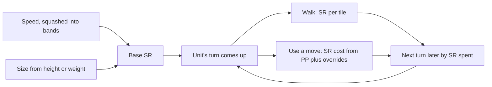

# Strike rank turns (parked idea, for after M1)

Date: 2026-11-15. Status: `[Proposed]`, parked. M1 uses a plain Speed order (2026-11-15-turn-order-m1).
Inspired by RuneQuest strike ranks (SR), without the statement of intent: turns stay one unit at a time, no
Into the Breach telegraphs.

## The idea

- Speed and size set a unit's base SR, so the 5 to 200 Speed range is squashed into a few bands.
- Every action costs SR. Expensive moves delay your next turn, which replaces PP as the limit on strong moves.
- The pack already has what it needs: `height_decimetres`, `weight_hectograms`, and each move's `pp`.

## Two ways to run the clock

| | A. 12 SR rounds | B. Running clock (recommended) |
|---|---|---|
| Shape | Each round resets; first turn at base SR | No rounds; next turn at now plus SR spent |
| Extra turns | A second turn if it fits before SR 12 | Fast, cheap turns come back sooner |
| Turn bar | Fixed 1 to 12 scale | Forecast of the next turns; a unit can appear twice |

Optional on either: wind-up, where an expensive move goes off at a later SR so the target can react (FFT spells).
It is a per-move telegraph, so Jess decides whether it is allowed. Recommendation: none in the first version.

## Open questions

| # | Question | Recommendation |
|---|---|---|
| 1 | Rounds (A) or running clock (B)? | B, no wind-up at first |
| 2 | Does bigger size strike sooner (RuneQuest reach) or later (heavy and slow)? | Jess decides |
| 3 | Height or weight for size? | Height, banded (weight has extremes like 0.1 kg to 950 kg) |
| 4 | Speed bands: how many? | 4 to 6; edges are tuning |
| 5 | Walking cost per tile; does climbing cost extra? | 1 SR per tile; climbing open |
| 6 | Move cost source | Default from PP (low PP means expensive), overrides in the move translation schema (#9) |
| 7 | Is PP gone entirely? | Yes, the SR cost is the only limit |
| 8 | Do status moves or ending the turn early cost SR? | Open; a cheap pass brings your next turn sooner |

## Slices it would touch
The turn order code from #8 (swap the order rule for the clock), the move schema from #9 (add an SR cost field),
use a move from #10, and the turn bar (it becomes a forecast).
