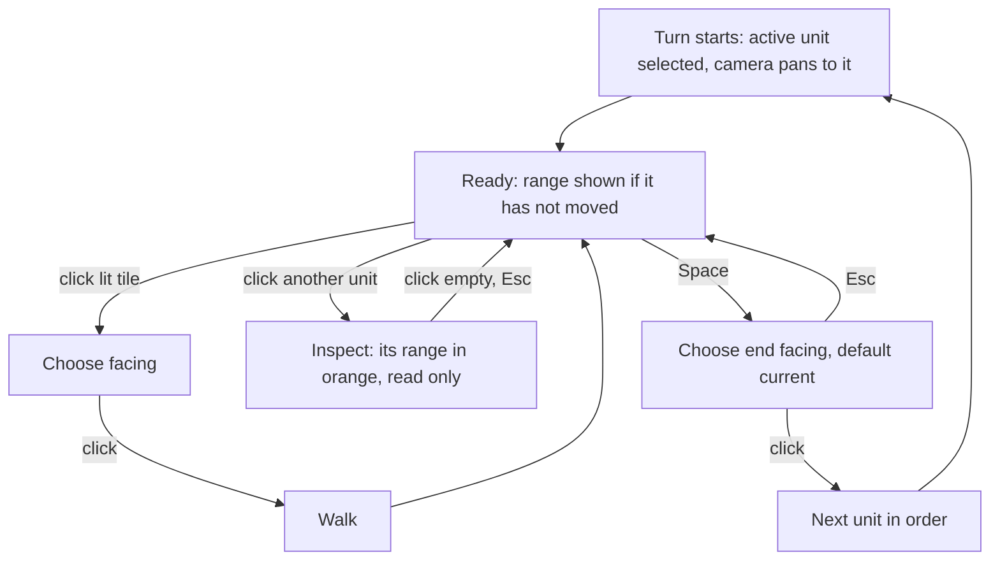

# Turn order by Speed (#8): opening and plan

Date: 2026-11-15. Agreed in chat ("overlap the map, build it"). Rulings: 2026-11-15-turn-structure,
2026-11-15-turn-order-m1. Strike ranks are parked as #13.

## Goal
Units act one at a time in rounds, fastest first, with a turn bar on the right edge of the screen.

## Done when
Jess feel-tests the turn flow (auto-selected active unit, camera pan, move once, end-turn facing, inspecting
others) and the bar (shape, hover, click) in all four rotations; the end-goal test passes; Jess closes #8.

## End-goal test (relations, headless by tools\run-tests.cmd)
| # | Relation |
|---|---|
| 1 | In every round each standing unit acts exactly once, and Speed never rises along the order |
| 2 | Equal Speed is broken by the battle seed: one seed always gives the same order, and over many seeds both orders occur (not by side) |
| 3 | With no Speed changes, every round has the same order as the first |
| 4 | A Speed change mid-round leaves the current round alone and applies from the next round |
| 5 | A fainted unit never acts and never shows in the forecast |
| 6 | The forecast starts with the active unit, has the asked-for length, never goes back a round, and matches the turns as they are played |
| 7 | Only the active unit may move, at most once per turn; the next turn may move again |
| 8 | Ending a turn turns the unit to the chosen facing |
| 9 | Bar layout: the active entry is at the bottom and larger, each higher entry is closer to the right edge, entries never overlap and stay on screen |

## Turn flow

## Rulings applied in this slice
| Question | Answer |
|---|---|
| Rounds or charge time | Rounds: everyone once per round, fastest first; Speed changes count from the next round |
| Ties | Random tiebreak drawn once per unit from the battle seed |
| A turn | Move and act at most once each, either order, either skippable; until #10 it is move, then end turn |
| Facing | Every turn ends with a facing choice, defaulting to the current facing |
| Control | Active unit auto-selected, camera pans to it; other units inspect only |
| Enemy turns before #11 | Hotseat: the player controls both sides |
| Bar | Right edge, overlaps the map; active at the bottom and larger; slanted with the top closer to the edge; rest of this round, a round divider, then the next round, 8 entries; idle frame crop in a blue or red frame with an HP sliver; hover lights the unit, click pans to it |

## Files
| File | Change |
|---|---|
| rules/turn_order.gd (new) | Round order, seeded tiebreak, forecast, active unit, move once, end turn with facing |
| rules/battle_unit.gd | A "has fainted" check |
| view/turn_bar.gd (new) | The bar, its layout rule, hover and click signals |
| view/camera_rig.gd | A short eased pan to a unit, cancelled by key panning |
| view/tile_highlight.gd | Active unit outline, inspect colour |
| view/unit_sprite.gd | Show a new facing without walking |
| view/test_map.gd | Turn flow above; turn label (round, unit, side, Space hint); seed printed at start |
| tests/test_turn_order.gd (new) | Relations 1 to 9 |

Risk: test_map.gd input flow is rewritten, so #7 behaviour (select, path, facing, walk) needs a recheck in the
feel test.
