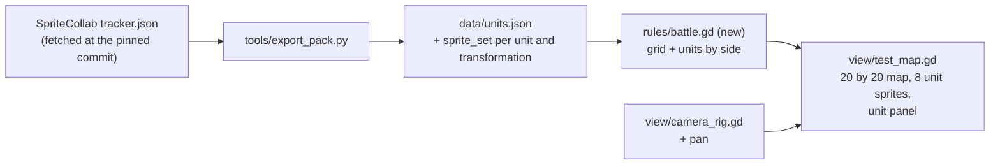

# Slice #6: units from the pack on a large test map [Approved]

Date: 2026-11-15. Rulings: 2026-11-15-battle-scale (20 by 20, 4 a side), 2026-11-15-unit-stats-and-moves.
Approved by Jess 2026-11-15 with decisions 1 to 3 as recommended (pan in #6, the 8 units at level 30, Tab panel).

## Opening

| | Proposal |
|---|---|
| Goal | The test map becomes a 20 by 20 greybox battlefield with 4 real pack units a side, each built at a level with its stats and 4 moves, drawn with its own SpriteCollab sprite, facing the other side, in all four rotations |
| Done when | Jess feel-tests: every unit shows its own sprite, facings read right after rotating, the whole map can be reached by panning, the unit panel shows each unit's level, HP and moves; the end-goal test passes; Jess closes #6 |
| End-goal test | Relations below |

## What gets built

| File | Change |
|---|---|
| tools/fetch-spritecollab.js | Also keeps tracker.json (SpriteCollab's list naming every folder), byte-exact at the same pin |
| tools/export_pack.py, data/ | Each unit and transformation gains sprite_set: the packed set that draws it (0037 Vulpix, 0037-0001 Alolan Vulpix), or none when SpriteCollab has no sprite; data/README lists the units without one |
| rules/battle.gd | New: a battle as rules see it, the grid plus each side's units. Rules only, so later slices (turns, moves, AI) run headless on it |
| view/test_map.gd | A hand-made 20 by 20 height map (two starting zones in opposite corners, a central hill up to 4 levels, a ridge and a low valley); 8 units placed from the battle |
| view/camera_rig.gd | Pan with WASD or arrow keys, relative to the current rotation, kept inside the map and on the pixel grid |
| view/unit_panel.gd | New, temporary: a text panel (toggle with Tab) listing each unit's side, name, level, HP and 4 moves, for checking the build by eye |
| tests | New relation tests below |

## Sprite matching

| Unit kind | Matched to |
|---|---|
| Species default | The species' normal set (dex number) |
| Regional form | The species' form whose tracker name is that region (Alola, Galar, Hisui, Paldea) |
| Mega, Gigantamax, Primal | The form named Mega, Mega_X, Mega_Y, Gigantamax or Primal |
| No match, or no sprite upstream | none, listed in data/README (the fallback is still an open decision in STATE) |

## End-goal test relations

| # | Relation |
|---|---|
| 1 | Every sprite_set in the pack is a packed set in assets/pokemon |
| 2 | A species default's set is its dex number; a regional unit's set is a form of the same dex number and never the species' normal set |
| 3 | The test battle has 4 units a side, all on different cells inside the grid, each built from the pack with 1 to 4 moves and a sprite set |
| 4 | Each side's units face the other side's starting zone |
| 5 | Panning never moves the camera's focus outside the map, and a pan step is a whole number of sprite pixels |

## Decisions (recommendation first)

| # | Question | Recommendation | Other option |
|---|---|---|---|
| 1 | Camera pan | Move pan into #6 (the 20 by 20 map does not fit one 640x360 screen at crisp pixels, so it cannot be feel-tested without it); zoom stays in #7, since zooming out breaks crisp pixels and needs its own ruling | Keep pan in #7 and test #6 on part of the map |
| 2 | The 8 units and their level | Level 30. Yours: Charmander, Squirtle, Bulbasaur, Pikachu. Theirs: Vulpix, Alolan Vulpix, Geodude, Gastly (a regional form, a dual type, and a Ghost for later immunity tests) | Your own picks |
| 3 | Unit panel | Yes, temporary, until #10 adds HP bars and #7 adds selection | No panel |

## Risks
- Fetching tracker.json is a network step in tools/ at the existing pin; nothing else is re-fetched.
- Some regional forms may be named differently in SpriteCollab (for example the three Paldean Tauros breeds); any
  unmatched unit is listed, never guessed.
- Eight animated sprites plus a 400 cell map is still small for the Compatibility renderer.
