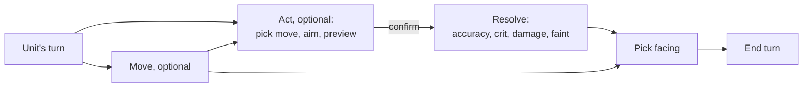
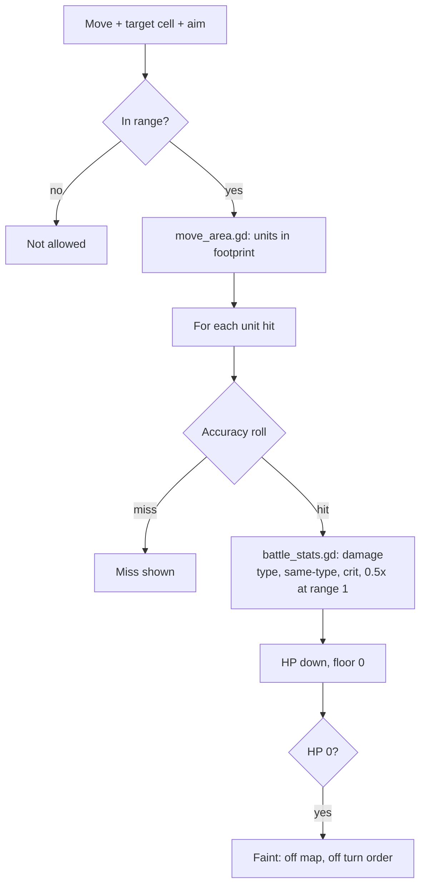
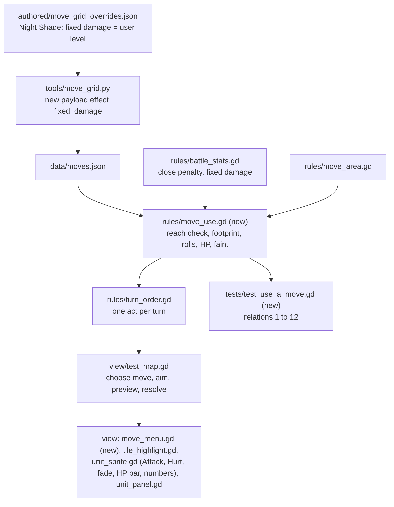

# #10 opening: use a move [Approved]

Date: 2026-11-16. Issue: #10. Rulings: 2026-11-15-damage-and-hit, 2026-11-16-move-shapes-and-range,
2026-11-16-height-and-sight (deferred, see Q1). Builds on #9 (grid entries, rules/move_area.gd).

## Goal
On its turn a unit picks one of its moves, sees which tiles it would cover, confirms, and the move resolves:
accuracy and crit rolls, flat mainline damage to every unit in the footprint, HP bars drop, a unit at 0 HP faints
and leaves the map and the turn order. Rules stay headless and seeded.

## Done when
- Every one of the 45 roster moves can be picked and used in the test battle (status moves as Q3 decides).
- The end-goal test passes headless via `tools\run-tests.cmd`.
- Jess feel-tests the test battle: pick, preview, confirm, damage, faint. Committed; Jess closes #10.

## End-goal test (relations)
| # | Relation |
|---|---|
| 1 | Same attacker, defender and move: a super effective hit does more than neutral, neutral more than resisted, and an immune target takes 0 |
| 2 | A same-type move does more than the same power off-type move; a crit does more than a non-crit |
| 3 | Higher Defense takes less from a physical move, higher Special Defense less from a special move |
| 4 | A 100 percent accuracy move hits on every seed; the same seed and inputs give the same outcome |
| 5 | A move cannot target a cell outside its range; a contact move only reaches adjacent cells; a cell in range with no unit on it is allowed, spends the action and changes no HP |
| 6 | A ranged damaging move at range 1 does less than the same move at range 2 (moved from #9) |
| 7 | An area move damages every unit in its footprint, ally or enemy, and no unit outside it |
| 8 | HP never drops below 0; a unit at 0 HP has fainted, frees its cell and never gets another turn |
| 9 | A unit acts at most once per turn |
| 10 | A status move deals no damage and changes no HP |
| 11 | Self-Destruct leaves its user fainted, whether or not it hits anyone |
| 12 | Fixed damage (Night Shade) does the same to targets with different Defense and Special Defense, and 0 to an immune target |

## Turn flow (proposed)

## Resolving one move

## Decisions needed (recommendations first)
| # | Question | Recommendation |
|---|---|---|
| Q1 | Line of sight and height: the issue draft lists them, but #17 and #18 are their M2 slices | Leave both out; range is grid steps, per the shapes ruling |
| Q2 | Turn order of move and act | Move and act each at most once, in either order; acting does not end the turn, facing does |
| Q3 | 18 of the 45 moves are status moves. What do they do in M1? | They can be used and spend the action, but show "no effect yet" (stats, ailments and heals come in M2b) |
| Q4 | Damage add-ons in the payload: drain, recoil, flinch, ailments | Damage only in M1; Self-Destruct's user_faints is the one exception, since faint exists now |
| Q5 | Multi-hit (Rock Blast is 2 to 5 hits in mainline, a third random roll) | One hit at full power in M1; settle multi-hit in M2b, keeping randomness to accuracy and crit |
| Q6 | Fixed damage (Night Shade) | Damage equals the user's level, as in mainline, ignoring stats and type except immunity |
| Q7 | Aim for cones and lines | Aim is one of the 4 directions and becomes the unit's facing |
| Q8 | One accuracy roll per move or per unit hit | Per unit hit (an area can hit some and miss others) |
| Q9 | PP and SR cost | Neither counts in M1; Speed order stays until #13 |
| Q10 | Animations | Attack for the user (core, every set has it), Hurt for each unit hit, timed on HitFrame; faint is a fade out since only 1 set in 5 has Faint |
| Q11 | HP display | A small bar over each unit plus the number in the Tab panel; damage numbers float up on hit |
| Q12 | Move menu | Number keys 1 to 4 pick a move (name, type, power, range shown); Esc backs out; Enter or click confirms the previewed cell |

## Jess's answers (2026-11-16)
All twelve recommendations agreed, with one addition: a move may be used even with nothing in range or in its
footprint; it is just a wasted action (later it can set up environmental effects). Relation 5 updated to match.
Ruling: 2026-11-16-use-a-move-m1.

## Plan [Approved]

1. **Fixed damage (data).** tools/move_grid.py accepts a new payload effect, fixed_damage with the amount
   user_level. authored/move_grid_overrides.json gives it to Night Shade in place of damage. Re-export; only that
   one entry in data/moves.json changes.
2. **Formulas (rules/battle_stats.gd).** Two additions next to the existing damage: the close penalty (0.5x,
   rounded down, at least 1, when a move flagged close_penalty hits from range 1), and fixed damage (the user's
   level, 0 if the type multiplier is 0, no crit or same-type bonus).
3. **Using a move (rules/move_use.gd, new).** Given the battle, user, move, target cell, aim direction and the
   battle's seeded random, it checks reach, finds the units in the footprint (MoveArea), and for each one in
   footprint order rolls accuracy, then crit, then applies damage with HP floored at 0. Status moves roll nothing
   and change nothing. Self-Destruct's user faints afterwards. Returns an outcome per unit (hit or miss, crit,
   damage, effectiveness, fainted) for the view to animate. An empty footprint is a valid, wasted use.
4. **Turn rules (rules/turn_order.gd, rules/battle.gd).** The turn tracks "has acted" beside "has moved": move and
   act each at most once, in either order, and facing still ends the turn. Aiming a cone or line turns the user to
   the aim; a single target turns the user toward it. Battle.unit_at skips fainted units, so their cells free up
   for walking and targeting.
5. **Controls (view/test_map.gd, view/move_menu.gd new).** Keys 1 to 4 (or clicking a row) pick a move from a
   small menu listing name, type, power and range; it greys out once the unit has acted. While aiming, cells in
   range are tinted, the hovered cell (or, for self-aimed cones and lines, the direction under the mouse) shows the
   footprint in a stronger tint, Enter or click confirms, Esc backs out. The hint line and turn label gain the new
   keys. Note: keys 1 to 3 currently restart the battle (#16); they move to F1 to F3 so 1 to 4 can pick moves.
6. **Feedback (view/unit_sprite.gd, view/tile_highlight.gd, view/unit_panel.gd).** The user plays Attack once;
   at its hit frame each target plays Hurt and a number floats up (or "Miss", "No effect yet" for status moves,
   with "Critical" and "Super effective" or "Not very effective" tags). A small HP bar sits over every unit and
   the Tab panel shows HP. A fainted unit fades out and leaves the turn bar. A missing animation is skipped.
7. **Tests (tests/test_use_a_move.gd, new).** Relations 1 to 12, headless, on pack units and the real moves.

**Risks.** Keys 1 to 3 move to F1 to F3 (a control change you will notice). test_map.gd grows, so the menu goes
in its own file. Damage numbers and the HP bar are new 3D labels over sprites, which may need a size pass after
the feel test. Ally hits are now possible by mistake, since areas hit everyone (as ruled).

**Decisions in this plan.** (a) Encounter restart keys move to F1 to F3. (b) A single-target move turns the user
toward its target. (c) A miss and a status move show floating text instead of nothing.

**Plan check (coding principles).**
| Part | Reuses | New | Not built |
|---|---|---|---|
| 1 Fixed damage data | move_grid.py payload builder and validator, the override file | one payload effect name | other special-damage moves (none on the roster) |
| 2 Formulas | BattleStats.damage, move_damage, type_multiplier | close penalty and fixed damage functions, one named 0.5 constant | height factor (#17) |
| 3 move_use.gd | MoveArea.can_reach, units_hit; rolls_hit, rolls_critical_hit; PackData.shapes | one rules file, since neither MoveArea (geometry) nor BattleStats (formulas) owns HP changes | ailments, stat stages, heal, drain, recoil, flinch, multi-hit (#24 M2b); PP and SR (#13); line of sight (#18) |
| 4 Turn rules | TurnOrder's has-moved pattern, _drop_fainted | a has-acted flag and act entry point | enemy turns (#11), win and lose (#12) |
| 5 Controls | the facing-from-mouse code (reused for aim), CellPicker, the existing mode machine | move_menu.gd, two new modes (choosing a move, aiming) | mouse-only targeting polish |
| 6 Feedback | UnitSprite.play, SpritePack hit_frame, TileHighlight fill layers, UnitPanel | HP bar and floating number nodes on UnitSprite, two highlight colours | a real Faint animation (1 set in 5 has one) |

Size: test_map.gd grows from about 310 to about 430 lines, unit_sprite.gd from about 130 to about 200; none near
1000. Touched-code cleanup: Battle.unit_at skipping fainted units (part 4) is a fix, since today a fainted unit
would still block its cell.

## Build notes (2026-11-16)
Built as planned; Jess approved (a) to (c). Differences and small additions, for the feel test:
- The 0.5x at range 1 also halves Night Shade's fixed damage, since relation 6 covers every ranged damaging move.
  Say if fixed damage should ignore range instead.
- Two small helpers the plan implied: MoveArea.target_cells (the tinted target cells) and BattleUnit.take_damage
  (HP floored at 0).
- Battle.unit_at now skips fainted units, so the select-and-move test helper gives its bare units 1 HP.
- Status moves float "No effect yet" over the user; misses float "Miss".
