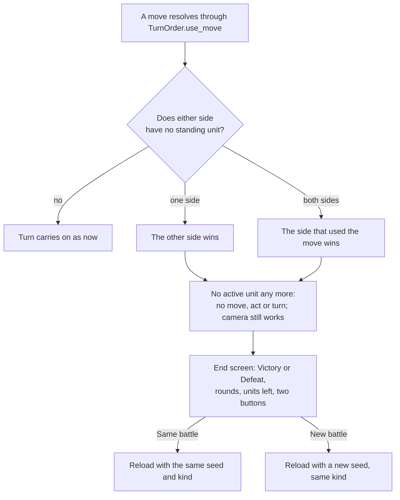

# #12 opening and plan: win, lose, restart

Date: 2026-11-17. Issue: #12. Rulings: 2026-11-17-battle-end-m1, 2026-11-16-party-and-battles (M1 ends on a
rout), 2026-11-16-objectives (other objectives later), 2026-11-16-saves-and-wipes (a run wipe sends the player
home, M3). Last M1 slice: when it ships, M1 is done (development-plan.md).

## Goal [Approved]
The battle ends on a rout: the moment one side has no standing unit, the other side wins. The rules report the
result (so the run layer in M3 and hotseat in #15 can use it), no unit acts after it, and an end screen shows the
result and offers a restart.

## Done when [Approved]
- The end-goal test passes headless via `tools\run-tests.cmd`.
- Jess plays a full test battle start to finish, wins or loses, and restarts from the end screen (M1 done).
- Committed; Jess closes #12.

## Answers (Jess, 2026-11-17)
| # | Question | Answer |
|---|---|---|
| 1 | When does the battle end? | The moment the last unit faints, mid-turn |
| 2 | Both sides wiped at once (Self-Destruct, last unit against last unit) | **The user's side wins**: Self-Destruct as the last unit is a valid win condition |
| 3 | End screen | Victory or Defeat, plus rounds played and units left per side |
| 4 | Restart | Same battle (same seed) and New battle (new seed); F1 to F3 still pick a kind |
| 5 | Stalemate | Nothing in M1; the player restarts |
| 6 | Where the result lives | Rules: the battle reports the result; the turn order gives no more turns once it is over |
| 7 | Words | "Victory" and "Defeat" from the player side's view, until #15 |

## Flow

## End-goal test (relations) [Approved]
| # | Relation |
|---|---|
| 1 | While both sides have a standing unit, the battle is ongoing |
| 2 | When every unit of one side has fainted, the other side wins (checked for both sides) |
| 3 | The result is fixed the moment the last unit faints, mid-turn: after it, no unit may move, act or end a turn |
| 4 | Self-Destruct that faints the last foe and its own user (its side's last unit) gives the user's side the win |
| 5 | The same seed and kind, played AI against AI, gives the same result in the same number of rounds |
| 6 | The #11 AI-against-AI battles end with a result from the rules (replaces the test's own check) |

## Decision for Jess (changes AI behaviour)
| Question | Options | Recommendation |
|---|---|---|
| Should the AI go for a battle-winning move? Today it scores Self-Destruct as foe knocked out minus itself knocked out, so a last-unit Self-Destruct on a healthy last foe scores 0 and is never chosen, though q2 makes it a win | a) yes: an option whose knockouts take every standing foe gets a win bonus (times its hit chance) that outranks any other option; b) no, leave the scorer as it is | **a**: the AI should take a win it can see, and it is one named const and a few lines |

## Prose plan

### Part 1: the result in rules/battle.gd (grows about 25 lines)
- Battle gains the winning side, starting as "no winner yet" (a named const), and an is-over question.
- A new settle-rout step, given the side that just acted: if there is no winner yet and some side has no standing
  unit, it fixes the winner. One side empty: the other side wins. Both empty: the acting side wins (q2). Once
  fixed, it never changes.
- Reuses: units_on_side and BattleUnit.has_fainted. Where: Battle owns the units and sides, so it owns "who is
  left"; no new module for one question.

### Part 2: the turn order stops (rules/turn_order.gd, about 6 lines)
- use_move calls settle-rout with the acting unit's side right after the move resolves.
- active_unit gives no unit once the battle is over. can_move, can_act and end_turn already check the active unit,
  so they all refuse with no further change (relation 3). forecast is left as is.
- Reuses the existing active-unit gate rather than adding an is-over check to each call (one home for "may this
  unit do anything").

### Part 3: the AI takes a win (rules/turn_ai.gd, about 10 lines; only if the decision above is a)
- One named const, the win bonus, set well above any score a non-winning option can reach.
- In the score of an option: if the units it would knock out include every standing foe, add the win bonus times
  the move's hit chance.
- Reuses the knockout test the scorer already makes and the existing standing-foes helper.

### Part 4: the end screen (new view/end_screen.gd, about 70 lines)
- A CanvasLayer in the pattern of MoveMenu and UnitPanel (same panel colour and font size): centred panel with the
  title ("Victory" or "Defeat"), one line for rounds played, one line per side for units standing out of units
  fielded, and two buttons. Hidden until shown.
- It announces the two buttons by signal; it reads no rules state itself beyond what it is handed (the battle and
  the round number).
- New file because it is its own drawn component, as the move menu and unit panel are.

### Part 5: view/test_map.gd (grows about 30 lines)
- After a move's playback, if the battle is over: refresh the panels, fade any fainted user, then show the end
  screen and enter a new "over" mode that blocks map clicks and keys (camera and F1 to F3 still work).
- Same battle: a static replay seed kept across the scene reload (as encounter_kind already is) is used instead of
  a fresh random seed, then cleared. New battle: reload as F1 to F3 do now.
- The turn label shows the result when the battle is over.
- Reuses the reload and the encounter_kind pattern already there.

### Part 6: tests
- New tests/test_win_lose.gd: relations 1 to 5 on small hand-built boards (as test_use_a_move.gd does), relation
  5 on the real test battle setup with the AI on both sides. If the decision above is a, one more relation: a last
  unit chooses a Self-Destruct that wins.
- tests/test_enemy_turn.gd (touched-code cleanup): its own "one side left" check is replaced by the battle's
  result (relation 6). Its AI battle loop stays where it is, since it also checks legality; the new suite has a
  smaller loop of its own (two loops with different jobs, not yet a third repeat).

## Not built (YAGNI)
- Objectives other than rout (#22), round limits and draws (q5).
- What a result does to a run: rewards, recovery, catching, going home (M3).
- Hotseat wording and per-side screens (#15). Stats beyond rounds and units left.
- Showing what the AI chose (#25).

## Risks
- Same battle replays the seed, but the player's choices differ, so only an AI-only battle replays exactly. That is
  what relation 5 checks.
- Part 2 changes what active_unit returns after the end; the turn bar and the #8 and #10 tests read it. They run
  no battle to its end today, so they should not notice; the full suite must stay green.
